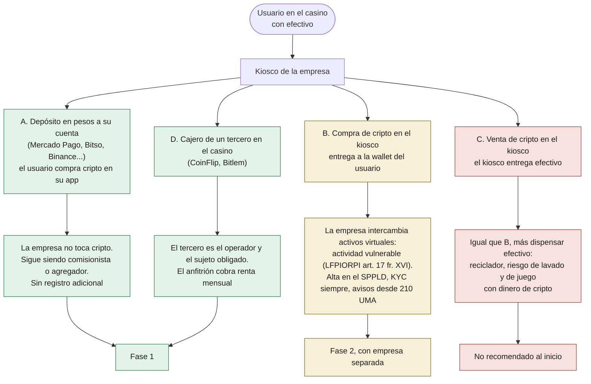
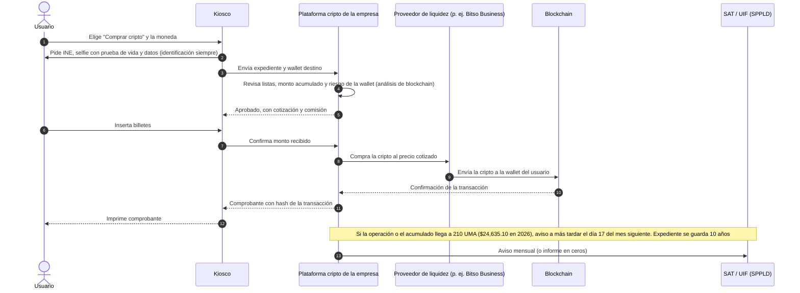
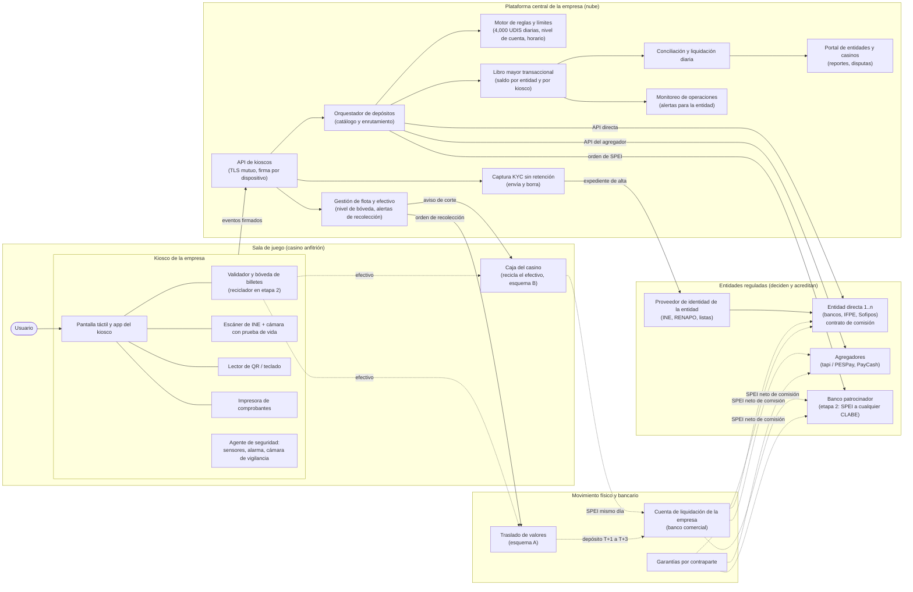
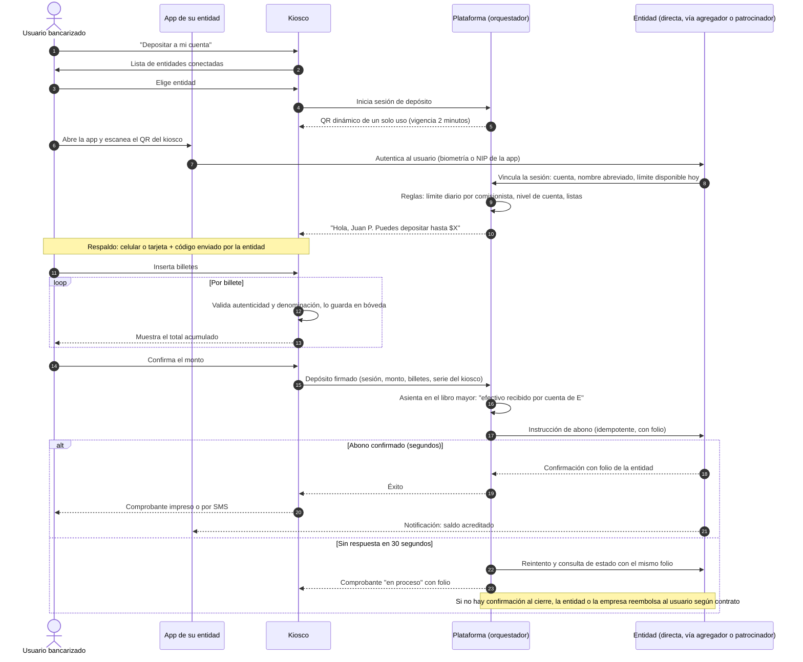
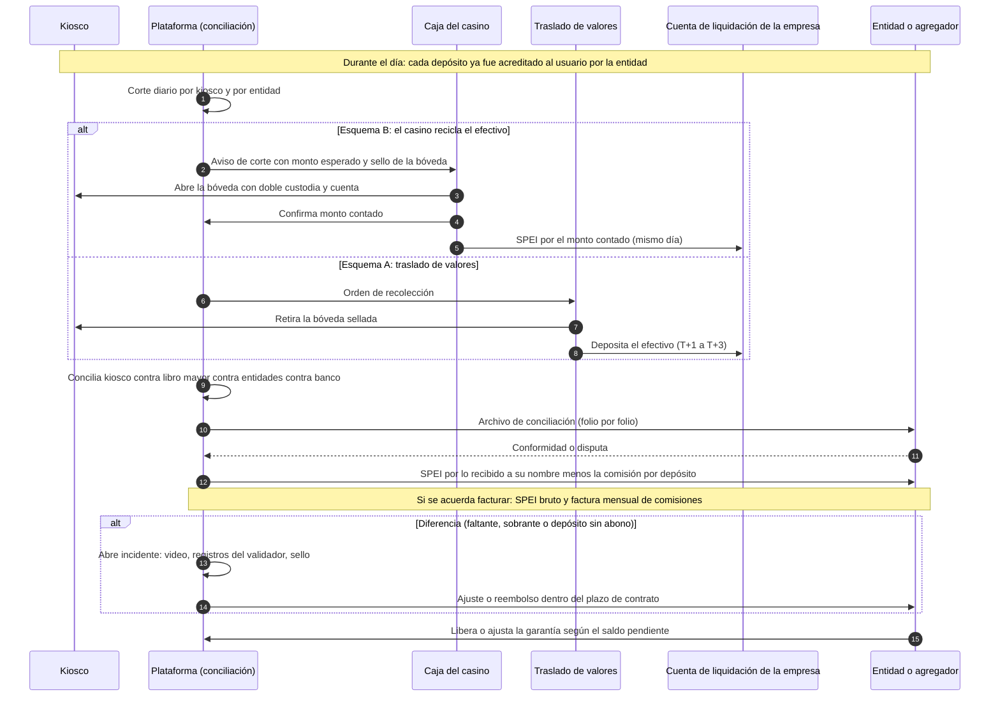
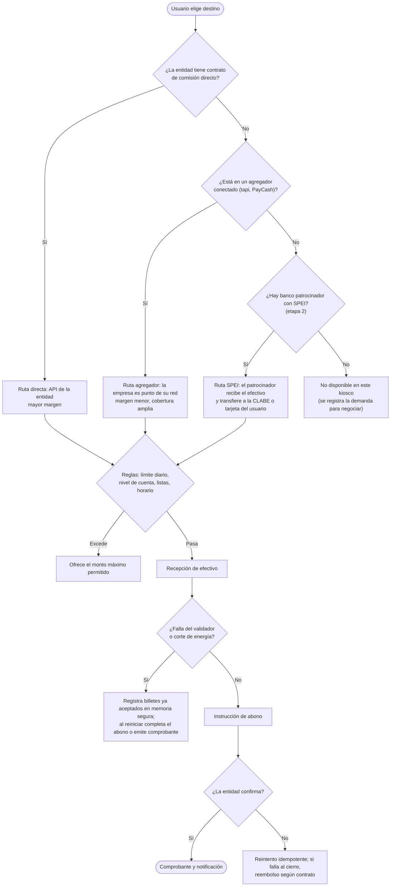
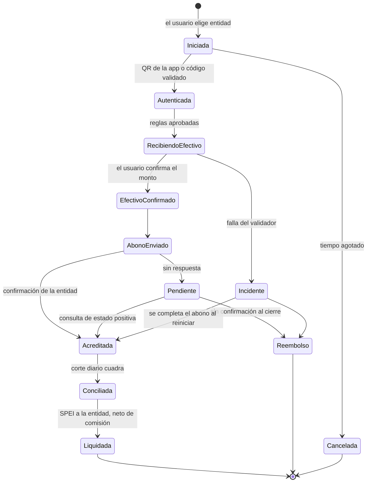

# Estudio de prefactibilidad: red neutral de kioscos de depósito en efectivo (cash-in multibanco) para casinos en México

**Versión:** 5.0 · **Fecha de investigación y consulta de fuentes:** 9 de noviembre de 2026
**Cambios de la versión 4.0:** nueva sección V4 (precios reales de Mercado Pago por cadena según la app; tapi, PayCash y PESPay a detalle; revisión de los padrones del SPEI de Banxico; requisitos legales por tipo de empresa; seis diagramas del flujo del kiosco en `estudios/diagramas/`). **Versión 5.0:** nueva sección V6: universo completo de bancos, fintechs y exchanges en México, y kioscos que también transaccionen cripto (regulación, cuatro modalidades, socios, requisitos y diagramas 7 y 8). **Versión 4.5:** perfil B2B o usuario final de cada operador (V5.4.2). **Versión 4.5:** perfil B2B o usuario final de cada operador (V5.4.2). **Versión 4.5:** perfil B2B o usuario final de cada operador (V5.4.2). **Versión 4.4:** comparativa producto por producto (V5.4.1) y programas de partners con liga de inscripción (V5.4.2). **Versión 4.3:** detalle de Banlink con sus documentos (V5.2.1). **Versión 4.2:** nueva sección V5 (ser partner de procesadores de pago: Klu, Mercado Pago, Cobre, 88 Pay, Banlink, Tonder y otros; tabla comparativa de productos; análisis de las tablas de precio por volumen). **Versión 4.1:** lista legal completa de arranque (sección V4.6: constitución, fiscal, laboral, marca, datos, equipo, licencias por casino y municipio, seguros y ruta crítica). **Cambios de la versión 3.0:** nueva sección 0 (comisión por depósito y precios de referencia de las cadenas; cómo operan tapi, PayCash y redes similares; flujo de efectivo con cuenta propia frente a patrocinador; KYC completo en kiosco y acceso "como cajero") y modelo financiero con comisión cobrada a las entidades. **Cambio de la versión 2.0 respecto a la 1.0:** el modelo ya no es "kiosco que emite una tarjeta de un emisor". Ahora es el que definió Lucho: **un kiosco neutral donde el usuario elige el banco, la IFPE o el procesador al que quiere abonar su efectivo, o abre una cuenta nueva**, igual que los comercios que hoy reciben depósitos "en nombre de" Mercado Pago u otras entidades. La empresa es intermediaria entre las entidades financieras y el cliente, y no queda amarrada a un solo banco o procesador. La versión 1.0 queda en el historial del repositorio.
**Alcance:** México, salas de juego con permiso de SEGOB como ubicación inicial; el mismo kiosco puede operar fuera de casinos.
**Naturaleza:** prefactibilidad para decidir. No sustituye un dictamen jurídico, fiscal ni de cumplimiento.

> **Convenciones**
> - **[H] Hecho verificado:** fuente consultada el 9-nov-2026 y enlazada en el anexo A.
> - **[E] Estimación:** cálculo del consultor con supuestos explícitos. No es cotización.
> - **[S] Hipótesis:** razonable, no probada.
> - **[P] Pendiente de validación:** requiere dictamen, autoridad o confirmación comercial expresa.
>
> **Limitaciones.** Varios textos oficiales (DOF, portal de la CNBV) bloquean la lectura automática; su contenido se verificó con fuentes secundarias y se marca [P] donde falta confirmar contra el texto oficial. No se contactó a ninguna entidad, agregador ni proveedor: **no hay precios cotizados**.

---

> **Universo de entidades y cripto:** la tabla de todos los bancos, fintechs, SOFIPO, IFPE, crédito, BNPL, exchanges y cajeros cripto en México, y el análisis para que el kiosco también transaccione cripto, están en la sección **"V6"** (V6.2 universo, V6.3 regulación cripto, V6.4 socios cripto, V6.5 modalidades, V6.6 requisitos, V6.7 recomendación). En la página interactiva son las pestañas "Universo México" y "Cripto".
>
> **Tabla comparativa de procesadores de pago (Mercado Pago, Klu, Cobre, 88 Pay, Banlink, Tonder y 13 más):** está en la sección **"V5. Ser partner de procesadores de pago"**, subsección **V5.4** (productos a detalle en V5.4.1, perfil B2B o usuario final en V5.4.2 y programas de partners con liga de inscripción en V5.4.3). También como página interactiva en `estudios/tabla-procesadores-mexico.html`.

## Resumen ejecutivo

**Recomendación: avanzar con condiciones.** El modelo de red neutral de depósito es legalmente viable en México y ya existe en la práctica: las tiendas reciben efectivo **a nombre de** bancos e IFPE como **comisionistas**, y hay **agregadores** (por ejemplo, tapi o PayCash) que conectan a muchas entidades con muchos puntos de depósito mediante una sola integración [H]. Un kiosco puede ocupar el lugar de esa tienda. Pero hay tres condiciones que deciden si el negocio funciona:

1. **"No amarrarse a un banco" se logra con tecnología, no con una figura legal propia.** Cada depósito tiene que hacerse por cuenta de una entidad regulada (banco o IFPE). La empresa puede ser **comisionista no exclusiva de varias entidades** y **administradora de comisionistas** (figura prevista por la CNBV) [H], y conectarse a varios **agregadores**. El kiosco funciona como un orquestador que muestra al usuario todas las entidades disponibles por cualquiera de esas vías. Lo que la empresa **no puede** hacer, salvo que obtenga un registro o autorización propia, es recibir el efectivo a nombre propio y luego "mandarlo" a la cuenta que el usuario quiera [H/P].
2. **Para abonar a "cualquier" cuenta, aun de entidades que no tienen convenio, existen dos rieles posibles,** cada uno con un costo regulatorio:
   - **Transferencia SPEI ordenada por un banco patrocinador** del que la empresa es comisionista: el usuario deposita efectivo y el banco envía un SPEI a la CLABE o tarjeta de débito que el usuario indique. La guía de la CNBV incluye las transferencias de fondos entre las operaciones que puede hacer un comisionista [H]; los límites para personas que no son clientes del banco están pendientes [P].
   - **Registro propio como transmisor de dinero** ante la CNBV (LGOAAC art. 81-A Bis, con dictamen técnico de PLD y renovación cada tres años) [H]. Da independencia, pero convierte a la empresa en sujeto supervisado en materia de PLD.
3. **La economía depende de que el efectivo no tenga que trasladarse.** Las redes como la de Mercado Pago funcionan porque el comercio **reutiliza el efectivo** y no hay traslado de valores; Mercado Pago le paga al comercio $4 por depósito o retiro [H]. Un kiosco con traslado de valores propio apenas cubre su costo variable en el escenario base [E]. **El casino es una ubicación ideal precisamente porque necesita efectivo** para su operación diaria: si el casino toma el efectivo del kiosco y lo liquida de forma electrónica el mismo día, el modelo mejora mucho. Ese esquema requiere dictamen, porque el casino estaría recibiendo efectivo destinado a cuentas financieras [P].

**Otros hallazgos:**

- **La "nueva ley de pagos digitales"** es la *Ley de Economía Digital para Pagos Digitales y Electrónicos* (DOF 4-nov-2026, vigente desde el 5-nov-2026) [H]. Para los privados la aceptación de pagos digitales es voluntaria (art. 11) salvo en los sectores que la SHCP declare obligatorios (art. 13), cuya lista se espera para finales de noviembre de 2026; no se han mencionado los casinos [H]. Es un viento a favor, no una obligación que cree demanda.
- **El vínculo con casinos sigue siendo el principal riesgo comercial.** Cada banco, IFPE o agregador decide si acepta puntos de depósito dentro de salas de juego. Los juegos con apuesta son actividad vulnerable con reglas nuevas desde el 30-nov-2026, y ha habido bloqueos de cuentas y sanciones a casinos [H]. **No debe suponerse que ninguna entidad acepta este giro sin confirmación escrita.**
- **El modelo de ingresos es una comisión de $10 a $15 por depósito** (base $12) más un pago por cuenta nueva. La app de Mercado Pago muestra que en las cadenas **la paga el usuario** ($10 en Circle K y Farmacias Yza, $12 en Soriana, Neto, Waldo's y Farmacias del Ahorro, $15 en 7-Eleven) y solo en tienditas es gratis porque Mercado Pago paga $4 [H, sección V4.1]. El kiosco puede cobrarla al usuario, siempre como **comisión de la entidad** (el comisionista no puede cobrar comisiones propias [H]), o a la entidad; la economía es la misma.
- **Las redes de depósito (tapi, PESPay, PayCash, Yastás) no aparecen en los padrones del SPEI de Banxico**: operan por cuenta de entidades que sí están. Esto confirma que la empresa no necesita licencia propia para empezar; PESPay, un administrador de comisionistas, es el antecedente más parecido (sección V4).
- **Límites:** la guía de la CNBV menciona un tope de depósitos en efectivo vía comisionista de 4,000 UDIS diarios (≈ $35,000) [H, P: confirmar si es por cuenta]; las cuentas nivel 2 admiten 3,000 UDIS al mes y las 2 Bis, 15,000 UDIS con 3,000 en efectivo [H].
- **Números (todos estimados, versión 3 con comisión de $12 por depósito cobrada a las entidades):** con traslado de valores propio, el escenario base deja ≈ $4,300 MXN/kiosco/mes de contribución y requiere ≈ 187 kioscos para el equilibrio. Con el casino reciclando el efectivo, la contribución sube a ≈ $11,600 MXN, el equilibrio baja a ≈ 69 kioscos, el kiosco se paga en ≈ 18 meses y el financiamiento máximo en tres años es ≈ $58 M MXN [E]. Cada peso adicional de comisión por depósito vale ≈ $1,600 al mes por kiosco; con $15 el equilibrio baja a ≈ 49 kioscos. El escenario conservador no alcanza equilibrio.

**Condiciones para avanzar:**

| # | Condición | Evidencia | Antes de |
|---|---|---|---|
| 1 | Dictamen sobre la figura (comisionista y administrador de comisionistas, o transmisor de dinero), el riel SPEI para no clientes y el esquema de reciclaje con el casino | Opinión escrita de despacho financiero | Comprometer más de $1.5 M MXN |
| 2 | Un banco patrocinador (comisionista + SPEI) **o** un agregador que confirme por escrito que acepta kioscos dentro de casinos | Carta de intención o term sheet | Desarrollar integraciones |
| 3 | Al menos 3 entidades disponibles en el kiosco desde el día uno (directas o vía agregador), para que la neutralidad sea real | Contratos o cartas de intención | Lanzar el piloto |
| 4 | Dos casinos dispuestos a hospedar y, de preferencia, a reciclar el efectivo | Cartas de intención | Comprar hardware |

### Preguntas esenciales

1. **¿Qué entidades o agregadores tienen ya contactados o en mente?** Cambia la ruta de integración.
2. **¿Abonar a cuentas de entidades sin convenio (vía SPEI) es imprescindible desde el inicio, o basta con un catálogo de entidades conectadas?** Define si se necesita banco patrocinador con SPEI o registro de transmisor.
3. **¿Los casinos aceptarían tomar el efectivo del kiosco y liquidarlo electrónicamente?** Es la variable económica más importante.
4. **¿Se incluyen retiros de efectivo (cash-out)?** Mercado Pago los tiene y son el 57% de sus transacciones [H], pero en un kiosco exigen reciclador y más exposición de PLD.
5. **¿Cuánto capital hay disponible y en qué horizonte?**

Mientras no haya respuesta, el estudio supone: solo depósitos (cash-in) y apertura de cuentas; catálogo de entidades conectadas desde el inicio y riel SPEI como segunda etapa; casinos como ubicación con reparto de ingresos.

---

## V6. Universo completo de bancos, fintechs y exchanges, y kioscos que también transaccionen cripto (versión 5.0)

> **Qué agrega esta versión.** Lucho pidió dos cosas: (1) considerar **todas** las entidades que existen en México y no solo procesadores de pago: banca tradicional, banca digital, SOFIPO, IFPE, crédito y BNPL, gasto corporativo, inversión, exchanges cripto y cajeros cripto; y (2) que **los kioscos también puedan servir para transaccionar criptomonedas**, repitiendo para cripto los pasos que se hicieron para el modelo de depósito: modelo, regulación, requisitos legales, socios, diagramas y recomendación. La tabla interactiva tiene dos pestañas nuevas: **"Universo México"** y **"Cripto"** (`estudios/tabla-procesadores-mexico.html`).

### V6.1 Respuesta corta

1. **Sí se puede agregar cripto, pero no de cualquier forma.** En México los bancos y las fintech reguladas (IFPE, SOFIPO) **no pueden ofrecer cripto a sus clientes** (Circular 4/2019 de Banxico; la CNBV lo ratificó en mayo de 2026) [H]. Los exchanges operan fuera de esa supervisión, registrados ante el SAT como **actividad vulnerable** de activos virtuales (LFPIORPI art. 17, fracción XVI) [H]. Si nuestra empresa vende o compra cripto en el kiosco, **se convierte en un sujeto obligado de esa misma actividad vulnerable**.
2. **Hay cuatro formas de hacerlo** (diagrama 7). Recomendamos empezar por las dos que no exigen que la empresa intercambie cripto: **(A)** depositar pesos en la cuenta del usuario en una plataforma que ya vende cripto (Mercado Pago, Bitso, Binance), y **(D)** alojar en el casino el cajero de un operador existente (CoinFlip tiene casi 50 en México) [H].
3. **La compra de cripto en el kiosco (B)** es viable como fase 2, con **una empresa separada** de la que es comisionista de bancos. Así un problema de cumplimiento en cripto no pone en riesgo los convenios bancarios, que es el negocio base.
4. **La venta de cripto con entrega de efectivo (C)** no se recomienda al inicio: suma el riesgo de dispensar efectivo dentro de una sala de juego a todo el riesgo de lavado de la cripto.
5. **El universo de entidades** quedó en una tabla de más de 50 filas. **Sí hay cuentas para menores en México, pero en bancos, no en procesadores**: BBVA (Cuenta para Chavos, 12 a 17 años), Hey Banco (menores de 18), Santander (Cuenta Junior) y Banco Azteca (Guardadito Kids); Revolut anunció Kids & Teens para después [H/S]. Esto corrige la lectura de V5.4.2, que solo aplicaba a los 11 procesadores.

### V6.2 Universo de entidades financieras en México

**Cómo leer la tabla.** Cada fila es una entidad (o un grupo de entidades menores). ✓ = confirmado con fuente consultada el 9-nov-2026; (✓) = conocido públicamente, pero no se verificó hoy; ? = sin información pública encontrada; — = no lo ofrece o no está permitido. Los 19 procesadores de pago siguen en V5.4 y no se repiten aquí, salvo Mercado Pago.

**Sobre "Alpaka":** no encontramos una empresa con ese nombre en México. Lo más cercano es **Alpaca**, un bróker de EE. UU. que da infraestructura a apps mexicanas de inversión como Rivium y RUUT [H]. Hay que confirmar con Lucho si se refería a otra empresa.

| Entidad | Tipo | Figura en México | Modelo | Cuenta persona | Cuenta empresa | Cuentas para menores | Tarjeta de débito | Tarjeta de crédito | Préstamos personales | Crédito para negocio | Rendimientos o inversión | Seguros | Pago de servicios | Remesas | Cripto | Depósito en efectivo | Rol para el kiosco |
|---|---|---|---|---|---|---|---|---|---|---|---|---|---|---|---|---|---|
| BBVA México | Banca tradicional | (✓) Banco múltiple | (✓) B2C y B2B | (✓) Sí | (✓) Sí | ✓ Cuenta para Chavos, 12 a 17 años, con tarjeta (mar-2025) | (✓) Sí | (✓) Sí | (✓) Sí | (✓) Sí | (✓) Sí | (✓) Sí | (✓) Sí | (✓) Sí | — Banco: no puede ofrecer cripto (Circular 4/2019; CNBV, may-2026) | (✓) Sucursales, cajeros y corresponsales | (✓) Destino de depósito como comisionista; posible banco patrocinador SPEI |
| Santander | Banca tradicional | (✓) Banco múltiple | (✓) B2C y B2B | (✓) Sí | (✓) Sí | (✓) Cuenta Junior (menores de 18), con débito | (✓) Sí | (✓) Sí | (✓) Sí | (✓) Sí | (✓) Sí | (✓) Sí | (✓) Sí | (✓) Sí | — Banco: no puede ofrecer cripto (Circular 4/2019; CNBV, may-2026) | (✓) Sucursales, cajeros y corresponsales | (✓) Destino de depósito como comisionista; posible banco patrocinador SPEI |
| Banorte | Banca tradicional | (✓) Banco múltiple | (✓) B2C y B2B | (✓) Sí | (✓) Sí | ? | (✓) Sí | (✓) Sí | (✓) Sí | (✓) Sí | (✓) Sí | (✓) Sí | (✓) Sí | (✓) Sí | — Banco: no puede ofrecer cripto (Circular 4/2019; CNBV, may-2026) | (✓) Sucursales, cajeros y corresponsales | (✓) Destino de depósito como comisionista; posible banco patrocinador SPEI |
| Banamex | Banca tradicional | (✓) Banco múltiple | (✓) B2C y B2B | (✓) Sí | (✓) Sí | ? | (✓) Sí | (✓) Sí | (✓) Sí | (✓) Sí | (✓) Sí | (✓) Sí | (✓) Sí | (✓) Sí | — Banco: no puede ofrecer cripto (Circular 4/2019; CNBV, may-2026) | (✓) Sucursales, cajeros y corresponsales | (✓) Destino de depósito como comisionista; posible banco patrocinador SPEI |
| HSBC | Banca tradicional | (✓) Banco múltiple | (✓) B2C y B2B | (✓) Sí | (✓) Sí | ? | (✓) Sí | (✓) Sí | (✓) Sí | (✓) Sí | (✓) Sí | (✓) Sí | (✓) Sí | (✓) Sí | — Banco: no puede ofrecer cripto (Circular 4/2019; CNBV, may-2026) | (✓) Sucursales, cajeros y corresponsales | (✓) Destino de depósito como comisionista; posible banco patrocinador SPEI |
| Scotiabank | Banca tradicional | (✓) Banco múltiple | (✓) B2C y B2B | (✓) Sí | (✓) Sí | ? | (✓) Sí | (✓) Sí | (✓) Sí | (✓) Sí | (✓) Sí | (✓) Sí | (✓) Sí | (✓) Sí | — Banco: no puede ofrecer cripto (Circular 4/2019; CNBV, may-2026) | (✓) Sucursales, cajeros y corresponsales | (✓) Destino de depósito como comisionista; posible banco patrocinador SPEI |
| Inbursa | Banca tradicional | (✓) Banco múltiple | (✓) B2C y B2B | (✓) Sí | (✓) Sí | ? | (✓) Sí | (✓) Sí | (✓) Sí | (✓) Sí | (✓) Sí | (✓) Sí | (✓) Sí | (✓) Sí | — Banco: no puede ofrecer cripto (Circular 4/2019; CNBV, may-2026) | (✓) Sucursales, cajeros y corresponsales | (✓) Destino de depósito como comisionista; posible banco patrocinador SPEI |
| Banco Azteca | Banca tradicional | (✓) Banco múltiple | (✓) B2C y B2B | (✓) Sí | (✓) Sí | (✓) Guardadito Kids, con débito Mastercard | (✓) Sí | (✓) Sí | (✓) Sí | (✓) Sí | (✓) Sí | (✓) Sí | (✓) Sí | (✓) Sí | — Banco: no puede ofrecer cripto (Circular 4/2019; CNBV, may-2026) | (✓) Sucursales, cajeros y corresponsales | (✓) Destino de depósito; red propia en tiendas Elektra |
| BanCoppel | Banca tradicional | (✓) Banco múltiple | (✓) B2C y B2B | (✓) Sí | (✓) Sí | ? | (✓) Sí | (✓) Sí | (✓) Sí | (✓) Sí | (✓) Sí | (✓) Sí | (✓) Sí | (✓) Sí | — Banco: no puede ofrecer cripto (Circular 4/2019; CNBV, may-2026) | (✓) Sucursales, cajeros y corresponsales | (✓) Destino de depósito; red propia en tiendas Coppel |
| Banregio | Banca tradicional | (✓) Banco múltiple | (✓) B2C y B2B | (✓) Sí | (✓) Sí | ? | (✓) Sí | (✓) Sí | (✓) Sí | (✓) Sí | (✓) Sí | (✓) Sí | (✓) Sí | (✓) Sí | — Banco: no puede ofrecer cripto (Circular 4/2019; CNBV, may-2026) | (✓) Sucursales, cajeros y corresponsales | (✓) Destino de depósito como comisionista; posible banco patrocinador SPEI |
| BanBajío | Banca tradicional | (✓) Banco múltiple | (✓) B2C y B2B | (✓) Sí | (✓) Sí | ? | (✓) Sí | (✓) Sí | (✓) Sí | (✓) Sí | (✓) Sí | (✓) Sí | (✓) Sí | (✓) Sí | — Banco: no puede ofrecer cripto (Circular 4/2019; CNBV, may-2026) | (✓) Sucursales, cajeros y corresponsales | (✓) Destino de depósito como comisionista; posible banco patrocinador SPEI |
| Afirme | Banca tradicional | (✓) Banco múltiple | (✓) B2C y B2B | (✓) Sí | (✓) Sí | ? | (✓) Sí | (✓) Sí | (✓) Sí | (✓) Sí | (✓) Sí | (✓) Sí | (✓) Sí | (✓) Sí | — Banco: no puede ofrecer cripto (Circular 4/2019; CNBV, may-2026) | (✓) Sucursales, cajeros y corresponsales | (✓) Destino de depósito como comisionista; posible banco patrocinador SPEI |
| Compartamos Banco | Banca tradicional | (✓) Banco múltiple (microcrédito) | (✓) B2C y B2B | (✓) Sí | (✓) Sí | ? | (✓) Sí | (✓) Sí | (✓) Sí | (✓) Sí | (✓) Sí | (✓) Sí | (✓) Sí | (✓) Sí | — Banco: no puede ofrecer cripto (Circular 4/2019; CNBV, may-2026) | (✓) Sucursales, cajeros y corresponsales | (✓) Destino de depósito como comisionista; posible banco patrocinador SPEI |
| Banco del Bienestar | Banca tradicional | (✓) Banca de desarrollo | (✓) B2C (programas sociales) | (✓) Sí | ? | ? | (✓) Sí | ? | ? | ? | (✓) Ahorro | ? | ? | (✓) Sí | — Banco: no puede ofrecer cripto (Circular 4/2019; CNBV, may-2026) | (✓) Sucursales propias | (✓) Destino de depósito de beneficiarios |
| Nu México | Banca digital | ✓ Banco; opera como banco desde 10-jul-2026 | ✓ B2C (más de 15 millones de clientes) | ✓ Cuenta Nu de Débito | ? | ? | ✓ Sí | ✓ Sí, y tarjeta garantizada | ✓ Sí | ? | (✓) Cajitas con rendimiento | ? | (✓) Sí | ? | — Banco: no puede ofrecer cripto (Circular 4/2019; CNBV, may-2026) | (✓) Depósitos en OXXO | (✓) Destino de depósito de alto volumen |
| Revolut | Banca digital | ✓ Banco; opera desde ene-2026 | ✓ B2C | ✓ Cuenta multimoneda | ? | (✓) Kids & Teens, 6 a 17 años (anunciado para después) | ✓ Planes Premium y Metal | (✓) Tarjeta de crédito anunciada | ? | ? | ✓ Hasta 15% anual en los primeros $25,000 | ? | ✓ Sí | ✓ Transferencias internacionales | — Banco: no puede ofrecer cripto (Circular 4/2019; CNBV, may-2026) | ? | (✓) Destino de depósito |
| Openbank (Santander) | Banca digital | (✓) Banco (Grupo Santander) | (✓) B2C | (✓) Sí | ? | ? | (✓) Sí | (✓) Sí | ? | ? | (✓) Ahorro e inversión | ? | ? | ? | — Banco: no puede ofrecer cripto (Circular 4/2019; CNBV, may-2026) | ? | (✓) Destino de depósito |
| Hey Banco (Banregio) | Banca digital | (✓) Banco (brazo digital de Banregio) | (✓) B2C y B2B | (✓) Sí | (✓) Sí | ✓ Ahorro para menores de 18, sin costo | (✓) Sí | (✓) Sí | (✓) Sí | (✓) Sí | (✓) Rendimientos | ? | (✓) Sí | ? | — Banco: no puede ofrecer cripto (Circular 4/2019; CNBV, may-2026) | ? | (✓) Destino de depósito |
| Plata | Banca digital | ✓ Banco; autorizado en 2026 | ✓ B2C | (✓) Por lanzar (feb-2026) | ? | ? | ? | ✓ Tarjeta de crédito, su producto principal | ? | ? | ? | ? | ? | ? | — Banco: no puede ofrecer cripto (Circular 4/2019; CNBV, may-2026) | ? | (✓) Destino de pagos de tarjeta |
| Klar | Banca digital | (✓) SOFIPO; compra de bineo (banco) anunciada | (✓) B2C y pymes | (✓) Cuenta de débito | (✓) Klar Empresarial | ? | (✓) Sí | (✓) Sí, incluso garantizada | ? | (✓) Crédito para pymes | (✓) Inversiones con rendimiento | ? | ? | ? | — ITF: no puede ofrecer cripto a clientes (Circular 4/2019) | ? | (✓) Destino de depósito |
| bineo (Banorte, vendido a Klar) | Banca digital | (✓) Banco | (✓) B2C | (✓) Sí | ? | ? | (✓) Sí | ? | ? | ? | (✓) Rendimientos | ? | ? | ? | — Banco: no puede ofrecer cripto (Circular 4/2019; CNBV, may-2026) | ? | (✓) Se integra a Klar |
| Ualá | Banca digital | (✓) Banco, vía ABC Capital | (✓) B2C | (✓) Sí | ? | ? | (✓) Sí | (✓) Sí | (✓) Sí | ? | (✓) Rendimientos | ? | (✓) Sí | ? | — Banco: no puede ofrecer cripto (Circular 4/2019; CNBV, may-2026) | ? | (✓) Destino de depósito |
| Kapital | Banca digital | (✓) Banco, ex Banco Autofin | (✓) B2B y B2C | (✓) Sí | (✓) Sí | ? | ? | ? | ? | (✓) Sí | ? | ? | ? | ? | — Banco: no puede ofrecer cripto (Circular 4/2019; CNBV, may-2026) | ? | (✓) Posible banco patrocinador |
| Mercado Pago | IFPE y cartera digital | ✓ IFPE; licencia bancaria a la mitad del proceso (sep-2026) | ✓ B2C y B2B | ✓ Cuenta (IFPE) | ✓ Cuenta Negocio | — No en México | ✓ Debit Mastercard | ✓ Sí | ✓ Sí | ✓ Mercado Crédito | ✓ Rendimientos con fondo de GBM | ✓ Vida y accidentes | ✓ Sí | ✓ Sí | (✓) Bitcoin y ethereum vía Paxos (lanzado oct-2022; vigencia 2026 no verificada) | ✓ Red de corresponsales; usuario paga $10 a $15 en cadenas | ✓ Destino de depósito y partner |
| Stori | SOFIPO y neobanco | ✓ SOFIPO (compró Mascaja) | (✓) B2C | ✓ Cuenta con rendimientos y apartados | ? | ? | ? | (✓) Tarjeta de crédito sin historial | ? | ? | ✓ Rendimientos | ? | ? | ✓ Recepción desde EE. UU. (oct-2025) | — ITF: no puede ofrecer cripto a clientes (Circular 4/2019) | ? | (✓) Destino de depósito |
| Spin by OXXO | IFPE y cartera digital | ? | (✓) B2C | (✓) Cuenta digital | ? | ? | (✓) Sí | ? | ? | ? | ? | ? | (✓) Sí | ? | ? | (✓) En tiendas OXXO | (✓) Competidor directo en depósitos en efectivo |
| Albo | IFPE y cartera digital | (✓) IFPE | (✓) B2C | (✓) Sí | ? | ? | (✓) Mastercard | ? | (✓) Créditos | ? | ? | ? | ? | ? | — ITF: no puede ofrecer cripto a clientes (Circular 4/2019) | ? | (✓) Destino de depósito |
| Fondeadora | IFPE y cartera digital | ? | (✓) B2C y B2B | (✓) Cuenta digital | (✓) Sí | ? | (✓) Sí | ? | ? | ? | ? | ? | ? | ? | ? | ? | (✓) Destino de depósito |
| Cuenca | IFPE y cartera digital | (✓) IFPE | (✓) B2C | (✓) Sí | ? | ? | (✓) Sí | ? | ? | ? | ? | ? | ? | ? | — ITF: no puede ofrecer cripto a clientes (Circular 4/2019) | ? | (✓) Destino de depósito |
| Finsus | SOFIPO y neobanco | (✓) SOFIPO; busca licencia bancaria | (✓) B2C | (✓) Sí | ? | ? | ? | ? | (✓) Sí | ? | (✓) Inversiones a plazo | ? | ? | ? | — ITF: no puede ofrecer cripto a clientes (Circular 4/2019) | ? | (✓) Destino de depósito |
| DiDi Finanzas | Crédito y cartera digital | (✓) SOFOM | (✓) B2C | (✓) Cuenta DiDi | ? | ? | ? | (✓) DiDi Card | (✓) Préstamos DiDi | ? | ? | ? | ? | ? | ? | ? | (✓) Destino de depósito y pago de préstamos |
| Cashi (Walmart) | IFPE y cartera digital | ? | (✓) B2C | (✓) Monedero | ? | ? | ? | ? | ? | ? | ? | ? | ? | ? | ? | (✓) En tiendas Walmart y Bodega Aurrera | (✓) Competidor en depósitos en efectivo |
| Vexi | Crédito y cartera digital | ? | (✓) B2C | ? | ? | ? | ? | (✓) Tarjeta con cashback | ? | ? | ? | ? | (✓) Pago de servicios con tapi (alianza) | ? | ? | ? | (✓) Destino de pagos de tarjeta |
| Otros neobancos del mapa 2026: Billú Bank, Bankaya, Now Invex, Covalto, Techreo, Fincomún, Va App, PagaTodo, Miio | SOFIPO y neobanco | (✓) Varias figuras | ? | ? | ? | ? | ? | ? | ? | ? | ? | ? | ? | ? | ? | ? | (✓) Destinos potenciales; revisar uno por uno |
| Kueski | Crédito y BNPL | ✓ SOFOM ENR | ✓ B2C (mayores de 18) | — | — | — Solo mayores de 18 | — | — | ✓ Kueski Préstamos | — | — | ? | — | — | ? | ✓ Pagos en OXXO y ventanilla BBVA | (✓) Punto de pago de créditos (cobranza en efectivo) |
| Aplazo | Crédito y BNPL | ? | (✓) B2C y comercios | — | — | — | — | — | (✓) Compra a plazos (BNPL) | ? | — | ? | — | — | ? | ? | (✓) Punto de pago de cuotas |
| Otros de crédito: Atrato, Baubap, Tala | Crédito y BNPL | (✓) SOFOM u otras | (✓) B2C | — | — | — | — | — | (✓) Sí | — | — | ? | — | — | ? | ? | (✓) Punto de pago de créditos |
| Konfío | Gasto corporativo y crédito pyme | ✓ SOFOM; busca licencia bancaria (2026) | ✓ B2B (pymes) | — | (✓) Sí | — | — | (✓) Tarjeta empresarial | — | ✓ Capital de trabajo para pymes | — | ? | — | — | ? | ? | (✓) Fuera del modelo; posible crédito para la empresa |
| Clara | Gasto corporativo y crédito pyme | ? | (✓) B2B | — | (✓) Sí | — | — | (✓) Tarjetas corporativas, incluso respaldadas por stablecoins con Bitso Business | — | (✓) Sí | — | ? | — | — | (✓) Solo para empresas, con Bitso Business | — | (✓) Fuera del modelo; tarjetas para gastos de la empresa |
| Mendel | Gasto corporativo y crédito pyme | ? | ✓ B2B (clientes como Mercado Libre y AB InBev) | — | ✓ Software de gastos | — | — | ✓ Tarjetas de crédito corporativas | — | ✓ Línea de crédito empresarial | — | ? | — | — | — | — | (✓) Fuera del modelo; gastos de la empresa |
| GBM | Inversión | (✓) Casa de bolsa | (✓) B2C | (✓) Cuenta de inversión | ? | ? | — | — | — | — | ✓ Opera el fondo de rendimientos de Mercado Pago | — | — | — | — Casa de bolsa: no puede ofrecer cripto | — | (✓) Fuera del modelo |
| Cetesdirecto | Inversión | (✓) Gobierno federal | (✓) B2C | (✓) Sí | ? | (✓) Cetes Directo Niños | — | — | — | — | (✓) Valores gubernamentales | — | — | — | — | ? | (✓) Fuera del modelo |
| Alpaca (posible "Alpaka") | Inversión | ✓ Bróker de EE. UU.; da infraestructura a apps mexicanas como Rivium y RUUT | ✓ B2B2C | — | — | — | — | — | — | — | ✓ Acciones de EE. UU. vía apps socias | — | — | — | ? | — | (✓) Fuera del modelo; confirmar con Lucho si se refería a otra empresa |
| Bitso | Exchange cripto | ✓ Pesos vía Nvio Pagos México (IFPE autorizada por la CNBV); la cripto no la supervisa la CNBV | ✓ B2C y B2B (Bitso Business) | ✓ Sí | ✓ Bitso Business | — Solo mayores de 18 | (✓) Tarjeta Bitso | — | — | — | (✓) Rendimientos en cripto | ? | ? | (✓) Remesas EE. UU.–México | ✓ Compra, venta y custodia | ? | ✓ Destino de depósito en pesos y proveedor de liquidez (API) |
| Binance | Exchange cripto | ✓ Bmex Techfin, registro ante el SAT como actividad vulnerable; pesos vía Programas de Relacionamiento Medá (IFPE) | ✓ B2C | ✓ Sí | (✓) Binance Pay para comercios | — Solo mayores de 18 | (✓) Tarjeta (según país) | — | — | — | (✓) Earn | ? | ? | ? | ✓ Compra, venta, P2P | ? | (✓) Destino de depósito en pesos |
| Bitget | Exchange cripto | ✓ Registro ante el SAT (actividad vulnerable) y la UIF, may-2026 | ✓ B2C | ✓ Sí | ? | — Solo mayores de 18 | ? | — | — | — | (✓) Earn | ? | ? | ? | ✓ Compra y venta | ? | (✓) Destino de depósito en pesos (SPEI) |
| OKX | Exchange cripto | ? | (✓) B2C | (✓) Sí | ? | — Solo mayores de 18 | (✓) Tarjeta OKX | — | — | — | (✓) Earn | ? | ? | ? | (✓) Compra directa con SPEI | ? | (✓) Destino de depósito en pesos |
| Kraken | Exchange cripto | ? | (✓) B2C | ✓ Sí | ? | — Solo mayores de 18 | ? | — | — | — | ? | ? | ? | ? | ✓ Compra y venta | — Solo SPEI desde una CLABE a nombre del usuario; mínimo $150; convierte a USD | — Un depósito desde el kiosco sería de un tercero y se rechazaría |
| Coinbase | Exchange cripto | ? | (✓) B2C | (✓) Acceso desde México | ? | — Solo mayores de 18 | ? | — | — | — | ? | ? | ? | (✓) Retiros a México para remesas | ✓ Compra y venta | — Sin depósito en pesos según comparador (jun-2026) | — Sin depósito en pesos |
| Otros exchanges: Bybit, Crypto.com, KuCoin, BingX | Exchange cripto | (✓) Licencias extranjeras | (✓) B2C | (✓) Sí | ? | — Solo mayores de 18 | ? | — | — | — | ? | ? | ? | ? | ✓ Compra y venta | (✓) P2P o SPEI (BingX) | (✓) Destinos secundarios |
| Tauros, Volabit, Airtm, RedotPay | Exchange cripto | ? | (✓) B2C | (✓) Sí | ? | ? | (✓) Tarjetas cripto (RedotPay) | — | — | — | ? | ? | ? | (✓) Sí (Airtm, RedotPay) | (✓) Sí | ? | (✓) Destinos secundarios |
| CoinFlip | Cajero cripto | ? | ✓ B2C con cajeros físicos | — | — | — | — | — | — | — | — | — | — | — | ✓ Compra y venta en casi 50 cajeros en México (26 en CDMX) y un Crypto Center | ✓ Recibe efectivo | ✓ Socio para alojar su cajero (paga renta mensual al anfitrión) o competidor |
| Bitlem | Cajero cripto | ? | ✓ B2C | — | — | — | — | — | — | — | — | — | — | — | ✓ Cajeros y casa de cambio física en CDMX | ✓ Recibe efectivo | (✓) Socio o competidor |

**Lectura por tipo de entidad:**

- **Banca tradicional (14 bancos principales).** Todos ofrecen cuentas, crédito y servicios; ninguno puede ofrecer cripto. Son los candidatos naturales para **comisionista** y **banco patrocinador SPEI** (V4). Azteca y BanCoppel tienen redes propias de depósito en sus tiendas, así que son a la vez socios y competidores.
- **Banca digital con licencia (Nu, Revolut, Openbank, Hey Banco, Plata, Klar/bineo, Ualá, Kapital).** Ya hay **al menos ocho neobancos con licencia bancaria, propia o adquirida**. Nu opera como banco desde el 10 de julio de 2026 con más de 15 millones de clientes [H], y es el destino de depósito con más usuarios potenciales en un casino. Como bancos, tampoco pueden ofrecer cripto.
- **IFPE y carteras (Mercado Pago, Spin by OXXO, Albo, Fondeadora, Cuenca, Cashi).** Son los destinos clásicos del modelo de depósito. **Spin by OXXO y Cashi (Walmart) son competencia directa** porque ya reciben efectivo en sus propias tiendas.
- **SOFIPO (Stori, Klar, Finsus).** Pueden captar depósitos y ser destino. Stori ya recibe remesas desde EE. UU. [H].
- **Crédito y BNPL (Kueski, Aplazo, DiDi, Atrato, Baubap, Tala).** No captan depósitos, pero **cobran cuotas**. El kiosco puede ser **punto de pago de créditos** en efectivo; Kueski ya acepta pagos en OXXO [H]. Es una línea de ingreso adicional parecida al pago de servicios.
- **Gasto corporativo y crédito pyme (Konfío, Clara, Mendel).** Son **B2B puros**: no atienden personas, así que no sirven como destino de depósito del usuario del casino. Sirven para la operación de nuestra empresa (tarjetas para gastos, crédito de capital de trabajo).
- **Exchanges cripto (Bitso, Binance, Bitget, OKX, Kraken, Coinbase y otros).** Ver V6.4.
- **Cajeros cripto (CoinFlip, Bitlem).** Ver V6.4.

### V6.3 Regulación de cripto aplicable al kiosco

| Tema | Qué dice | Qué significa para el kiosco | Fuente |
|---|---|---|---|
| Bancos e ITF | La Circular 4/2019 de Banxico (DOF 8-mar-2019) solo permite a las instituciones operaciones **internas** con activos virtuales, con autorización previa, y les prohíbe trasladar el riesgo a sus clientes o darles servicios de intercambio, transmisión o custodia [H]. | Ningún banco, IFPE ni SOFIPO socio del kiosco puede vender cripto. Un banco patrocinador puede ver con recelo que su comisionista haga cripto en el mismo kiosco [S]. | Banxico, Circular 4/2019 |
| Postura vigente | En mayo de 2026 la CNBV ratificó que ningún banco ni casa de bolsa tiene autorización para comprar, vender o custodiar cripto [H]. | Confirma que el riel cripto debe ir por fuera del sistema bancario. | iProUP, 12-may-2026 |
| Exchanges | Operan registrados ante el SAT como actividad vulnerable de activos virtuales. Ejemplos: Binance (Bmex Techfin) [H], Bitget (SAT y UIF, mayo de 2026) [H]. Los pesos los mueve una IFPE aparte: Nvio Pagos México para Bitso y Medá para Binance [H]. | Si la empresa intercambia cripto, entra en la misma figura. | Finantres (sep-oct 2026), DPL News (15-may-2026) |
| Actividad vulnerable (LFPIORPI art. 17 fr. XVI) | Registro en el SPPLD del SAT; **identificación de todos los clientes**; aviso cuando una operación llega a **210 UMA ($24,635.10 en 2026)** o la comisión llega a 4 UMA ($469.24); aviso a más tardar el día 17 del mes siguiente; expediente por **10 años** [H]. La reforma del 16-jul-2025 bajó el umbral desde 645 UMA e incluye operaciones con mexicanos desde otra jurisdicción [H]. | KYC completo en **cada** compra, sin importar el monto. Sistema de avisos mensuales. | Expansión (18-mar-2026 y 15-oct-2026), EY (2025), KYC Systems |
| Volumen de avisos | Entre enero y septiembre de 2026 hubo 1.2 millones de avisos de activos virtuales, 52% más que el año anterior; ya es la tercera de 16 actividades vulnerables [H]. | La UIF revisa activamente este sector. | Expansión, 15-oct-2026 |
| Efectivo en juegos | LFPIORPI art. 32 fr. IV restringe el pago en efectivo de boletos y premios de juegos con apuesta desde 3,210 UMA [H]. El art. 32 no incluye activos virtuales [H]. | La compra de cripto con efectivo no tiene tope del art. 32, pero el casino sí tiene tope para premios. No se debe usar el kiosco para convertir premios en cripto sin control. | KYC Systems |
| Juegos y sorteos | La Ley Federal de Juegos y Sorteos (1947) no menciona cripto; desde 2026 el IEPS a juegos con apuesta subió de 30% a 50%; hay iniciativa para una nueva ley [H]. | No hay permiso explícito para que el casino acepte cripto como apuesta. El kiosco **no debe** acreditar saldo de juego con cripto [S]. | Vanguardia (20-ago-2026) |
| Advertencias | Banxico, SHCP y CNBV han advertido sobre los riesgos de los activos virtuales (2014, 2017, 2019, 2021) [H]. | La pantalla del kiosco debe mostrar un aviso de riesgo antes de comprar. | IDC Online, 29-jun-2021 |

**Puntos abiertos [P]:** tratamiento de IVA e ISR de la comisión por intercambio; si la Regla Viaje del GAFI (datos de origen y destino en transferencias de cripto) es exigible en México; si el permisionario de SEGOB debe autorizar un servicio cripto dentro de la sala; si Nvio o Medá aceptan comisionistas que reciban efectivo para cuentas de Bitso o Binance.

### V6.4 Socios posibles para cripto

| Operador | Figura y registro en México | Depósito en pesos | Comisiones públicas | Producto para empresas o API | Programa de partners o afiliados | Utilidad para el kiosco |
|---|---|---|---|---|---|---|
| Bitso | ✓ Pesos vía Nvio Pagos México (IFPE, autorizada ene-2020) | ✓ SPEI (guía oct-2026); un comparador también menciona OXXO, no confirmado | (✓) 0.5% maker / 0.75% taker (comparador, jun-2026) | ✓ Bitso Business: API única, rampas de entrada y salida fiat, pagos en stablecoins, FX; atiende "industrias de alto riesgo" | ✓ Formulario en bitso.com/business/about-us | ✓ Mejor candidato como proveedor de liquidez para un kiosco que venda cripto |
| Binance | ✓ Bmex Techfin (SAT, actividad vulnerable); pesos vía Medá (IFPE) | ✓ P2P, muchas veces pagado por SPEI | (✓) 0.1% (comparador) | (✓) Binance Pay | (✓) Programa de afiliados; condiciones no revisadas hoy | (✓) Destino de depósito si Medá acepta comisionistas [P] |
| Bitget | ✓ SAT y UIF, may-2026 | (✓) SPEI | (✓) 0.1% (comparador) | ? | (✓) Programa de afiliados; no revisado hoy | (✓) Destino de depósito |
| OKX | ? | (✓) Compra directa con SPEI | (✓) 0.08% (comparador) | ? | (✓) Programa de afiliados; no revisado hoy | (✓) Destino de depósito |
| Kraken | ? | ✓ Solo SPEI desde CLABE a nombre del usuario; mínimo $150; sin comisión; convierte a USD | (✓) 0.16% (comparador) | ? | (✓) Programa de afiliados; no revisado hoy | — No sirve para depósito desde el kiosco (sería un tercero) |
| Coinbase | ? | — Sin depósito en pesos (comparador) | (✓) Aprox. 1.49% (comparador) | ? | (✓) Programa de afiliados; no revisado hoy | — No aplica |
| Mercado Pago | ✓ IFPE; cripto vía Paxos | ✓ El usuario ya puede depositar efectivo en su cuenta en la red de corresponsales | ? | — | ✓ Mercado Pago Partners (integradores) | ✓ Ruta más simple: el kiosco deposita pesos en Mercado Pago y el usuario compra cripto en su app |
| CoinFlip | ? | ✓ Efectivo en cajero | (✓) Cajeros en México: 6% por operación más $50 (Expansión, dic-2024; no específico de CoinFlip) | — | ✓ Programa para anfitriones: CoinFlip instala, da soporte y recoge el efectivo; paga renta mensual; espacio de 1.5 pies cuadrados y un contacto | ✓ Piloto rápido: alojar su cajero en el casino sin ser el operador |
| Bitlem | ? | ✓ Efectivo | ? | — | ? | (✓) Alternativa de socio para cajero |

**Lectura:** **Mercado Pago** es la ruta más simple porque el depósito en efectivo ya funciona y el usuario compra bitcoin o ethereum en su app (lanzado en octubre de 2022 con Paxos; la vigencia en 2026 no se verificó) [H/P]. **Bitso Business** es el mejor candidato como **proveedor de liquidez** si la empresa vende cripto en el kiosco: tiene una sola API con rampas fiat, stablecoins y FX, y dice atender industrias de alto riesgo [H]. **Kraken no sirve para depósitos desde el kiosco**, porque solo acepta SPEI desde una CLABE a nombre del usuario [H]. **CoinFlip** permite un piloto inmediato: instala, da soporte, recoge el efectivo y paga renta mensual al anfitrión [H].

### V6.5 Las cuatro modalidades del kiosco cripto

**Diagrama 7. Cuatro formas de que el kiosco transaccione cripto** (imagen: `diagramas/d7-cripto-modalidades.png`).



| Modalidad | Qué hace el kiosco | Figura de la empresa | Ingreso | Riesgo | Recomendación |
|---|---|---|---|---|---|
| **A. Depósito en pesos a una plataforma cripto** | Recibe efectivo y lo abona en la cuenta del usuario en Mercado Pago, Bitso, Binance, etc. El usuario compra cripto en su app. | La misma del modelo base: comisionista o punto de agregador [H]. Para Bitso o Binance hace falta un convenio con su IFPE (Nvio, Medá) [P]. | Comisión por depósito, igual que el modelo base. | Bajo; la cripto la vende la plataforma. | **Fase 1** |
| **B. Compra de cripto en el kiosco** | Recibe efectivo, compra la cripto a un proveedor de liquidez y la envía a la wallet del usuario. | Actividad vulnerable fr. XVI: alta en el SPPLD, KYC siempre, avisos, expediente 10 años [H]. | Comisión más diferencial de precio. Referencia de mercado: 6% más $50 por operación en cajeros en México [H, Expansión dic-2024]. | Medio-alto: lavado, wallets riesgosas, volatilidad entre el cobro y la compra. | **Fase 2, empresa separada** |
| **C. Venta de cripto en el kiosco** | El usuario envía cripto y el kiosco le entrega efectivo. | Igual que B, más manejo de efectivo para dispensar. | Comisión y diferencial. | Alto: efectivo para apostar con origen cripto. | **No al inicio** |
| **D. Cajero de un tercero** | El casino aloja un cajero de CoinFlip o Bitlem. | Ninguna nueva; el operador es el sujeto obligado [S]. | Renta mensual del operador (monto no público) [H]. | Bajo para la empresa. | **Fase 1, piloto** |

**Diagrama 8. Flujo de una compra de cripto en el kiosco (modalidad B)** (imagen: `diagramas/d8-cripto-compra.png`).



### V6.6 Requisitos legales adicionales para la modalidad B

Se suman a la lista de arranque de V4.6.

1. **Empresa separada (S.A. de C.V. o S.A.P.I.)** con objeto social que incluya intercambio de activos virtuales, distinta de la que es comisionista de bancos [S].
2. **Alta en el SPPLD del SAT** como actividad vulnerable de operaciones con activos virtuales, antes de la primera operación [H].
3. **Representante encargado de cumplimiento** ante el SAT y **manual de políticas de identificación y PLD** [S].
4. **Identificación completa en cada operación:** INE, selfie con prueba de vida, actividad económica; para empresas, la persona física responsable [H].
5. **Avisos mensuales** cuando la operación o la comisión superen los umbrales (210 UMA y 4 UMA), a más tardar el día 17 del mes siguiente [H]; informe en ceros los meses sin avisos [S].
6. **Conservación de expedientes por 10 años** [H].
7. **Análisis de blockchain** para revisar el riesgo de cada wallet destino (proveedores como Chainalysis o Elliptic) [S].
8. **Contrato con un proveedor de liquidez** (por ejemplo, Bitso Business) que fije precio, tiempos y límites [S].
9. **Política de no custodia:** enviar siempre a la wallet del usuario y no guardar cripto de clientes, para no convertirse en custodio [S].
10. **Aviso de riesgo y términos y condiciones** en pantalla, con lo que exige la Profeco para servicios al consumidor [S].
11. **Acuerdo con el casino** que deje claro que el kiosco no acredita saldo de juego con cripto, y revisión de si el permiso de SEGOB lo permite [P].
12. **Dictamen fiscal** sobre ISR e IVA de la comisión y del diferencial [P].

### V6.7 Recomendación

- **Fase 1 (con el lanzamiento):** incluir en el menú del kiosco la opción "Depositar para comprar cripto" con Mercado Pago (ya disponible) y negociar con Bitso (Nvio) y Binance (Medá) si aceptan depósitos en efectivo vía comisionista. En paralelo, **piloto con CoinFlip** en uno o dos casinos para medir la demanda real sin carga regulatoria.
- **Fase 2 (si el piloto muestra demanda):** crear la empresa cripto separada, registrarla en el SPPLD, contratar a Bitso Business como proveedor de liquidez y habilitar la compra en el kiosco (modalidad B).
- **No hacer por ahora:** venta de cripto con entrega de efectivo (C) ni acreditar saldo de juego con cripto.
- **Preguntas nuevas para Lucho:** (1) ¿qué cripto quiere ofrecer (bitcoin, stablecoins como USDT y USDC, otras)?; (2) ¿solo compra o también venta?; (3) ¿los casinos aliados ya tienen interés o restricciones sobre cripto?; (4) ¿"Alpaka" es Alpaca u otra empresa?

---

## V5. Ser partner de procesadores de pago digital (versión 4.2)

Lucho pidió, el 9-nov-2026, que la empresa también sea **partner (socio comercial) de procesadores de pago** como Klu, Mercado Pago, Cobre, 88 Pay, Banlink y Tonder, y que se identifiquen otros procesadores en México con su oferta de productos. Compartió además dos tablas de precios por volumen.

**Limitaciones de esta sección:**
- **88 Pay:** su documentación (developers.88pay.io) y su sitio (88pay.io) **no se pudieron leer** desde este entorno ni desde el equipo de Lucho: la red bloquea el dominio. Solo se usan los títulos de los enlaces que compartió Lucho ("API 88 Suite" y "Cards México"). Ojo: existe otra "88Pay" que es la función de pagos de la app sudafricana 80eight; no es la misma empresa.
- **Banlink:** se revisaron los dos documentos que compartió Lucho el 9-nov-2026 ("Propuesta Comercial" y "Requisitos de Registro de Casino MCC 7995"); son documentos comerciales confidenciales de Banlink y no se encontró información pública adicional. Ver V5.2.1.
- "Que estén buscando partners" no es un dato público. Se marca quién tiene **programa de partners, referidos o modelo B2B publicado**; el resto queda [P].
- Convención de la tabla: **✓** confirmado en fuente consultada hoy [H]; **(✓)** lo ofrece según información pública general, no verificada hoy [S]; **?** sin información [P]; **—** no lo ofrece según la fuente.

### V5.1 Qué significa "ser partner" y por qué le sirve al negocio

| Tipo de alianza | Qué hace la empresa | Cómo gana | Ejemplo |
|---|---|---|---|
| **A. Destino de depósitos en el kiosco** | El procesador o su monedero aparece en el kiosco; el usuario abona efectivo a su cuenta | Comisión por depósito y por cuenta nueva (sección 7) | Mercado Pago, Klu (monederos), Spin by OXXO |
| **B. Revendedor o referidor de cobros** | Lleva comercios (casinos físicos, operadores en línea, negocios de la zona) a que cobren con el procesador | Margen entre el precio al comercio y el costo del procesador (las tablas de Lucho) o comisión por referido | Tonder, OKTO, Conekta, Kushki, Klu adquirente, Mercado Pago Partners |
| **C. Emisor de tarjetas para el kiosco** | El kiosco entrega o activa una tarjeta de un programa de un procesador | Comisión por tarjeta activada e intercambio compartido | 88 Pay (Cards México), Pomelo, Paymentology |
| **D. Riel SPEI o de pagos** | Usa al procesador para mover dinero (liquidaciones, abonos a cualquier CLABE) | Ahorro y alcance, no ingreso | Cobre, STP, Monato (Finco Pay), Fintoc |

**Por qué conviene:** la red de kioscos ya trae relación con casinos y con jugadores. Las alianzas B y C suman ingreso **sin traslado de efectivo**, lo que mejora la economía que en la sección 7 dependía del reciclaje del casino.

### V5.2 Los procesadores que nombró Lucho

| Procesador | Qué es | Productos confirmados | Licencia en México | Para nosotros | Fuente |
|---|---|---|---|---|---|
| **Mercado Pago** | Cuenta digital, pagos y crédito de MercadoLibre | Cobros con tarjeta (checkout), terminal Point, cuentas, depósito en efectivo en tiendas, retiros | IFPE, participante directo del SPEI ("MERCADO PAGO W") [H]; licencia bancaria en trámite (dic-2025) [H] | **A y B.** Su programa de partners es gratuito: se entra con una certificación y paga un **porcentaje de lo que procese cada comercio integrado** (mínimo $30,000 al mes por comercio, durante 12 meses, por niveles Bronce a Platino) [H, 1-abr-2026] | Mercado Pago Developers |
| **Klu (Grupo Klu)** | Grupo fintech para pymes: más de 22 soluciones en crédito, tesorería, operaciones internacionales y monederos; procesa más de $25,000 M al mes y atiende más de 4,000 empresas [H] | **Adquirente no bancario y agregador de pagos** (mar-2025) [H]; plataforma cambiaria [H]; monederos electrónicos [H]; remesas de marca blanca "Klu Sin Fronteras" anunciadas (jul-2026) [H] | IFPE autorizada (nov-2023) [H]; participante indirecto del SPEI ("KLU") [H]; trámite de Sofipo y evaluación de licencia bancaria (2026) [H] | **B** (su adquirente atiende agregadores) y **A** (monederos) | Latam Fintech; Descubre.vc |
| **Cobre** | "Fintech de fintechs": infraestructura de pagos empresariales en tiempo real; más de US$1,500 M al mes en México (ago-2026) [H] | Pagos y cobros por SPEI en tiempo real (alianza con Toku para cobranza, jun-2026) [H]; pagos internacionales y cobertura cambiaria "Rate Lock" [H]; automatización de tesorería [H] | Su entidad Tesored es **transmisor de dinero participante directo del SPEI** [H: padrón de Banxico] | **D**: riel para liquidar a entidades y para abonar a cualquier CLABE vía un tercero regulado | DPL News; Banxico |
| **88 Pay** | Según los enlaces de Lucho, una suite de API ("88 Suite") con programa de tarjetas para México | Emisión de tarjetas en México [H: título del enlace]; lo demás [P] | [P] | **C**: tarjeta para entregar o activar en el kiosco | Enlaces de Lucho (no legibles desde aquí) |
| **Banlink** (Banlink Payment Solutions) | Revendedor y pasarela que opera **sobre la adquirencia de Getnet (grupo Santander)** con Visa, Mastercard y American Express [H: documentos de Banlink] | Terminales, Tap to Phone, checkout en línea con complementos (Shopify, WooCommerce, VTEX, Magento), links de pago, cobro recurrente, botón y QR, PayPal, meses sin intereses; liquidación a la CLABE de cualquier banco [H] | No publica figura propia; el adquirente es Getnet [H] | **B, y la más avanzada para juego:** tiene un proceso de alta específico para **casinos en línea con MCC 7995** [H] | Documentos de Banlink (ver V5.2.1) |
| **Tonder** | Infraestructura de pagos para Latinoamérica, con enfoque en operadores de alto riesgo y plataformas grandes [H] | Tarjetas, SPEI, OXXO Pay, vales de efectivo en cadenas ($5,000 a $20,000), Mercado Pago, más de 50 métodos locales, ruteo inteligente, antifraude y contracargos; liquidación quincenal, T+1 o T+2 [H] | No publica entidad ni licencia; PCI DSS [H] | **B**: su guía operativa trae límites recomendados para **juego y forex** (SPEI hasta $200,000 por operación) [H], lo que sugiere que atiende ese giro | tonder.io; guía operativa |

#### V5.2.1 Banlink a detalle (documentos compartidos por Lucho)

**Propuesta comercial [H: documento de Banlink, sin fecha]:**
- Se presenta como una relación única para bajar el costo de cobro y sumar canales (tienda, en línea y a distancia), con la tecnología de Getnet/Santander "tropicalizada" por giro y volumen.
- Precio: "tasa según volumen", revisada conforme crece el comercio; no publica tarifas. Ofrece una comparación de tasa y ahorro en 48 horas con tres datos: tasa actual, volumen mensual, giro y canales.
- Implementación en cuatro pasos: documentación (licencia, políticas y estados financieros según el giro), validación de riesgo y cumplimiento, activación (terminales, Tap to Phone o pasarela) y primer cobro acompañado.
- Tablero con monto transaccionado y liquidado, aprobaciones y rechazos, alertas por terminal y contracargos.

**Requisitos para afiliar un casino en línea (MCC 7995) [H: documento de Banlink]:**

| # | Requisito | Tipo |
|---|---|---|
| 1 | Licencia de la SEGOB del casino | Regulatorio |
| 2 | Carta del SAT que acredita el registro como actividad vulnerable (LFPIORPI) | Regulatorio |
| 3 | URL del sitio, revisada contra las reglas de Visa y Mastercard | Técnico |
| 4 | **Contrato de administración de cuenta a favor de Banlink**, que formaliza la administración de la cuenta de liquidación y el manejo de los fondos del casino | Contractual |
| 5 | Política de prevención de lavado de dinero | Política |
| 6 | Política de verificación de edad e identidad (identificación oficial, biometría, bases de datos nacionales) | Política |
| 7 | Juego responsable: autoexclusión, límites de depósito, apuesta y sesión, enlaces de apoyo | Política |
| 8 | Estados financieros auditados de dos ejercicios (o internos firmados) | Financiero |
| 9 | Estados financieros internos de no más de tres meses | Financiero |

La clasificación **MCC 7995 es obligatoria y no negociable**, y cumplir los nueve requisitos es condición necesaria pero no suficiente: Banlink y Getnet pueden pedir más o rechazar.

**Qué significa para nosotros [S]:**
1. **Banlink es probablemente el origen de las tablas de precio por volumen** (6.35% a 6.50% más cuota fija), porque es el único de la lista con oferta explícita para casinos con MCC 7995 [S: confirmar con Lucho].
2. **El requisito 4 indica que Banlink administra los fondos de liquidación del casino**, es decir, actúa como agregador o facilitador de pagos sobre Getnet. Si nuestra empresa revende a Banlink, conviene ser **referidor o subagente sin tocar fondos**, para no heredar las obligaciones de agregador (sección V5.6).
3. **Es la vía más directa para la línea B** (vender cobro con tarjeta a casinos), sobre todo **casinos en línea**. Para casinos físicos, el mismo esquema aplicaría con terminales, pero el documento solo trata casinos en línea [P].
4. **Los requisitos son una buena lista para preparar a los casinos** que nos hospeden: si un casino los cumple para Banlink, también tendrá casi todo lo que piden los bancos y fintechs para aceptar depósitos en su sala.
5. **Puntos a negociar:** tarifa de partner, quién se queda con la cuota fija, plazo y vigencia de la comisión, responsabilidad por contracargos, reservas y que no haya exclusividad.

### V5.3 Otros procesadores en México

| Procesador | Categoría | Productos destacados | Licencia o figura | Relevancia | Fuente |
|---|---|---|---|---|---|
| **Conekta** | Pasarela y adquirente | Cobros en línea; más de 8,000 comercios [H] | **Adquirente no bancario directo** autorizado por la CNBV (sep-2026) [H] | B | Latam Fintech |
| **Openpay (BBVA)** | Pasarela | Tarjetas, SPEI y efectivo vía Paynet (✓) | Grupo BBVA (✓) | B | [S] |
| **Clip** | Terminales y pagos para pymes | Terminal, links de pago, cuenta (✓) | IFPE, participante directo del SPEI [H] | A y B | Banxico |
| **Kushki** | Pasarela y adquirente regional | Tarjetas, efectivo, transferencias (✓); programa de partners con casos publicados [H] | Adquirente no bancario en la región (✓) | B | kushkipagos.com |
| **OKTO** | Pagos para iGaming en Latinoamérica | **Tarjeta directa en México (nov-2025)** y SPEI de entrada y salida [H] | [P] | **B**: especializado en casinos en línea | Gambling News |
| **Paysafe (Paysafecash)** | Pago en efectivo con código de barras en tiendas | En México desde ago-2020 con Farmacias del Ahorro, Extra y Circle K; atiende iGaming en general [H] | [P] | B y referencia de competencia | Paysafe |
| **dLocal, EBANX, Nuvei** | Procesadores transfronterizos | Tarjetas, OXXO, SPEI y pagos a terceros para comercios globales, incluido juego en línea (✓) | Operan por medio de socios locales (✓) | B | [S] |
| **Stripe, PayPal** | Pasarelas globales | Tarjetas, OXXO, SPEI (✓); PayPal tiene IFPE propia ("PPBALANCEMX") [H] | IFPE (PayPal) [H] | B (con restricciones para juego) | Banxico; [S] |
| **Monato (Finco Pay)** | Infraestructura financiera | SPEI con CLABE verificada, cobranza y dispersiones por SPEI, domiciliación, **red de efectivo**, pago de servicios [H] | Finco Pay: IFPE regulada por CNBV y Banxico, participante directo del SPEI [H] | D y posible A | monato.com |
| **STP** | Infraestructura SPEI | Cuentas CLABE y dispersión (✓) | IFPE, participante directo y proveedor de participación indirecta [H] | D | Banxico |
| **Fintoc** | Pagos de cuenta a cuenta | Cobros por SPEI para comercio electrónico [H] | Transmisor de dinero, participante directo del SPEI [H] | D | Latam Fintech |
| **Bitso Business** | Pagos y cambio de divisas | SPEI y cuentas para cobros internacionales con stablecoins [H: página comercial] | [P] | D | business.bitso.com |
| **tapi / PESPay, PayCash, Spin by OXXO, Arcus** | Redes de efectivo | Ver sección V4.2 | Ver V4.2 | A (somos punto de su red) | Sección V4.2 |
| **Pomelo** | Emisión y procesamiento de tarjetas | Tarjetas Visa y Mastercard físicas y virtuales como servicio (✓) | IFPE participante indirecta del SPEI [H] | C | pomelo.la; Banxico |
| **Paymentology, Thredd + inswitch, Reap** | Procesadores de emisión | Plataforma para lanzar programas de tarjeta en México (albo y Undostres con Paymentology) [H] | Requieren un emisor o patrocinador | C | Paymentology; Finextra |

### V5.4 TABLA COMPARATIVA DE PRODUCTOS POR PROCESADOR DE PAGO

> Versión interactiva con filtros y pestañas: `estudios/tabla-procesadores-mexico.html`. No confundir con la sección 5.4 "Comprar, adaptar o desarrollar", que trata del kiosco.

**Método:** se tomó como base el catálogo de Mercado Pago (Checkout Pro, Checkout API, Checkout Bricks, Link de pago, Suscripciones, Point, Point Tap, QR, etc.) y, producto por producto, se buscó el equivalente en el sitio o la documentación de cada procesador el 9-nov-2026. Se agregaron los productos que otros tienen y Mercado Pago no (SPEI, payouts, emisión de tarjetas, cambio de divisas, compra ahora y paga después). En cada celda va el **nombre del producto equivalente**. Convención: ✓ confirmado; (✓) mencionado sin detalle o no verificado hoy; ? sin información; — no lo ofrece.

#### V5.4.1 Productos a detalle

**Pagos en línea**

| Producto | Mercado Pago | Klu | Cobre | 88 Pay | Banlink | Tonder | Conekta | Openpay | Clip | Kushki | Stripe |
|---|---|---|---|---|---|---|---|---|---|---|---|
| Checkout alojado o con redirección | ✓ Checkout Pro | (✓) Pagos en Línea | (✓) Checkout (no indica país) | ? | ✓ Get Checkout | ✓ Hosted Checkout | ✓ Checkout | ✓ Pasarela de pago | ✓ Checkout de Clip | ✓ Kajita de pagos | ✓ Checkout |
| Checkout por API (transparente) | ✓ Checkout API (Orders API) | ? | (✓) APIs de Cobre (payins) | (✓) API 88 Suite | ? | ✓ API directa | ✓ API directa | (✓) API | (✓) APIs de pago | ✓ API | (✓) Payment Intents API |
| Componentes de pago embebidos | ✓ Checkout Bricks (Payment, Card, Wallet, Status) | ? | ? | ? | ? | ✓ SDK web, iOS y Android | ✓ Checkout Component | ? | ? | ✓ Librería JS | ✓ Payment Element |
| Links de pago | ✓ Link de pago | ✓ Links de Pago | (✓) Links de pago (no indica país) | ? | ✓ Get Link and Pay | ? | ✓ Links de pago | ✓ Link de Pago | ✓ Link de pago | ✓ Smartlink | ✓ Payment Links |
| Suscripciones y cobro recurrente | ✓ Suscripciones y planes | ? | (✓) Débito a cuenta | ? | ✓ Cobro recurrente | (✓) Tarjetas guardadas | ✓ Suscripciones | ? | ? | ? | (✓) Billing |
| Botón de pago con monedero propio | ✓ Wallet Brick | ? | ? | ? | — | — | — | — | ? | (✓) Botón de pagos | ✓ Link |
| Plugins de comercio electrónico | ✓ Plugins | ? | ? | ? | ✓ Shopify, WooCommerce, VTEX, Magento | ✓ Plugins | ✓ Plugins | (✓) Plugins (Tiendanube, OpenCart) | ✓ Plugins | ✓ Plugins e-commerce | ✓ Plugins |
| Marketplace y pagos divididos | ✓ Checkout en marketplace | ? | (✓) Connect | ? | ? | ? | ? | ? | ? | ? | (✓) Connect |

**Métodos de pago aceptados**

| Producto | Mercado Pago | Klu | Cobre | 88 Pay | Banlink | Tonder | Conekta | Openpay | Clip | Kushki | Stripe |
|---|---|---|---|---|---|---|---|---|---|---|---|
| Tarjetas de crédito y débito | ✓ Visa, Mastercard, Amex | ✓ Adquirente propio | — | ? | ✓ Visa, Mastercard, Amex (Getnet) | ✓ Visa, Mastercard, Amex | ✓ Visa, Mastercard, Amex | ✓ Tarjetas | (✓) Tarjetas | ✓ Tarjetas | ✓ Visa, Mastercard, Amex |
| Meses sin intereses | ✓ Hasta 24 meses | ? | — | ? | ✓ MSI | ? | ? | ✓ MSI | (✓) MSI | ? | ✓ Meses sin intereses |
| Apple Pay y Google Pay | ✓ Apple, Google y Samsung Pay | ? | — | ? | ? | ✓ Apple Pay | ✓ Apple Pay y Google Pay | ? | ? | ? | ✓ Apple Pay y Google Pay |
| Efectivo con referencia en tiendas | (✓) Efectivo en tiendas | ? | — | ? | — | ✓ OXXO Pay y vales en cadenas | ✓ Conekta Efectivo | ✓ 32,000 puntos | ? | (✓) Efectivo | ✓ OXXO |
| Transferencia SPEI (cobro) | ? | ? | ✓ SPEI | ? | ? | ✓ SPEI | ✓ SPEI | ✓ Transferencias | ? | ? | ✓ Mexico bank transfer |
| Compra ahora, paga después | (✓) Mercado Crédito | ? | — | ? | ? | ? | ✓ Aplazo, Creditea, Coppel Pay | ? | ? | ? | — No disponible en México |
| Otros medios | ✓ Vales (Toka, Edenred, Pluxee, Sí Vale), PayPal | ? | (✓) Stablecoins | ? | ✓ PayPal | ✓ Mercado Pago | ✓ Pago Directo BBVA | ? | ? | ? | ✓ Stablecoins |

**Pagos presenciales**

| Producto | Mercado Pago | Klu | Cobre | 88 Pay | Banlink | Tonder | Conekta | Openpay | Clip | Kushki | Stripe |
|---|---|---|---|---|---|---|---|---|---|---|---|
| Terminal física | ✓ Point (Smart 2, Mini) | ✓ Terminales Punto de Venta | — | ? | ✓ Terminales Getnet | — | ✓ Pagos en persona | ? | ✓ Total 3, Plus 2, Ultra, Pin Pad | ✓ Pagos presenciales | ? |
| Celular como terminal (Tap to Pay) | ✓ Point Tap y Tap to Pay en iPhone | ? | — | ? | ✓ Tap to Phone | — | ? | ? | ✓ Tap to Pay | ? | ? |
| Cobro con código QR | ✓ Código QR | ? | — | ? | ✓ Botón y QR | — | ? | ? | ✓ Pagos con Código QR | ? | ? |
| Sistema punto de venta | ✓ Sistema de punto de venta | ? | — | ? | ? | — | ? | ? | ✓ Wansoft, Inventario Digital | ? | ? |

**Dinero, cuentas y otros servicios**

| Producto | Mercado Pago | Klu | Cobre | 88 Pay | Banlink | Tonder | Conekta | Openpay | Clip | Kushki | Stripe |
|---|---|---|---|---|---|---|---|---|---|---|---|
| Pagos a terceros (dispersión o payouts) | ? | ? | ✓ Payouts, Fast Pay | ? | — | (✓) Payouts (anunciados en Chile) | ? | ? | ? | ✓ Payouts | (✓) Connect |
| Cuenta empresarial | ✓ Cuenta Negocio | ✓ Cuenta Empresarial | (✓) Virtual Accounts, Portal Cobre | ? | — Liquida a cualquier CLABE | — | ✓ Cuentas Conekta | ? | ✓ Clip Cuenta Digital, Clip Empresas | ? | ? |
| Cuenta para personas o monedero | ✓ Cuenta Digital | ✓ Cuenta Persona Física | — | ? | — | — | — | — | (✓) Mi Clip | — | — |
| Tarjeta propia | (✓) Tarjeta Mercado Pago | ✓ Tarjeta Corporativa | ? | ? | — | — | — | — | ? | — | ? |
| Emisión de tarjetas como servicio | — | ? | ? | ✓ Cards México | — | — | — | — | — | — | ? |
| Créditos para negocios | ✓ Créditos (Mercado Crédito) | ✓ Crédito productivo | — | ? | — | — | ? | ? | ✓ Préstamo Clip | — | ? |
| Depósito de efectivo en tiendas a la cuenta | ✓ Red de corresponsales | ? | — | ? | — | — | — | — | ? | — | — |
| Pagos internacionales y cambio de divisas | ? | ✓ Plataforma cambiaria | ✓ Cross Border, Rate Lock | ? | ? | ? | ? | ? | ? | ? | (✓) Multimoneda |
| Pago de servicios y recargas | ✓ Pago de servicios y recargas | ? | — | ? | — | — | — | — | ✓ Pago de servicios, Recargas | — | — |
| Antifraude | ✓ Antifraude y 3DS 2.0 | ? | ? | ? | ✓ Monitoreo de fraude, tokenización | ✓ Guardian AI, 3DS adaptativo | ? | ? | ? | ? | (✓) Radar |
| Herramientas de IA para integrar | ✓ MCP Server, CLI | ? | ? | ? | ? | ✓ Plugin MCP | ✓ Conekta AI | ? | ? | ? | ✓ Agent skills, CLI |
| Acepta juego y casinos | ? | ? | ? | ? | ✓ Casinos en línea, MCC 7995 | ✓ Socios iGaming (Soft2Bet, SoftSwiss) | ? | ? | ? | ✓ Industria Gaming & Gambling | (✓) Restringido |

#### V5.4.2 B2B o usuario final: perfil de cada operador

Quién es el cliente de cada uno, qué sectores atiende y qué ofrece a personas (cuentas, menores, créditos, seguros, servicios).

| Característica | Mercado Pago | Klu | Cobre | 88 Pay | Banlink | Tonder | Conekta | Openpay | Clip | Kushki | Stripe |
|---|---|---|---|---|---|---|---|---|---|---|---|
| Modelo | ✓ B2B y B2C | ✓ B2B (pymes) | ✓ B2B | ? Probable B2B (API) | ✓ B2B | ✓ B2B | ✓ B2B | ✓ B2B | ✓ B2B y B2C (Mi Clip, jun-2026) | ✓ B2B | ✓ B2B |
| A quién atiende | ✓ Personas, comercios de todos los tamaños, desarrolladores | ✓ Pymes y empresas en expansión (más de 4,000) | ✓ Empresas y fintechs (más de 300 en la región) | ? | ✓ Comercios físicos y en línea | ✓ Startups, operadores de alto riesgo, plataformas grandes | ✓ Comercios en línea (más de 8,000) | ✓ Comercios (grupo BBVA) | ✓ Pymes y comercios; consumidores con Mi Clip | ✓ Empresas y PSP | ✓ Negocios en internet y plataformas |
| Sectores destacados | ✓ Comercio, comercio electrónico, servicios | ✓ Pymes, comercio exterior | ✓ Pagos B2B, tesorería, transfronterizos | ? | ✓ Por giro; casinos en línea MCC 7995 | ✓ iGaming, forex, comercio electrónico | ✓ Comercio electrónico | (✓) Comercio electrónico | ✓ Comercio minorista, restaurantes (Wansoft) | ✓ Retail, educación, PSP, Gaming & Gambling | (✓) SaaS, plataformas, comercio electrónico |
| App para usuario final | ✓ App Mercado Pago | — | — | ? | — | — | — | — | ✓ App Mi Clip | — | — |
| Cuenta para persona (usuario final) | ✓ Cuenta Wallet (IFPE) | (✓) Cuenta Persona Física (para personas con actividad) | — | ? | — | — | — | — | ✓ Cuenta digital Mi Clip | — | — |
| Cuenta empresarial | ✓ Cuenta Negocio | ✓ Cuenta Empresarial | (✓) Virtual Accounts | ? | — | — | ✓ Cuentas Conekta | — | ✓ Clip Cuenta Digital | — | — |
| Cuentas para menores de edad | — No en México (sí en Argentina, desde 10 y 13 años) | — | — | ? | — | — | — | — | ? | — | — |
| Tarjeta de débito | ✓ Debit Mastercard | ✓ Tarjeta Corporativa | ? | ✓ Cards México (emisión) | — | — | — | — | (✓) Pagos con tarjeta Mastercard (Mi Clip) | — | — |
| Tarjeta de crédito | ✓ Por Mercado Lending | ? | — | ? | — | — | — | — | ? | — | — |
| Préstamos personales | ✓ Por Mercado Lending; Meses sin Tarjeta | — | — | ? | — | — | — | — | ✓ Crédito para consumidores (Mi Clip) | — | — |
| Créditos para negocio | ✓ Mercado Crédito | ✓ Crédito productivo | — | ? | — | — | (✓) Creditea (aliado) | — | ✓ Préstamo Clip | — | (✓) Capital (otros países) |
| Rendimientos o inversión | ✓ Rendimientos con fondo de GBM | ? | — | ? | — | — | — | — | (✓) Ahorro (Mi Clip) | — | — |
| Seguros | ✓ Seguro de vida y accidentes (desde feb-2023) | ? | — | ? | — | — | — | — | ? | — | — |
| Pago de servicios | ✓ Sí | ? | — | ? | — | — | — | — | ✓ Sí | — | — |
| Recargas de tiempo aire | ✓ Sí | ? | — | ? | — | — | — | — | ✓ Sí | — | — |
| Remesas | ✓ Sí | (✓) Klu Sin Fronteras (anunciado, marca blanca) | ✓ Cross Border | ? | — | — | — | — | (✓) Pagos internacionales (próxima fase) | — | — |
| Cripto | (✓) Bitcoin y ethereum vía Paxos (lanzado oct-2022; vigencia 2026 no verificada) | — IFPE: no puede ofrecer cripto | — | ? | — | — | — | — | — IFPE: no puede ofrecer cripto | — | (✓) Stablecoins en otros países |
| Depósito de efectivo en tiendas | ✓ Red de corresponsales | ? | — | ? | — | — | — | — | ? | — | — |
| Figura en México | ✓ IFPE; licencia bancaria en trámite | ✓ IFPE; Sofipo en trámite | ✓ Transmisor de dinero (Tesored) | ? | ✓ Revendedor sobre Getnet | ? No publicada | ✓ Adquirente no bancario directo | (✓) Grupo BBVA | ✓ IFPE | (✓) Adquirente | (✓) Opera con socios locales |
| Rol para nuestro kiosco | ✓ Destino de depósitos y partner | (✓) Destino (monederos) y partner de cobro | (✓) Riel SPEI | (✓) Tarjeta del kiosco | ✓ Reventa de cobro a casinos | ✓ Reventa de cobro a casinos | (✓) Reventa (modelo Mark Up) | (✓) Reventa | (✓) Destino (Mi Clip) y terminales | ✓ Reventa de cobro a casinos | — Restringe juego |

**Lectura:** solo **Mercado Pago** y **Clip** (con Mi Clip, desde jun-2026) atienden directamente a personas; los demás venden a empresas. Para el kiosco, los que tienen usuario final son **destinos de depósito** y los B2B son **socios para revender cobro**. Ninguno de estos 11 procesadores ofrece cuentas para menores en México (Mercado Pago sí en Argentina); los bancos sí las ofrecen (ver V6.2). Fuentes: Bancario.com.mx (productos de Mercado Pago para personas), Expansión (seguro de vida de Mercado Pago, 28-feb-2023), comunicado de Clip sobre Mi Clip (9-jun-2026) y los sitios de cada procesador.

#### V5.4.3 Programas de partners: cómo inscribirse

| Procesador | ¿Tiene programa? | Cómo funciona y cómo se gana | Proceso para inscribirse | Liga |
|---|---|---|---|---|
| Mercado Pago | Sí: Programa de Partners | Integradores certificados. Gratis; se entra aprobando una certificación (Checkout Pro, Bricks, etc.). Paga un porcentaje de lo que procese cada comercio integrado (mínimo $30,000 al mes por comercio), durante 12 meses, por niveles Bronce, Plata, Oro y Platino; desde Plata, tasa preferencial para clientes. | 1) Elegir una certificación y hacer la integración de prueba. 2) Recibir el ID de partner. 3) Usar ese ID en cada integración. | https://mercadopago.com.mx/partners/developers/en |
| Klu | No publicado | Su adquirente atiende a agregadores de pago (modelo B2B), pero no publica programa de socios. | Contacto comercial en su sitio. | https://www.klu.mx/ |
| Cobre | No publicado | Plataforma B2B ("fintech de fintechs"); no publica programa de socios. | Contacto comercial en su sitio. | https://www.cobre.com/ |
| 88 Pay | Sin verificar | Su documentación no se pudo leer desde este entorno. | Revisar la documentación compartida por Lucho. | https://developers.88pay.io/en/getting-started/introduction |
| Banlink | No hay programa público | Revende la adquirencia de Getnet; atiende casinos en línea con MCC 7995. El esquema de socio se negocia directo. | Contacto comercial indicado en su propuesta (documento compartido por Lucho). | https://banlink.mx |
| Tonder | Sí: Partners | Tres tipos: Technology (plataformas como Btobet, Praxis, Soft2Bet, SoftSwiss), Referral y Channel. Revenue share mensual por cada comercio referido, sin topes ni devoluciones, con comisión por transacción. | Agendar con ventas en su calendario. | https://cal.com/tonder |
| Conekta | Sí: Programa de Partners | Cuatro modelos: Referral (pago por empresa referida), Revenue Share (% del volumen), Comisión Preferencial (tasa preferente según volumen agregado) y Mark Up (ganas la diferencia entre tu precio y la tasa preferencial). Partner Success Manager, panel en tiempo real y materiales. | 1) Escribir a partners@conekta.com con el asunto "Me interesa!". 2) Definir el modelo. 3) Onboarding de clientes. | https://www.conekta.com/partnerships |
| Openpay | No se encontró | No se encontró programa público en México. | Contacto por BBVA Empresas. | https://www.bbva.mx/empresas/productos/medios-de-cobro/pago-electronico-Openpay.html |
| Clip | Sí: Clip Agente y Mi Clip | Clip Agente: compras terminales y las revendes; ganas al vender, al colocar (2 primeras ventas del cliente) y al activar ($750 en 3 transacciones), más ingreso cuando el cliente usa la terminal. Compra mínima de 10 lectores; pide INE, CLABE y domicilio. Mi Clip: $100 por cliente referido. | Registro en línea en agentes.clip.mx/register; un asesor explica el programa. | https://www.clip.mx/vender-clip |
| Kushki | Sí: Kushki Partners | Network Partner (red de empresas de alto volumen), Distribution Partner (extensión de su fuerza de ventas) y Solution Partner (empresas que venden servicios de pago). Portal, capacitación, co-marketing e incentivos. Atiende Gaming & Gambling. | Llenar el formulario; Kushki contacta. | https://kushkipagos.com/formulario-partners |
| Stripe | Sí: Stripe Partner Program | Servicios, Plataformas SaaS, Apps y Tecnología, con especializaciones. Restringe juego y apuestas. | Solicitar en la página de partners. | https://stripe.com/partners/become-a-partner |

**Lectura:** el modelo **Mark Up de Conekta** es el más parecido a las tablas de precio de Lucho. Para casinos, los más afines son **Kushki** (atiende Gaming & Gambling), **Tonder** (socios iGaming) y **Banlink** (casinos en línea, MCC 7995); Stripe restringe el giro. Mercado Pago paga por integrar comercios, no por revender. Clip Agente sirve para revender terminales a negocios, no para casinos.

#### V5.4.4 Resumen general de 19 procesadores

| Procesador | Tarjetas (cobro) | SPEI (cobro) | Efectivo con referencia | Depósito a cuenta en tiendas | Pagos a terceros (SPEI) | Emisión de tarjetas | Cuentas o monedero | Terminal física | Juego y casinos | Programa de partners | Licencia en México |
|---|---|---|---|---|---|---|---|---|---|---|---|
| Mercado Pago | ✓ | (✓) | (✓) | ✓ | (✓) | Solo tarjeta propia | ✓ | ✓ | ? | ✓ | IFPE (banco en trámite) |
| Klu | ✓ | (✓) | ? | ? | (✓) | ? | ✓ | ? | ? | ✓ (B2B) | IFPE |
| Cobre | — | ✓ | — | — | ✓ | ? | ? | — | ? | ✓ (B2B) | Transmisor (Tesored) |
| 88 Pay | ? | ? | ? | ? | ? | ✓ | ? | ? | ? | ? | ? |
| Banlink | ✓ (Getnet) | ? | — | — | — | — | — | ✓ (terminal y Tap to Phone) | ✓ (casinos en línea, MCC 7995) | (✓) revendedor | Sobre Getnet (Santander) |
| Tonder | ✓ | ✓ | ✓ | — | ? | — | — | — | ✓ (indicios) | ? (menú "Partners") | No publicada |
| Conekta | ✓ | (✓) | (✓) | — | ? | — | — | ? | ? | (✓) | Adquirente directo |
| Openpay | (✓) | (✓) | (✓) | — | (✓) | — | — | (✓) | ? | (✓) | Grupo BBVA |
| Clip | (✓) | (✓) | ? | — | ? | (✓) | (✓) | ✓ | ? | ? | IFPE |
| Kushki | (✓) | (✓) | (✓) | — | ? | — | — | ? | ? | ✓ | (✓) Adquirente |
| OKTO | ✓ | ✓ | ? | — | ✓ | — | — | — | ✓ | ? | ? |
| Paysafecash | — | — | ✓ | — | — | — | — | — | ✓ | ? | ? |
| dLocal / EBANX / Nuvei | (✓) | (✓) | (✓) | — | (✓) | — | — | — | (✓) | (✓) | Vía socios locales |
| Monato (Finco Pay) | — | ✓ | ✓ (red de efectivo) | ? | ✓ | — | Próximamente | — | ? | ? | IFPE |
| STP | — | (✓) | — | — | (✓) | — | (✓) | — | ? | ? | IFPE |
| Fintoc | — | ✓ | — | — | ? | — | — | — | ? | ? | Transmisor |
| tapi / PESPay | — | — | ✓ | ✓ | — | — | — | — | ? | ✓ (B2B) | PESPay: [P] |
| PayCash | — | ✓ (A2A) | ✓ | — | — | — | — | — | ✓ | ✓ (B2B) | [P] |
| Pomelo | — | — | — | — | — | (✓) | (✓) | — | ? | (✓) | IFPE |

### V5.5 Las tablas de precios de Lucho (cobro con tarjeta)

Las dos imágenes que compartió Lucho (9-nov-2026) muestran una tarifa por volumen mensual del comercio, con un **costo** y una **utilidad para Antonio y Andrés**. No dicen de qué procesador son **[P: confirmar]**.

| Volumen mensual del comercio | Precio al comercio | Costo | Margen | Margen con ese volumen [E] |
|---|---|---|---|---|
| $0 a $2,000,000 | 6.50% + $4 | 3.99% | 2.51% | Hasta ≈ $50,200 al mes (con $2 M) |
| $2,000,000 a $4,000,000 | 6.40% + $4 | 3.99% | 2.41% | ≈ $48,200 a $96,400 al mes |
| Más de $4,000,000 | 6.35% + $4 | 3.60% | 2.75% | ≈ $110,000 al mes por cada $4 M |

La segunda tabla repite las tasas con **$3.50 fijos** en lugar de $4 y aclara que el beneficio de tasa exige **90 días consecutivos** con ese volumen.

**Lectura [S]:**
1. **Una tasa de 6.35% a 6.50% es de giro de alto riesgo** (juego y apuestas), muy por encima de la de un comercio general. Encaja con vender cobro con tarjeta a casinos y operadores en línea, pero también implica más contracargos, reservas y revisiones de las redes de tarjetas.
2. **El escalón intermedio deja menos margen** (2.41%) que el primero, porque el precio baja y el costo no. Conviene negociar que el costo también baje en ese escalón.
3. **Falta saber quién se queda con los $4 o $3.50 fijos.** Si esa cuota es del partner, a $500 de ticket promedio sumaría ≈ 0.8 puntos porcentuales de margen [E].
4. **Ejemplo [E]:** un operador que procesa $3 M al mes deja ≈ $72,300 de margen mensual (2.41%) más la cuota fija que corresponda. Con tres operadores así, el margen sería ≈ $217,000 al mes **sin un solo kiosco**; esto lo vuelve una línea de negocio que puede financiar la red.

### V5.6 Lo que exige ser partner de cobro (línea B)

| Requisito | Detalle | Marca |
|---|---|---|
| **Figura** | Si la empresa solo **refiere** comercios y el procesador contrata y liquida, basta un contrato de referidos o de agente comercial. Si la empresa **recibe los fondos** de los comercios y les liquida, pasa a ser **agregador** y entra en las reglas de Banxico para participantes en redes de pago con tarjeta | [S/P: dictamen] |
| **Registro ante las redes** | Visa y Mastercard exigen que quien busca comercios por cuenta de un adquirente esté registrado como agente o proveedor de servicios, con más requisitos para juego (código de giro 7995 y programas de riesgo de las redes) | [S/P] |
| **PLD** | El procesador pedirá debida diligencia de la empresa y de cada comercio referido; los casinos son actividad vulnerable | [H: sección 2] |
| **Contrato** | Exclusividad (evitarla), propiedad de la cartera de comercios, vigencia del pago de comisiones (Mercado Pago, por ejemplo, la limita a 12 meses por comercio [H]), responsabilidad por contracargos y fraude, reservas | [S] |

### V5.7 Recomendación

1. **Pedir a Lucho la documentación de 88 Pay en PDF** (la de Banlink ya se integró), para llenar su fila.
2. **Primeras conversaciones:** **Banlink**, **Tonder** y **OKTO** para cobro con tarjeta a casinos (línea B), **Mercado Pago** y **Klu** como destinos de depósito y como partners (líneas A y B), **88 Pay** o **Pomelo** para la tarjeta del kiosco (línea C) y **Cobre** o **Monato** como riel SPEI (línea D).
3. **Pedir a cada uno por escrito** si acepta el giro de juego, la tarifa de partner y quién se queda con la cuota fija.
4. **Separar en dos sociedades o dos líneas contables** la red de kioscos (comisionista) y la reventa de procesamiento (agente comercial), para que el riesgo de contracargos no contamine la relación con las entidades financieras [S].

---

## V4. Ampliación de la versión 4: precios reales de Mercado Pago, agregadores a detalle, padrones de Banxico, requisitos y diagramas

Responde a los comentarios de Lucho del 9-nov-2026: (1) los precios que Mercado Pago muestra en su app por cadena; (2) más detalle de tapi y PayCash, y qué es PESPay; (3) validar contra Banxico si hay más entidades que funcionen igual; (4) qué permisos, regulación y sociedades se necesitan para montar una empresa similar; (5) un diagrama detallado del flujo del punto 4 con nuestra entidad.

### V4.1 Lo que Mercado Pago muestra en su app (screenshots de Lucho, 9-nov-2026)

| Punto de depósito | Costo al usuario | Máximo por depósito | Cómo se identifica el usuario | Nota |
|---|---|---|---|---|
| Soriana | $12 | $5,000 | "Mostrar código" | |
| Waldo's | $12 | $5,000 | "Mostrar código" | |
| Farmacias Guadalajara | $12 | $5,000 | "Generar código" | |
| Circle K | $10 | $10,000 | "Generar código" | 24 horas |
| Neto | $12 | $5,000 | "Generar código" | |
| Abarrotes y tienditas de la red SYS | $12 | $10,000 | "Generar código" | El logotipo SYS apunta a la red de puntos que era de Arcus y hoy opera tapi [S] |
| Farmacias Yza | $10 | $3,000 | "Generar código" | |
| Farmacias del Ahorro | $12 | $10,000 | "Mostrar código" | |
| 7-Eleven | $15 | $10,000 | "Generar código" | 24 horas |
| Tienditas con terminal de Mercado Pago | **Sin costo** | — | Código en la app | Mercado Pago le paga $4 al comercio [H] |

**Fuente:** capturas de la app de Mercado Pago compartidas por Lucho [H: dato primario del usuario, 9-nov-2026].

**Qué cambia respecto a la versión 3:**

1. **Hay dos modelos de cobro en el mercado, no uno.** En las cadenas, **paga el usuario** ($10 a $15) y, según lo que Lucho sabe, Mercado Pago no le paga nada adicional a la cadena [S: dicho por Lucho, coincide con el cuadro]. En las tienditas, **paga la entidad** ($4) y el usuario no paga. La versión 3 suponía solo el segundo.
2. **Para el kiosco, el precio de referencia es el de las cadenas: $10 a $15 por depósito pagados por el usuario.** El kiosco compite con Soriana, Neto o Circle K, no con la tiendita: tiene horario de casino (muchas veces 24 horas), no necesita personal y está donde está el efectivo.
3. **Cobrarle al usuario tiene un punto legal a revisar.** La guía de la CNBV dice que el comisionista **no puede cobrar comisiones propias** al cliente de la entidad [H]. En la práctica, lo que paga el usuario en una cadena por depositar a un banco es **una comisión de la entidad**, registrada por ella, que se reparte con la cadena por contrato [S: así aparece en los listados de El Imparcial, por banco y por cadena]. Para las IFPE como Mercado Pago aplica otro régimen (Ley Fintech y disposiciones de la CNBV para IFPE), y no está claro si la cadena cobra a nombre propio o de la IFPE [P]. **Recomendación:** que en el contrato con cada entidad la comisión al usuario sea **de la entidad**, mostrada en el kiosco con su nombre, y que la empresa reciba su parte por contrato. Así el modelo funciona igual con cualquiera de los dos esquemas.
4. **Efecto en el modelo financiero:** ninguno en la base. El modelo de la versión 3 ya usa $12 por depósito; lo único que cambia es quién lo paga. Si lo paga el usuario, la entidad tiene menos razones para negociar a la baja, y el riesgo pasa a ser que el usuario prefiera la tienda de enfrente; dentro de un casino ese riesgo es menor.
5. **Los topes por depósito ($3,000 a $10,000 por operación) son de cada cadena**, no de la ley. El kiosco puede fijar los suyos dentro del límite diario por comisionista (4,000 UDIS ≈ $35,000) y del nivel de cuenta [H/P].

### V4.2 tapi, PayCash y PESPay a detalle

#### tapi

| Tema | Lo que se sabe | Marca |
|---|---|---|
| Qué es | Empresa argentina de infraestructura de pagos. Una sola API conecta a bancos, fintechs y empresas con pagos de servicios, recargas, pago referenciado y cash-in/cash-out en tiendas | [H] Mexico Business News, jul-2025 |
| Cómo funciona el cash-in | El usuario entrega efectivo en una tienda adherida y el dinero queda en su cuenta en línea. La página no publica la mecánica exacta (código, referencia o tarjeta) ni el plazo de acreditación | [H] tapi.la |
| Red | Su página dice "más de 15,000 puntos activos" y en otra parte "más de 12,000 tiendas físicas"; cadenas: 7-Eleven, Woolworth, Tiendas Extra, Farmacias del Ahorro, Farmacia Super, Chedraui, Kiosko, Similares, Soriana, Waldos, Casa Ley y Benavides. Con la compra de las operaciones de efectivo de Arcus (2025) dice tener más de 50,000 tiendas, incluidas OXXO y Walmart | [H] tapi.la; Latam Fintech |
| Quién tiene la figura legal | **tapi no**. Su página dice que la red la administra **PESPay**, que "tiene la figura legal habilitada" para esta vertical. Y aclara que **el banco o la fintech cliente debe obtener la autorización de la CNBV** para operar cash-in/cash-out por esa red, y que no recomienda pilotos sin esa aprobación | [H] tapi.la |
| Integración | 4 a 6 semanas, portal de desarrolladores (tapila.dev), equipo de integración hasta la primera transacción | [H] tapi.la |
| Clientes y alianzas | Mercado Pago (cash-in y cash-out, feb-2025); Banco Plata en OXXO (may-2026) | [H] El Cronista; Latam Fintech |
| Capital | Serie B de US$27 M liderada por Kaszek | [H] El Cronista |
| Precio | No publicado. El retiro no tiene costo para el usuario final | [H] |

**Cómo encajaría el kiosco con tapi:** el kiosco sería un "punto adherido" más. Para el usuario de Mercado Pago o de Banco Plata, el kiosco aparecería como una tienda en la app. La empresa tendría que firmar con tapi y, muy probablemente, quedar dentro del esquema legal de PESPay (como comisionista administrado por PESPay o como punto de PESPay) [S/P].

#### PayCash

| Tema | Lo que se sabe | Marca |
|---|---|---|
| Qué es | Red latinoamericana de **pagos con referencia**. El comercio genera una referencia única, el cliente paga en efectivo o digital, y PayCash avisa al comercio en tiempo real | [H] paycashglobal.com |
| Cobertura | "Más de 400 mil" puntos en unos 11 países; el desglose por país suma ≈ 320 mil. **México: 31,602 puntos** | [H] paycashglobal.com |
| Clientes | "Más de 1,400" empresas: comercio electrónico, fintech y crédito, **juego en línea**, aplicaciones, educación, seguros. Varios casinos en línea en México lo ofrecen para depositar (por ejemplo, Betcris) | [H] |
| Mecánica (documentación de un integrador) | Referencia única por pago, monto exacto, mínimo $10 y máximo $20,000; vencimiento típico de 72 horas; confirmación casi inmediata (BBVA Practicaja: 30 minutos a 2 horas) con aviso por webhook; liquidación semanal | [H] docs.cheqpay.mx |
| Topes por punto | Walmart, 7-Eleven, Soriana y Sam's: $10,000. Kiosko: $15,000. Calimax: $5,000. Farmacias Yza: $3,000. Santander, BBVA, Banorte y Afirme: $20,000 | [H] docs.cheqpay.mx |
| Liquidación | El comercio puede elegir dónde recibir los fondos, incluso **fuera de México o en USDT** | [H] paycashglobal.com |
| Política | "Sin contracargos": garantiza el 100% de lo cobrado; los reembolsos los controla el comercio | [H] |
| Integración | 5 a 10 días hábiles | [H] |
| Figura legal | **No la publica**. Documentación antigua estaba en un dominio de Red Efectiva y hoy redirige a PayCash Global | [P] |
| Precio | Al usuario de albo: $10 a $12 por depósito [H, Xataka]. Al comercio: no publicado | |

**Diferencia clave con tapi:** PayCash es un **cobro por referencia** (el dinero va al comercio que generó la referencia), no un abono a una cuenta financiera elegida en el punto. Para el kiosco significa un **segundo producto**: cualquiera que traiga una referencia PayCash (por ejemplo, para fondear un casino en línea o pagar una compra) podría pagarla en el kiosco. **Ojo:** la liquidación fuera de México o en USDT y la fuerte presencia en juego en línea hacen que cualquier entidad bancaria pregunte por PLD antes de aceptar ese flujo en una sala de juego [S].

#### PESPay

| Tema | Lo que se sabe | Marca |
|---|---|---|
| Qué es | Plataforma que conecta los puntos de venta de las cadenas con **emisores**: carteras digitales, fintechs, Sofipos, Socaps y microfinancieras. Su gerente comercial la describe como "una carretera digital que conecta emisores financieros con comercios" | [H] CIONoticias, 12-feb-2022; POSTA, 4-feb-2023 |
| Dueño | Grupo **Stella Tech**, de Monterrey, que reúne siete empresas de tecnología financiera. PESPay se lanzó a mediados de 2021 | [H] |
| Productos | (1) **Cash in**: depósitos a carteras y pagos referenciados. (2) **Pagos digitales**: QR, referencias, lealtad, cupones y tarjetas de circuito cerrado. (3) **Cash out**: retiros de carteras, **dispersiones de gobierno** y retiros de microcréditos | [H] CIONoticias |
| Red | Más de 5,300 puntos afiliados en feb-2022 (Walmart entre ellos); Farmacias del Ahorro con retiro, depósito y pago QR en 2023. Hoy es la red sobre la que opera tapi (alianza de feb-2024) | [H] |
| Figura legal | La nota de POSTA dice que **administra comisionistas** para emisores y que está "regulada por la CNBV", sin decir con qué figura. tapi dice que PESPay "tiene la figura legal habilitada" | [H] declaraciones; [P] figura exacta |
| Modelo de ingresos | Los comercios ganan por transacción y los emisores pagan comisiones bajas (sin cifras) | [H] CIONoticias |

**Interpretación [S]:** PESPay es, con mucha probabilidad, un **administrador de comisionistas** en el sentido de la regulación (como Yastás de Gentera): firma con las entidades, contrata a las cadenas como comisionistas y responde por la operación. **Es el modelo más parecido al que busca Lucho**, con una diferencia: PESPay usa la caja de una tienda y nosotros un kiosco. Por eso PESPay es a la vez el **socio más natural** (entrar a su red y, por medio de tapi, llegar a Mercado Pago y otros) y el **competidor más directo** si la empresa quiere firmar directo con las entidades. **Pendiente:** confirmar en el padrón de la CNBV o con PESPay su figura y razón social.

### V4.3 Validación con Banxico: ¿hay más entidades que funcionen igual?

**Limitación:** no se contactó a Banxico. La validación se hizo con **los padrones públicos del SPEI** publicados por Banxico [H]:
- Participantes del SPEI (lista al 23-sep-2026): 94 participantes.
- Participantes que ofrecen participación indirecta (22-oct-2026).
- Participantes indirectos (10-sep-2026): 97.

**Hallazgo principal: las redes de puntos de depósito (tapi, PESPay, PayCash, Yastás) no aparecen en ningún padrón del SPEI.** No son entidades financieras; operan **por cuenta de** entidades que sí lo son. Esto confirma el modelo propuesto: **una empresa como la nuestra no necesita estar en el SPEI**; necesita contratos con entidades que sí estén.

**Entidades del SPEI relevantes para el modelo:**

| Grupo | Entidades | Por qué importan |
|---|---|---|
| **IFPE participantes directos (13)** | Albo, Arcus FI, Cashi Cuenta (Walmart), Clip, Cuenca, Dep y Pag Dig, Mercado Pago W, Mexpago, Nvio, Peibo, PPBalanceMX (PayPal), Spin by OXXO (Compropago), STP | **Clientes potenciales del kiosco.** Tres ya tienen redes de efectivo propias: Arcus FI (hoy parte de tapi), Spin by OXXO (OXXO) y Cashi (Walmart). Mercado Pago y Albo compran redes de terceros (tapi, PayCash) [H] |
| **Transmisores de dinero participantes directos (4)** | Finco Pay, Fintoc, Tesored (Cobre), Transfer Direct | **Prueba de que un transmisor de dinero puede conectarse directo al SPEI** [H]. Es la ruta C1 de la sección 0.3 con acceso propio al SPEI, no solo con cuenta bancaria |
| **Sofipos participantes directos (8)** | Entre ellas Fondeadora y Klar | Clientes potenciales; las Sofipos abren cuentas y aceptan efectivo por comisionista [S/P] |
| **Proveedores de participación indirecta (6)** | Banco Azteca, Banorte, Banregio, Banco PagaTodo, STP, ASP Integra | **Candidatos a banco patrocinador** (etapa 2). Banco Azteca y Banorte ya trabajan con redes de comisionistas (Banco Azteca con PESPay, según POSTA; Banorte con Yastás) [H/P] |
| **IFPE participantes indirectos (29)** | Alto Azareo, Beyapsi, BKBN, BRX Payments, Cashmind, CTA Monedero, Edenred, Efectifintech, Finalitix, FOD, Klu, Kuhnipay, Lanapay, Liftoff, Medá, Moneki, Pagando, Pagaphone, Pago Confiado, Paycaster, Pomelo, Pretech, PTM Prime, Sacbépayments, Serv OCTE Mapa, Sí Vale, Sylon, Todito Pagos, Toka Fintech | Clientes potenciales más pequeños, con más necesidad de una red de depósito barata. Ejemplo: Efectifintech (parece del grupo Efectivale [S]), Sí Vale, Edenred y Toka (vales y monederos) |
| **Bancos participantes indirectos** | Bineo, Banco Plata, Openbank, Revolut | Bancos digitales sin sucursales; Banco Plata ya compra cash-in a tapi [H] |
| **Sofipos y Socaps indirectas (14 y 50)** | Entre ellas Broxel y Stori | Clientes potenciales; PESPay dice atender a Sofipos y Socaps [H] |

**Otras redes de puntos que no están en el SPEI** (mismo motivo que tapi o PESPay): **Yastás** (Gentera, administrador de comisionistas bancarios) [H]; **Puntored** (red colombiana de corresponsales; declaró que México necesita 150,000 corresponsales para bancarizar al 90%) [H: DPL News; presencia en México: P]; **Sonect** (red suiza de "cajero en la tienda", anunció licencia para operar en México; figura: P) [H: Cash Essentials].

**Pendiente:** la CNBV publica el **padrón de comisionistas autorizados por entidad** y el de **transmisores de dinero registrados** en su portal; no fue legible por lectura automática. Es el siguiente paso para confirmar la figura de PESPay, PayCash y Yastás [P].

### V4.4 Qué se necesita para montar una empresa similar

Hay cinco formas de "empresa similar", de menor a mayor carga regulatoria. **La recomendación sigue siendo empezar en la 2 (con contratos de la 1) y evaluar la 4 cuando haya volumen.**

| # | Tipo de empresa (ejemplo) | Qué hace | Autoridad y permiso | Requisitos principales | Capital mínimo regulatorio | Plazo [E] |
|---|---|---|---|---|---|---|
| 1 | **Capa de integración** (tapi) | API entre entidades y redes de puntos; no toca el dinero ni tiene la relación con el cliente | Ninguna propia; la entidad cliente obtiene la autorización de la CNBV | Contratos de servicio; seguridad (ISO 27001; PCI DSS si toca tarjetas); cumplir los requisitos de proveedor tecnológico de cada entidad (auditorías, continuidad) | No hay | 3 a 6 meses |
| 2 | **Red de puntos y administrador de comisionistas** (PESPay, Yastás, **la propuesta para nosotros**) | Recibe efectivo por cuenta de varias entidades; puede abrir cuentas por cuenta de ellas | **CNBV autoriza a cada entidad** a contratar a la empresa como comisionista o administrador de comisionistas (LIC arts. 46 Bis 1 y 46 Bis 2; CUB arts. 318 a 334 y anexo 57); para IFPE, sus disposiciones [H] | Contrato de comisión mercantil con cada entidad; la entidad presenta a la CNBV su plan con la empresa ≈ 20 días hábiles antes [H]; manuales de operación, seguridad y capacitación que exige la entidad; PLD con las políticas de la entidad; garantías por contraparte | No hay capital regulatorio; sí garantías por contrato [S] | 3 a 12 meses (depende de cada entidad) |
| 3 | **Agregador de pagos referenciados** (PayCash, Paynet) | Cobra referencias en efectivo por cuenta de comercios y les liquida | No hay figura específica si cobra por cuenta del comercio; si recibe y transfiere fondos a nombre propio, puede caer en transmisor de dinero [P] | Contratos con comercios y cadenas; PLD voluntario o como actividad vulnerable según el giro de los comercios [P]; cuidado con juego en línea | No hay | 6 a 12 meses |
| 4 | **Transmisor de dinero** (Finco Pay, Fintoc, Tesored) | Recibe dinero del usuario a nombre propio y lo envía a la cuenta que indique | **Registro ante la CNBV** (LGOAAC art. 81-A Bis) con **dictamen técnico de PLD**, renovación cada 3 años; opcional, acceso directo al SPEI con autorización de Banxico [H] | Oficial de cumplimiento y comité; manual de PLD; sistema automatizado de monitoreo; reportes a la UIF por medio de la CNBV; auditoría anual de PLD; identificación por montos [H]. No puede abrir cuentas ni emitir dinero electrónico [H] | No fijado en la ley para el registro [P]; Banxico pide requisitos operativos y de seguridad para el SPEI | 9 a 18 meses |
| 5 | **IFPE** (Arcus, Spin by OXXO, Mercado Pago W) | Abre cuentas propias, emite dinero electrónico, recibe efectivo con excepción de la CNBV, SPEI propio | **Autorización de la CNBV con acuerdo del Comité Interinstitucional** (Ley Fintech arts. 11 y 35); **Banxico**: reglas de operación de IFPE y autorización para participar en el SPEI (Circular 14/2017) [H]; excepción para efectivo (art. 45) [H] | Plan de negocio; gobierno corporativo y consejeros con honorabilidad; capital pagado; PLD; seguridad de la información; contratos de adhesión registrados ante CONDUSEF; reportes regulatorios | Fijado en las disposiciones de la CNBV para ITF, en UDIS, según las operaciones autorizadas [P: confirmar monto vigente] | 18 a 36 meses |

**Requisitos comunes para el modelo 2 (el recomendado):**

| Área | Qué se necesita | Fundamento |
|---|---|---|
| **Sociedad** | **S.A.P.I. de C.V.** (facilita entrada de inversionistas y pactos entre socios). Objeto social que incluya actuar como comisionista mercantil y administrador de comisionistas de entidades financieras, servicios tecnológicos y operación de equipos de autoservicio. RFC, firma electrónica, domicilio fiscal | Ley General de Sociedades Mercantiles [S: práctica] |
| **Accionistas y directivos** | Las entidades revisarán honorabilidad y origen de recursos de socios y directivos (debida diligencia de PLD de la entidad); conviene que no haya socios vinculados al casino anfitrión | [S] |
| **Contratos** | (a) Comisión con cada entidad o con el administrador de su red; (b) servicio con agregadores (tapi, PayCash); (c) hospedaje y, en su caso, reciclaje de efectivo con cada casino; (d) traslado de valores; (e) cuenta de liquidación en banco comercial; (f) proveedor de identidad; (g) fabricante y mantenimiento de kioscos | Código de Comercio (comisión mercantil, arts. 273 y siguientes) [H] |
| **PLD** | Como comisionista, la empresa aplica la política de PLD **de cada entidad** (identificación, límites, avisos); designar un responsable interno; capacitación anual. Revisar si la empresa queda como actividad vulnerable por su relación con casinos (LFPIORPI) | LIC art. 115; LFPIORPI y reglas de 2026 [H/P] |
| **Datos personales** | Aviso de privacidad propio (como encargada de la entidad); consentimiento expreso para biometría; borrado en el kiosco; contratos de encargo con cada entidad | LFPDPPP 2025 [H] |
| **Seguridad** | ISO 27001 recomendado; PCI DSS solo si el kiosco lee tarjetas; pruebas de penetración anuales; plan de continuidad | Requisito habitual de las entidades [S] |
| **Operación física** | Licencia de funcionamiento o aviso según el municipio del casino; seguro de efectivo en bóveda y en tránsito; contrato con empresa de traslado de valores autorizada (si aplica) | Reglamentos municipales [P]; Ley Federal de Seguridad Privada para el transportista [H/P] |
| **Casino** | Que el permiso de SEGOB del casino no se oponga a servicios financieros de terceros en sala; dictamen sobre el reciclaje de efectivo | LFJS y su Reglamento [P] |
| **Fiscal** | Facturar comisiones a entidades; IVA sobre la comisión; si el casino recicla efectivo, documentar que no es ingreso del casino | [P: dictamen fiscal] |
| **Protección al usuario** | Mostrar en pantalla el nombre de la entidad, su comisión, límites, comprobante con folio y canal de aclaraciones de la entidad | CUB (comisionistas) y disposiciones de transparencia [H/P] |

### V4.6 Lista legal completa para arrancar la empresa (de la constitución a la operación en cada casino)

La sección V4.4 cubre lo financiero. Esta lista cubre **todo lo demás** que necesita la empresa para operar, en el orden en que conviene hacerlo. Responsables sugeridos: **N** notario o corredor público, **C** contador, **PI** despacho de propiedad intelectual, **F** despacho financiero y de PLD, **L** abogado laboral, **E** la propia empresa.

#### Etapa 0. Antes de constituir (semanas 1 y 2)

| # | Trámite | Ante quién | Qué es y por qué | Resp. | Marca |
|---|---|---|---|---|---|
| 0.1 | Búsqueda de marca y nombre | IMPI (Marcanet, gratis) | Confirmar que el nombre comercial no choca con marcas registradas en las clases del negocio **antes** de gastar en logotipo, dominio y acta | PI | [H] |
| 0.2 | Dominio de internet (.mx y .com) y redes sociales | Registradores | Asegurar el nombre en línea | E | [S] |
| 0.3 | Pacto de socios | Privado | Aportaciones, gobierno, salida, arrastre y acompañamiento, opciones para empleados; la S.A.P.I. permite pactarlos en los estatutos | N y abogado | [S] |
| 0.4 | Debida diligencia de los socios | Interno | Las entidades financieras, los agregadores y el banco de la cuenta de liquidación revisarán a socios y directivos (listas, origen de recursos). Conviene revisarlo antes de entrar a la sociedad | F | [S] |

#### Etapa 1. Creación de la empresa (semanas 2 a 6)

| # | Trámite | Ante quién | Detalle | Resp. | Marca |
|---|---|---|---|---|---|
| 1.1 | **Autorización de uso de denominación** | Secretaría de Economía, en línea (Módulo Único de Autorizaciones) con e.firma | **Gratuita**; respuesta en un máximo de dos días hábiles; vigencia de 180 días para usarla. Conviene pedir dos o tres nombres. **No es registro de marca** | N o E | [H] Praxium (fuente comercial) |
| 1.2 | **Acta constitutiva** de una **S.A.P.I. de C.V.** | Notario o corredor público | Objeto social amplio: comisión mercantil y administración de comisionistas por cuenta de entidades financieras; servicios tecnológicos y de procesamiento; operación, arrendamiento e importación de equipos de autoservicio; recepción de efectivo **por cuenta de terceros**. Consejo de administración, comisario y apoderados con facultades bancarias | N | [S] |
| 1.3 | Inscripción en el **Registro Público de Comercio** | Secretaría de Economía (SIGER), por medio del notario | Da efectos frente a terceros; la piden bancos y entidades | N | [H] |
| 1.4 | **RFC, e.firma y buzón tributario** de la sociedad | SAT | Normalmente el notario inscribe el RFC al firmar el acta | N y C | [H] |
| 1.5 | **Beneficiario controlador** | Registro interno; se entrega al SAT cuando lo pide | Obligación de identificar y documentar a las personas físicas que controlan la sociedad (Código Fiscal de la Federación) | C | [H/P: confirmar artículos vigentes] |
| 1.6 | Registro Nacional de Inversiones Extranjeras | Secretaría de Economía | **Solo si hay socios extranjeros** | N | [H] |
| 1.7 | Libros corporativos | Interno | Actas de asamblea y consejo, registro de acciones y de variaciones de capital | N | [H] |
| 1.8 | Cuenta bancaria operativa | Banco | Separada de la **cuenta de liquidación** (etapa 4), que se abre con su propio análisis de riesgo por manejar efectivo de casinos | E | [S] |

**Costo de referencia (no cotizado):** una consultora reporta rangos de mercado de $25,000 a $50,000 para constituir una S.A.P.I. (notario más registro) en 2026 [H: rango de mercado de fuente comercial; **no es tarifa oficial ni cotización**].

#### Etapa 2. Alta fiscal, laboral y empresarial (semanas 4 a 8)

| # | Trámite | Ante quién | Detalle | Resp. | Marca |
|---|---|---|---|---|---|
| 2.1 | Régimen fiscal de persona moral y obligaciones (ISR, IVA, contabilidad electrónica) | SAT | Las comisiones por depósito causan IVA; el efectivo recibido por cuenta de las entidades **no es ingreso** de la empresa y debe documentarse como tal | C | [H/P: dictamen fiscal] |
| 2.2 | Certificado de sello digital para facturar (CFDI) | SAT | Para facturar comisiones a entidades, agregadores y casinos | C | [H] |
| 2.3 | Registro patronal | IMSS (y alta en INFONAVIT) | Al contratar al primer empleado | C | [H] |
| 2.4 | Impuesto sobre nómina y registro estatal de contribuyentes | Gobierno de cada estado donde haya empleados | Varía por estado | C | [H] |
| 2.5 | Registro en el Sistema de Información Empresarial Mexicano (SIEM) | Secretaría de Economía / cámaras | Obligatorio para empresas (Ley de Cámaras Empresariales) | C | [H/P] |
| 2.6 | Contratos de trabajo, reglamento interior y política NOM-035 (riesgo psicosocial) | STPS | Obligaciones laborales básicas | L | [H] |
| 2.7 | REPSE (registro de servicios especializados) | STPS | Solo si la empresa presta personal para servicios especializados a terceros, o para verificar que sus proveedores (mantenimiento, seguridad) estén registrados | L | [H/P] |

#### Etapa 3. Marca y propiedad intelectual (solicitar en la semana 2; el registro tarda meses)

| # | Trámite | Ante quién | Detalle | Resp. | Marca |
|---|---|---|---|---|---|
| 3.1 | **Registro de marca** (nombre y logotipo) | IMPI, en línea | Cubre **una clase por solicitud**; derechos oficiales de ≈ **$3,126 con IVA por clase** (2026); vigencia de **10 años** renovables | PI | [H] El Imparcial, 14-jul-2026 |
| 3.2 | Clases sugeridas | IMPI (Clasificación de Niza) | **Clase 36** (servicios financieros: recepción de depósitos por cuenta de terceros, pagos); **clase 9** (software y aplicaciones del kiosco); **clase 42** (plataforma tecnológica como servicio); opcional **clase 35** (administración de redes de puntos) | PI | [S: confirmar descripciones con el despacho] |
| 3.3 | Aviso comercial (eslogan) | IMPI | Si habrá un eslogan de campaña | PI | [H] |
| 3.4 | Registro de derechos de autor del software | INDAUTOR | Protege el código del kiosco y de la plataforma; útil frente a inversionistas | PI | [H] |
| 3.5 | Contratos de cesión de derechos | Privado | Con empleados y desarrolladores externos, para que el software sea de la empresa | PI y L | [S] |

#### Etapa 4. Regulación financiera y contratos clave (meses 2 a 12, en paralelo)

Detallado en las secciones V4.4 y 2. Resumen de lo que debe existir antes del piloto:

| # | Pieza | Detalle | Resp. | Marca |
|---|---|---|---|---|
| 4.1 | **Dictamen jurídico** sobre la figura | Comisionista y administrador de comisionistas; kiosco desatendido; sala de juego como establecimiento; reciclaje del efectivo por el casino | F | [P] |
| 4.2 | Contratos de comisión con cada entidad o con el administrador de su red | Y que cada entidad haya obtenido la autorización de la CNBV o presentado su plan | F | [H] |
| 4.3 | Contratos con agregadores (tapi, PayCash) | Incluye garantías, conciliación y niveles de servicio | F | [S] |
| 4.4 | Cuenta de liquidación en un banco comercial | El banco hará su propio análisis de PLD sobre el giro | E y F | [S] |
| 4.5 | Programa de PLD de la empresa | Responsable interno, manual alineado con cada entidad, capacitación anual, conservación de registros; revisar si la relación con casinos convierte a la empresa en actividad vulnerable (LFPIORPI y reglas de 2026) | F | [H/P] |
| 4.6 | Registro de transmisor de dinero | **Solo en una etapa posterior**, si se decide la ruta C1 | F | [H] |

#### Etapa 5. Datos personales y protección al usuario

| # | Pieza | Detalle | Resp. | Marca |
|---|---|---|---|---|
| 5.1 | Aviso de privacidad propio | Como encargada de las entidades y como responsable de sus propios datos (cámaras de seguridad, contacto) | Abogado | [H] LFPDPPP 2025 |
| 5.2 | Consentimiento expreso para biometría (selfie, prueba de vida) | En pantalla, por entidad | Abogado | [H] |
| 5.3 | Contratos de encargo de tratamiento con cada entidad | Qué datos, para qué, cuánto tiempo, borrado | Abogado | [H] |
| 5.4 | Procedimiento para derechos ARCO y documento de seguridad | Atención a solicitudes de acceso, rectificación, cancelación y oposición | E | [H] |
| 5.5 | Información al usuario en el kiosco | Nombre de la entidad, comisión, límites, comprobante con folio, canal de aclaraciones; la Ley Federal de Protección al Consumidor aplica a los servicios de la empresa (PROFECO), y la CONDUSEF a los de las entidades | E | [H/P] |

#### Etapa 6. Equipo (antes de comprar kioscos)

| # | Trámite | Ante quién | Detalle | Resp. | Marca |
|---|---|---|---|---|---|
| 6.1 | Padrón de importadores | SAT | Solo si la empresa importa los kioscos directamente (si no, lo hace el proveedor) | C | [H] |
| 6.2 | Cumplimiento de normas oficiales mexicanas del equipo | Organismos de certificación | Seguridad eléctrica de equipos electrónicos e información comercial; pedir los certificados al fabricante | E | [P: confirmar NOM aplicables] |
| 6.3 | Homologación del módem celular | Autoridad de telecomunicaciones | Si el kiosco usa conexión celular, el módulo debe estar homologado para México | E | [P] |

#### Etapa 7. Por cada casino y cada municipio (antes de instalar)

| # | Trámite | Ante quién | Detalle | Resp. | Marca |
|---|---|---|---|---|---|
| 7.1 | **Licencia de funcionamiento o aviso de apertura** | Municipio (o alcaldía en CDMX) | Depende del reglamento local: algunos municipios piden licencia propia para un módulo de servicios dentro de otro establecimiento, otros lo cubren con la licencia del local. Los programas de apertura rápida (SARE) suelen ser solo para giros de bajo riesgo, y un punto con efectivo dentro de un casino probablemente no lo sea | Abogado local | [P: confirmar por municipio] |
| 7.2 | Uso de suelo | Municipio | Normalmente lo cubre el del casino; confirmar que admite "servicios financieros" | Abogado local | [P] |
| 7.3 | Protección civil | Municipio o estado | Incluir el kiosco en el programa interno del casino (ubicación, salidas, instalación eléctrica) | Casino y E | [P] |
| 7.4 | Permiso de anuncios | Municipio | Solo si hay señalización exterior | E | [P] |
| 7.5 | Permiso del casino ante SEGOB | Casino | Confirmar que el permiso de juegos y sorteos del casino no restringe servicios de terceros en sala | Casino y abogado | [P] |
| 7.6 | Contrato con el casino | Privado | Espacio, energía, red, vigilancia, horario, reparto de ingresos y, en su caso, reciclaje del efectivo con doble custodia | Abogado | [S] |

#### Etapa 8. Seguros y seguridad física

| # | Pieza | Detalle | Marca |
|---|---|---|---|
| 8.1 | Seguro de valores en bóveda y en tránsito | Cubre robo y daño del efectivo dentro del kiosco | [S] |
| 8.2 | Responsabilidad civil y ciberseguridad | Daños a terceros y fallas de datos | [S] |
| 8.3 | Contrato con empresa de traslado de valores autorizada | Solo en el esquema A; la empresa transportista debe tener autorización de seguridad privada | [H/P] |

#### Ruta crítica

```
Semana 1-2   Búsqueda de marca ─► Denominación ─► Pacto de socios
Semana 2-6   Acta S.A.P.I. ─► RPC ─► RFC y e.firma ─► Cuenta operativa
Semana 2     Solicitud de marca (IMPI) ······························► registro en meses
Mes 2-6      Dictamen jurídico ─► Contratos con entidades y agregadores ─► Cuenta de liquidación
Mes 3-6      Aviso de privacidad, PLD, seguros, compra de kioscos con certificados
Mes 6+       Por casino: licencia municipal, protección civil, contrato ─► Piloto
```

**Lo que bloquea el piloto, en orden:** (1) dictamen jurídico, (2) al menos una entidad o agregador con contrato que acepte casinos, (3) cuenta de liquidación abierta, (4) licencia municipal del primer casino. El resto puede avanzar en paralelo.

### V4.5 Diagramas del flujo del punto 4: cómo funcionaría nuestra entidad

Los diagramas están en formato Mermaid (se ven como gráfico en GitHub) y como imagen en `estudios/diagramas/`.

**Diagrama 1. Arquitectura y actores** (imagen: `diagramas/d1-arquitectura.png`). El kiosco solo captura y recibe efectivo; la plataforma de la empresa orquesta, aplica límites, lleva el libro mayor y concilia; **las entidades deciden el alta y acreditan el saldo**. Las líneas punteadas son dinero; las continuas, información.



**Diagrama 2. Alta y KYC de un usuario no bancarizado** (imagen: `diagramas/d2-alta-kyc.png`). El paquete de identidad viaja **cifrado con la llave de la entidad**: la empresa lo transporta pero no lo abre ni lo conserva.

```mermaid
sequenceDiagram
  autonumber
  actor U as Usuario no bancarizado
  participant K as Kiosco
  participant P as Plataforma (orquestador)
  participant E as Entidad elegida (banco o IFPE)
  participant ID as Proveedor de identidad de la entidad
  participant R as INE / RENAPO / listas

  U->>K: "Abrir una cuenta"
  K->>P: Pide catálogo de entidades con apertura en kiosco
  P-->>K: Entidades, beneficios, nivel de cuenta y límites
  U->>K: Elige entidad
  K->>U: Aviso de privacidad de la empresa (captura) y de la entidad
  U->>K: Acepta (consentimiento expreso para biometría)
  U->>K: Coloca INE (frente y reverso)
  K->>K: OCR, lectura del QR y la zona MRZ, revisión anti-fraude del documento
  U->>K: Selfie con prueba de vida
  K->>U: Pide celular
  K->>P: Envía paquete cifrado con la llave de la entidad
  P->>ID: Reenvía sin abrir (o el kiosco usa el SDK del proveedor)
  ID->>R: Valida CURP (RENAPO), datos y foto (INE), listas y PEP
  R-->>ID: Resultado
  ID->>U: SMS con código de verificación
  U->>K: Teclea el código
  K->>P: Código
  P->>E: Solicitud de apertura + resultado de identidad
  alt Aprobada
    E-->>P: Cuenta creada, nivel 2 o 2 Bis, límites y CLABE
    P-->>K: Contrato de la entidad para firma
    U->>K: Firma electrónica en pantalla
    K->>P: Firma
    P->>E: Contrato firmado
    E-->>U: App de la entidad: descarga y activación, tarjeta virtual
    P->>K: Borra imágenes y datos del kiosco
    Note over K,P: Continúa con el primer depósito (diagrama 3, desde el paso de efectivo)
  else Revisión manual
    E-->>P: Pendiente (minutos u horas)
    P-->>K: Comprobante con folio y aviso por SMS cuando se apruebe
  else Rechazada
    E-->>P: Rechazo (sin motivo detallado por PLD)
    P-->>K: Mensaje neutro y opción de elegir otra entidad
  end
  P->>E: Factura mensual del pago por cuenta nueva fondeada
```



**Diagrama 3. Depósito de un usuario bancarizado "como en un cajero"** (imagen: `diagramas/d3-deposito.png`). La app de la entidad es la llave; el kiosco no pide ni guarda contraseñas ni NIP.



**Diagrama 4. Corte, liquidación y conciliación diaria** (imagen: `diagramas/d4-liquidacion.png`). Muestra los dos esquemas: casino que recicla el efectivo (B) y traslado de valores (A).



**Diagrama 5. Enrutamiento y manejo de fallas** (imagen: `diagramas/d5-enrutamiento.png`). Cómo elige el orquestador la ruta para cada entidad y qué pasa si algo falla con el efectivo ya dentro.



**Diagrama 6. Estados de una transacción** (imagen: `diagramas/d6-estados.png`). Sirve como base para el libro mayor y para los contratos de nivel de servicio con las entidades.



**Reglas de diseño que se desprenden de los diagramas:**

1. **La empresa nunca acredita saldos.** Solo instruye a la entidad y registra "efectivo recibido por cuenta de X". Esto es lo que permite operar sin licencia propia [H/P].
2. **Cada instrucción lleva un folio único e idempotente**, para que un reintento nunca duplique un abono.
3. **El efectivo dentro del kiosco siempre tiene dueño identificado** en el libro mayor (por entidad), lo que facilita la conciliación y la defensa ante PLD.
4. **El kiosco no guarda datos personales** después de enviarlos; la plataforma solo guarda folios, montos y resultados.
5. **Si la entidad no confirma, el usuario sale con un comprobante con folio** y el contrato fija quién reembolsa y en qué plazo.
6. **La garantía por contraparte se ajusta al saldo pendiente de liquidar**; con el casino reciclando el efectivo, ese saldo es de un día.

---

## 0. Ampliación de la versión 3: respuestas a los puntos de Lucho

Esta sección responde a los comentarios del 9-nov-2026: (1) la empresa cobrará una comisión por depósito a las entidades y procesadores; (2) cómo funcionan hoy tapi, PayCash, "Cashnet" y redes similares; (3) flujo completo del efectivo y si se necesita una "cuenta madre" (banco patrocinador) o puede ser propia; (4) el kiosco hace todo el alta y el KYC para no bancarizados, y los bancarizados entran a su cuenta como en un cajero.

### 0.1 Comisión por depósito: cuánto cobran Soriana, Circle K y otras cadenas

> **Actualizado en la versión 4:** los precios que la app de Mercado Pago muestra por cadena están en la sección V4.1. Según Lucho, esa comisión la paga el usuario a la cadena y Mercado Pago no paga nada adicional, salvo $4 a las tienditas.

**Hecho importante:** lo que Soriana, Circle K u otras cadenas le cobran a Mercado Pago (o a cualquier banco o fintech) **no es público**; es un contrato privado entre empresas. No se encontró ninguna fuente que lo revele [H: búsqueda sin resultado]. Lo que sí es público:

| Referencia pública | Dato | Fuente |
|---|---|---|
| Mercado Pago, red de corresponsales | Depositar es **gratis para el usuario**; Mercado Pago **paga $4 por depósito o retiro** a los comercios (principalmente tienditas con TPV). Soriana, Circle K, 7-Eleven, Neto y Farmacias del Ahorro están en su red (60% de los puntos son cadenas) | [H] DPL News, 7-feb-2025 |
| Comisión al **usuario** por depósito a bancos en **Soriana** | Santander $10 · HSBC $10 · Banamex $8.62 · Banorte $8 · Banco Azteca $7.76 · Inbursa y Scotiabank sin cargo | [H] El Imparcial, 28-feb-2026 |
| Comisión al usuario en **Circle K** | Santander $10 | [H] ídem |
| Comisión al usuario en **7-Eleven** | Santander $12 · BBVA $15 · Banamex $12.07 · BanCoppel $13 · Banco Azteca $10.34 · Banorte $10 | [H] ídem |
| Comisión al usuario en **OXXO** | Bancos: $15 a $20. Fintechs (Mercado Pago, Nu, Klar, albo, Fondeadora): "suelen" cobrar ≈ $15 | [H] El Imparcial; Descubre.vc (cifra general) |
| Red PayCash (albo) | $10 a $12 por depósito al usuario | [H] Xataka, jul-2024 |
| Corresponsales bancarios en México | 57,624 puntos (CNBV, *Panorama Anual de Inclusión Financiera 2025*) | [H] citado por El Imparcial |

**Interpretación [S]:** el "precio de un depósito en efectivo" en México va de **$4** (lo que paga Mercado Pago a una tiendita) a **$20** (OXXO para algunos bancos). Cuando el usuario paga, la cadena se queda con la mayor parte; cuando el depósito es gratis para el usuario, la entidad le paga a la cadena. Las cadenas grandes probablemente cobran más que una tiendita por volumen, horario y seguridad, pero el monto exacto solo se conoce en una negociación.

**Propuesta de precio para la empresa [E]:**

| Concepto | Propuesta inicial | Racional |
|---|---|---|
| Comisión por depósito a la entidad | **$10 a $15** fijos (base del modelo: $12), con descuento por volumen mensual | Igual o menor que lo que hoy paga el usuario en una cadena, para que la entidad pueda ofrecer el depósito gratis |
| Pago por cuenta nueva abierta y fondeada con KYC completo en kiosco | **$60 a $120** por cuenta | La tienda no da este servicio; para la entidad es costo de adquisición |
| Mercado Pago | Esperar que ancle en $4 (su precio a tienditas). Argumentos para cobrar más: no requiere TPV ni personal, ubicación con mucho efectivo, depósitos promedio altos, cuentas nuevas. Alternativa: llegar a Mercado Pago **a través de tapi**, que ya tiene alianza de cash-in/cash-out con Mercado Pago [H] | [S] |

> Las comisiones exactas de las cadenas a Mercado Pago son un dato para la RFP y la negociación (pregunta C del cuestionario 6.3); no deben suponerse.

### 0.2 Cómo funcionan hoy tapi, PayCash, "Cashnet" y redes similares

**Hallazgo sobre "Cashnet":** no se encontró en México un operador de pagos con ese nombre. Lo más cercano es **Mexico Cash Network**, el producto con el que el agregador internacional Rapyd revende redes locales (PayCash, OpenPay, Waldos, Circle K, 7-Eleven, bancos) [H], y **KasNet**, una red de agentes de Perú. **[P: confirmar con Lucho a cuál se refiere.]**

| Red | Qué es | Cómo funciona | Cobertura | Figura legal | Precio público | Qué significa para nosotros |
|---|---|---|---|---|---|---|
| **tapi** | Infraestructura B2B de pagos: una sola API para bancos, fintechs y empresas de servicios [H] | Cash-in (el usuario entrega efectivo en tienda y queda en su cuenta digital), cash-out inmediato, pago referenciado, recargas y tarjetas de regalo [H] | Más de 50,000 tiendas incluidas OXXO y Walmart (jul-2025), en buena parte por la compra de los activos de efectivo de Arcus; su página de cash-in menciona 15,000 puntos activos (7-Eleven, Soriana, Chedraui, Farmacias del Ahorro, Waldos, Casa Ley, Benavides…) [H] | **tapi no está regulada directamente**; cumple los estándares de sus clientes regulados (ISO 27001). La red de tiendas la administra **PESPay**, que "tiene la figura legal habilitada". El banco o fintech cliente debe obtener la autorización de la CNBV para cash-in/cash-out [H] | No publicado; integración de 4 a 6 semanas [H] | **Socio natural**: nuestros kioscos pueden ser puntos de su red (y así llegar a Mercado Pago, Banco Plata y otros clientes de tapi). También es competidor si entramos directo con las entidades |
| **Arcus** (ahora operaciones de efectivo de tapi) | IFPE comprada por Mastercard en 2021 [H] | Convierte efectivo en dinero digital: es **participante directo del SPEI** desde 2021 [H] | 35,000 puntos, meta de 40,000 a fin de 2025 [H] | **IFPE** autorizada [H]; tapi compró sus operaciones de efectivo en 2025 [H] (si la licencia se transfirió: [P]) | No publicado | Es el ejemplo de "cuenta madre propia con licencia" (sección 0.3, opción C2) |
| **PayCash** | Red de pago en efectivo por referencia [H] | El integrador genera una **referencia única por pago**; el usuario paga en un punto; la confirmación llega casi de inmediato por webhook (BBVA Practicaja: 30 min a 2 h); liquidación semanal al integrador [H] | Walmart, 7-Eleven, Soriana, Sam's (hasta $10,000), Kiosko ($15,000), bancos Santander, BBVA, Banorte, Afirme ($20,000); mínimo $10 [H]; albo amplió con PayCash a más de 20,000 puntos [H] | [P] | Usuario de albo: $10 a $12 [H]; al integrador: no publicado | Podemos ser punto de cobro de PayCash: cualquier referencia de PayCash (fintechs, **casinos en línea**, comercio electrónico) se podría pagar en el kiosco |
| **Paynet (Openpay, grupo BBVA)** | Pagos referenciados en tiendas [P] | Referencia con código de barras [P] | Cadenas de conveniencia y farmacias [P] | [P] | No verificado | Igual que PayCash; muy usado por operadores en línea [H: listados de métodos de pago] |
| **PESPay** | Empresa de pagos en efectivo con red propia de puntos [H] | Red sobre la que tapi opera su cash-in/cash-out (alianza feb-2024) [H] | No publicada [H] | "Sólida posición regulatoria" sin detalle [H/P] | No publicado | Candidato a ser nuestra contraparte si somos puntos de la red de tapi |
| **Yastás (Gentera)** | **Administrador de comisionistas bancarios** [H: anuncio público] | Red de tienditas que operan como comisionistas de bancos (Banorte, entre otros) | Nacional [P] | Administrador de comisionistas (CUB) [H] | No verificado | **Es el antecedente directo de la figura que proponemos**: una empresa que administra una red de puntos por cuenta de varios bancos |
| **Mercado Pago, red propia** | Red de corresponsales de una sola entidad [H] | El usuario genera un código en la app; el comercio cobra con su TPV de Mercado Pago [H] | Más de 20,000 puntos [H] | Comercios por cuenta de la entidad [P] | Gratis al usuario; $4 al comercio [H] | Referencia de precio y competidor indirecto |
| **Mexico Cash Network (Rapyd)** | Agregador internacional que revende redes locales [H] | Comprobante o código; pago en tienda o banco; liquidación de 2 a 3 días; sin reembolsos ni contracargos [H] | Límites por punto: bancos hasta $215,000; Walmart $30,000; 7-Eleven y Farmacias del Ahorro $15,000; Circle K y Soriana $10,000; Waldos $5,000 [H] | — | No publicado | Muestra que los agregadores internacionales compran acceso a redes mexicanas: otro canal de ingreso para nuestros puntos |
| **Kushki (efectivo)** | Pasarela con pagos en efectivo en América Latina | Referencias | Dice tener más de 200,000 puntos en la región [P: solo su sitio] | [P] | No publicado | Otro posible cliente o canal |

**Patrón del mercado:** hay **dos capas**. (1) **La red de puntos con figura legal** (cadenas, PESPay, Yastás, Arcus) recibe el efectivo por cuenta de alguien regulado. (2) **La capa de integración** (tapi, PayCash, Openpay, Rapyd) conecta a muchas entidades y comercios con esa red mediante una API. Los kioscos de la empresa son una **red de puntos**; la empresa puede **venderle su red a la capa de integración** (rápido) y, en paralelo, **ser su propia capa de integración** para las entidades con las que firme directo (mejor margen).

**Dos mecánicas distintas que el kiosco debe soportar:**
- **Cash-in a cuenta:** el usuario identifica su cuenta (código de la app, celular, tarjeta o CLABE) y el dinero queda en su saldo.
- **Pago referenciado:** el usuario trae una referencia (por ejemplo, para fondear su cuenta en un **casino en línea** o pagar una compra) y el kiosco la cobra. Esto abre un segundo mercado dentro del mismo casino.

### 0.3 Flujo de efectivo: ¿cuenta madre propia o banco patrocinador?

**Punto de partida:** el efectivo físico siempre termina depositado en una cuenta bancaria, y el saldo del usuario siempre lo acredita una entidad regulada. La pregunta es **a nombre de quién** está la cuenta donde cae el efectivo y **quién manda el dinero** a la entidad final.

Una restricción que define todo: **el acceso al SPEI, directo o indirecto, es solo para entidades financieras reguladas y supervisadas** [H: reglas de participación indirecta de Banxico, DOF 23-mar-2022]. Una empresa sin licencia puede tener una cuenta bancaria y ordenar transferencias como cualquier cliente, pero **no puede ser "el banco" del usuario**.

#### Opción A. Sin patrocinador: cuenta de liquidación propia, como comisionista y punto de agregadores

```
1. Usuario ──efectivo──> KIOSCO (la empresa recibe por cuenta de la entidad X elegida)
2. KIOSCO ──instrucción──> Entidad X (directa) o agregador ──> Entidad X acredita al usuario (T+0, en segundos)
3. Efectivo ──(traslado de valores T+1 a T+3, o el casino lo toma y paga por SPEI el mismo día)──> CUENTA DE LIQUIDACIÓN de la empresa (banco comercial)
4. Cierre diario: la empresa paga a cada entidad o agregador, por SPEI, lo recibido a su nombre MENOS la comisión por depósito
5. Mientras tanto, cada contraparte está cubierta por una GARANTÍA (depósito en garantía o línea) de la empresa
```

| Pregunta | Respuesta |
|---|---|
| ¿Es "cuenta madre propia"? | **Sí, en el sentido de cuenta de liquidación.** Es lo que hacen las cadenas: depositan todo su efectivo en sus cuentas y liquidan a cada banco o fintech [S, práctica de mercado] |
| ¿Es legal sin licencia? | **Sí, si cada peso se recibió a nombre de una entidad identificada bajo contrato de comisión** (directo o a través del agregador) y la empresa nunca acredita saldos por sí misma [H/P: dictamen]. El dinero en la cuenta de liquidación es dinero de las entidades, no ingreso |
| ¿A qué cuentas puede abonar el usuario? | Solo a entidades conectadas (directas o vía agregadores). **No** a cualquier CLABE |
| Capital de trabajo | Garantía por contraparte ≈ 1 a 3 días de volumen; varias contrapartes = varias garantías (negociar topes) |
| Riesgos | Que el banco donde está la cuenta de liquidación no quiera un cliente que maneja efectivo de casinos ("de-risking"); concentración de garantías |

#### Opción B. Con patrocinador ("cuenta madre" en un banco o IFPE)

```
1. Usuario ──efectivo──> KIOSCO (la empresa es comisionista del PATROCINADOR)
2. KIOSCO ──instrucción──> PATROCINADOR
      a) si el usuario es cliente del patrocinador: abono a su cuenta (T+0)
      b) si no: el patrocinador ordena un SPEI a la CLABE, tarjeta de débito o celular que el usuario indique (T+0)
3. Efectivo ──(traslado o casino)──> CUENTA CONCENTRADORA DEL PATROCINADOR (o cuenta de la empresa en el patrocinador)
4. El patrocinador cobra su comisión y le paga a la empresa la suya (o la empresa retiene la suya)
5. Garantía única frente al patrocinador
```

| Pregunta | Respuesta |
|---|---|
| ¿Qué resuelve? | **El abono a cualquier banco** (vía SPEI) con una sola relación, y la apertura de cuentas del patrocinador |
| ¿Qué cuesta? | Dependencia de un patrocinador para ese riel (mitigable con dos); su comisión por SPEI y por manejo de efectivo; sus límites para personas que no son sus clientes [P]; su apetito por casinos [P] |
| Legal | La guía de la CNBV incluye transferencias de fondos y órdenes de pago entre las operaciones de comisionista [H]; los límites para no clientes están pendientes [P] |
| Capital de trabajo | Una sola garantía, normalmente más eficiente |

#### Opción C. Cuenta madre propia **con licencia o registro**

| Variante | Qué permite | Qué exige | Plazo [E] |
|---|---|---|---|
| **C1. Transmisor de dinero** | Recibir efectivo del usuario a nombre propio y enviarlo a la cuenta que indique, desde la cuenta bancaria de la empresa (como hacen las remesadoras) [H/P: confirmar abono a cuentas de terceros vía SPEI] | Registro ante la CNBV con dictamen técnico de PLD, renovación cada 3 años, oficial de cumplimiento, sistema automatizado, auditoría anual; identificación por montos (datos desde 500 USD, INE desde 3,000 USD, expediente desde 5,000 USD) [H]. No puede emitir fondos de pago electrónico ni abrir cuentas [H] | 9 a 18 meses |
| **C2. IFPE con SPEI directo (modelo Arcus)** | Todo: cuentas propias, recepción de efectivo (con excepción de la CNBV), SPEI directo [H] | Autorización de la CNBV y del Comité Interinstitucional, capital, gobierno corporativo, PLD, participación en SPEI | 18 a 36 meses |

#### Comparación y recomendación

| Criterio | A. Cuenta de liquidación propia | B. Patrocinador | C1. Transmisor | C2. IFPE |
|---|---|---|---|---|
| ¿Abona a cualquier banco? | No (solo conectados) | **Sí** | Sí [P] | Sí |
| ¿Abre cuentas? | Sí, de las entidades directas | Sí, del patrocinador | No | Sí, propias |
| Licencia propia | No | No | Registro | Autorización |
| Dependencia | Repartida entre varias entidades | Concentrada en el patrocinador | Banco donde está la cuenta | Ninguna |
| Tiempo para operar | 3 a 12 meses | 6 a 12 meses | 9 a 18 meses | 18 a 36 meses |
| Recomendación | **Inicio** | **Etapa 2** para "cualquier banco" | Evaluar con volumen | Largo plazo |

**Respuesta directa a la pregunta:** **sí se puede operar con cuenta propia** (opción A) como cuenta de liquidación, siempre que la empresa reciba el dinero por cuenta de entidades con contrato. **No se necesita un patrocinador para empezar**, pero **sí se necesita uno (o una licencia propia) para abonar a cualquier banco** sin convenio. Lo que no es viable es la combinación "cuenta propia + sin licencia + abono a cualquier CLABE": eso sería transmisión de dinero sin registro.

**Variante del casino (aplica a A y B):** el casino toma el efectivo del kiosco (lo necesita para su operación) y transfiere el mismo importe por SPEI a la cuenta de liquidación o a la del patrocinador. Elimina el traslado de valores y reduce la garantía a ≈ 1 día. Requiere dictamen sobre la figura del casino [P].

### 0.4 Experiencia del usuario: no bancarizado con KYC completo, bancarizado "como en un cajero"

#### Usuario no bancarizado: alta y KYC completos en el kiosco

| Paso | Qué hace el kiosco | Quién decide | Fundamento o requisito |
|---|---|---|---|
| 1. Elección | Muestra las entidades que permiten apertura por comisionista y compara beneficios y límites | Usuario | Neutralidad del catálogo |
| 2. Documento | Escanea la INE (frente y reverso, OCR, código QR y zona legible por máquina) | — | — |
| 3. Validación de datos | Consulta la CURP contra RENAPO y los datos de la INE contra el servicio de verificación del INE, a través del proveedor de identidad de la entidad | Entidad | [P: confirmar servicios disponibles para cada entidad] |
| 4. Biometría | Selfie con prueba de vida y cotejo contra la foto de la INE (o contra la base del INE si la entidad tiene acceso) | Entidad | Nivel 2 Bis remoto exige prueba de vida con tecnología autorizada por la CNBV [H] |
| 5. Contacto | Celular con código de verificación; correo opcional | — | — |
| 6. Listas y PLD | Envía los datos para listas de personas bloqueadas, PEP y perfil | Entidad | LIC art. 115 / Ley Fintech art. 58 |
| 7. Contrato | Muestra el contrato y el aviso de privacidad **de la entidad**; firma electrónica en pantalla | Usuario | LFPDPPP: consentimiento expreso para biometría [H] |
| 8. Resolución | La entidad aprueba (segundos o minutos) y asigna el nivel de cuenta (2 o 2 Bis) | Entidad | Límites: 3,000 UDIS/mes (nivel 2); 15,000 UDIS con 3,000 en efectivo (2 Bis) [H] |
| 9. Primer depósito | Recibe el efectivo de inmediato | — | Límite diario vía comisionista de 4,000 UDIS [H/P] |
| 10. Tarjeta | Tarjeta virtual en la app al instante; la física la envía la entidad (o, en una etapa posterior, un dispensador en el kiosco) | Entidad | — |

**Base legal del alta en kiosco:** la guía de la CNBV incluye la **apertura de cuentas por comisionista, incluso remota con validación de identidad** [H]. El responsable del expediente es la entidad; el kiosco solo captura y transmite [H: LIC art. 46 Bis 2]. Pendiente: si la CNBV considera esta apertura "presencial" (por haber un dispositivo físico) o "no presencial", lo que cambia los requisitos [P].

**Requisitos para que el kiosco sea una estación de KYC aceptada por varias entidades:** cámara de buena resolución con iluminación controlada y anti-suplantación; escáner de documentos; integración con **un proveedor de identidad que ya acepten varias entidades** (o con el proveedor de cada una); consentimiento separado por entidad (los datos capturados para una entidad no se reutilizan para otra sin nuevo consentimiento, LFPDPPP); conservación mínima en el kiosco (nada después del envío).

#### Usuario bancarizado: entrar a su cuenta "como en un cajero"

| Opción | Cómo funciona | Ventajas | Limitaciones | Recomendación |
|---|---|---|---|---|
| **1. Código o QR desde la app de su entidad** | El usuario abre su app, elige "depositar en kiosco" y escanea el QR del kiosco o muestra un código; la entidad lo autentica y el kiosco muestra su nombre y límite | Máxima seguridad; la entidad autentica (como exige el régimen de comisionistas de base tecnológica [H]); ningún dato sensible en el kiosco | Cada entidad debe tener la función (directa o vía agregador, como el código de Mercado Pago en tiendas [H]) | **Recomendada** |
| **2. Número de tarjeta o celular + código de verificación** | El usuario teclea su tarjeta o celular; la entidad le envía un código o confirma en la app | Funciona como el depósito en tienda actual; no requiere desarrollo especial de la entidad | El número de tarjeta pone al kiosco en alcance de PCI DSS | Recomendada como respaldo |
| **3. Tarjeta + NIP, como un cajero automático** | El kiosco lee la tarjeta y pide NIP a través de una red de cajeros | Experiencia idéntica a un cajero | Exige que el kiosco sea un cajero certificado (adquirente, conmutador, PCI PIN, EMV); en México los cajeros de otras redes normalmente no aceptan **depósitos** a tarjetas de otros bancos [S/P] | **No** para el inicio |
| **4. Usuario y contraseña de la banca en línea en el kiosco** | — | — | El comisionista no puede almacenar ni manipular factores de autenticación [H]; riesgo de fraude | **No permitida** |

**Conclusión de 0.4:** la experiencia "como cajero" se logra con **la app de la entidad como llave** (opciones 1 y 2), no con tarjeta y NIP. Para el no bancarizado, el kiosco hace todo el KYC y la entidad decide; esto es lo que justifica cobrar un **pago por cuenta nueva** además de la comisión por depósito.

---

## 1. Definición y evaluación del modelo

### 1.1 Cómo funciona hoy el modelo de referencia

| Caso | Qué hace | Figura (verificada o probable) | Datos públicos |
|---|---|---|---|
| **Red de corresponsales de Mercado Pago** | Tiendas que reciben depósitos y entregan retiros en nombre de Mercado Pago | Comercios que actúan por cuenta de la entidad [P: figura exacta] | Más de 20,000 puntos (ene-2025); 60% cadenas (7-Eleven, Soriana, Neto, Farmacias del Ahorro, Circle K), 40% negocios locales; gratis para el usuario; **Mercado Pago paga $4 al comercio por operación**; depósito promedio $2,450; 57% retiros y 43% depósitos [H] |
| **tapi + OXXO + Banco Plata** | tapi actúa como capa de integración entre bancos y fintechs y los comercios (cash-in, cash-out, recargas) | Agregador | Banco Plata recibe depósitos en ≈ 24,000 OXXO vía tapi (may-2026); más de 40,000 puntos en total con su red previa [H] |
| **PayCash + albo** | Red de depósitos en efectivo por referencia en miles de establecimientos | Agregador | Comisión al usuario de $10 a $12 por depósito; topes de $5,000 a $20,000 por depósito según el lugar (jul-2024) [H] |
| **Paynet (Openpay)** | Pagos y depósitos referenciados en tiendas | Agregador [P] | No verificado en este estudio |

**Conclusión:** el mercado ya separó tres papeles: **la entidad regulada** (dueña de la cuenta), **el agregador** (integra entidades y puntos) y **el punto físico** (recibe el efectivo). La empresa puede ser punto físico, agregador o ambas cosas.

### 1.2 Las tres vías para que el kiosco sea multientidad

```
                         ┌──────────────── KIOSCO (orquestador neutral) ────────────────┐
 Usuario elige entidad → │  Vía 1: integración directa (comisionista de cada entidad)    │ → Banco A, IFPE B…
                         │  Vía 2: agregadores (tapi, PayCash, Paynet…)                  │ → entidades del agregador
                         │  Vía 3: riel SPEI (banco patrocinador o transmisor propio)    │ → cualquier CLABE / tarjeta
                         └──────────────────────────────────────────────────────────────┘
```

| Criterio | **Vía 1. Comisionista directo de varias entidades** (y administrador de comisionistas) | **Vía 2. Punto de depósito de agregadores** | **Vía 3a. Riel SPEI con banco patrocinador** | **Vía 3b. Transmisor de dinero propio** |
|---|---|---|---|---|
| Qué entidades alcanza | Las que firmen | Todas las conectadas al agregador | Cualquier CLABE o tarjeta de débito del SPEI | Cualquier destino (nacional) |
| Figura de la empresa | Comisionista no exclusivo; administrador de comisionistas si opera la red de kioscos o puntos de terceros [H: guía de la CNBV] | Subcomisionista o punto de recaudación del agregador [P: figura exacta en cada contrato] | Comisionista del banco patrocinador | Transmisor de dinero registrado ante la CNBV (LGOAAC art. 81-A Bis y 81-B) [H] |
| Autorizaciones | La entidad presenta un plan estratégico de negocio a la CNBV al menos 20 días hábiles antes y espera autorización [H] | Las tramita el agregador o la entidad [P] | Igual que la vía 1 | Dictamen técnico de PLD + registro; renovación cada 3 años [H] |
| Apertura de cuentas nuevas | **Sí**: la guía incluye la apertura de cuentas, incluso remota con validación de identidad [H] | Normalmente no (solo depósito) [S] | Solo cuentas del banco patrocinador | No: el transmisor no puede emitir fondos de pago electrónico [H] |
| ¿El usuario debe tener cuenta previa? | No, si la abre en el kiosco | Sí | Sí (en el banco destino) | Sí (en el destino) |
| Tiempo estimado | 6 a 12 meses por entidad [E] | 3 a 6 meses [E] | 6 a 12 meses [E] | 9 a 18 meses [E] |
| Ingreso para la empresa | Comisión por depósito cobrada a la entidad y pago por cuenta abierta | Comisión por depósito cobrada al agregador (menor, porque el agregador también cobra) | Comisión por depósito cobrada al patrocinador | Comisión propia al usuario |
| Riesgo principal | Negociar uno por uno; cada entidad decide sobre casinos | Margen menor; dependencia del agregador | Límites para no clientes; apetito del banco por casinos | Carga de PLD y supervisión; acceso a SPEI vía un banco |
| Veredicto | **Sí, para 2 a 4 entidades ancla** (abren cuentas y pagan mejor) | **Sí, para el catálogo amplio desde el inicio** | **Evaluar en la etapa 2** | **Opción de mediano plazo** si el volumen lo justifica |

> **Sobre la figura de "intermediario".** No existe una figura general de intermediario que permita recibir dinero de terceros y abonarlo a donde el usuario elija. Si la empresa recibe efectivo **a nombre propio** y luego lo transfiere, estaría haciendo transmisión de dinero (que exige registro) o, según el diseño, captación o emisión de fondos de pago electrónico sin autorización [P: el dictamen debe fijar la frontera y los artículos de sanción]. La forma de ser "intermediario" sin licencia propia es **actuar siempre por cuenta de una entidad identificada en cada operación**.

### 1.3 Actividades y responsables (modelo recomendado: vías 1 + 2, luego 3a)

| Actividad | Quién la realiza y con qué figura | Relación con el usuario | Custodia y responsabilidad | Contratos o permisos | Restricción por casinos |
|---|---|---|---|---|---|
| **Recepción y custodia del efectivo** | La empresa (o el casino, si recicla el efectivo), siempre **por cuenta de la entidad** elegida | De la entidad | La entidad responde ante el usuario y no puede delegar su responsabilidad [H: LIC art. 46 Bis 2]. La empresa responde ante la entidad o el agregador por el efectivo hasta entregarlo | Contrato de comisión (vía 1) o con el agregador (vía 2); traslado de valores o acuerdo con el casino | La entidad o el agregador puede rechazar puntos en casinos [P] |
| **Identificación del usuario** | La entidad define el nivel. El kiosco captura INE y prueba de vida cuando lo exija la operación o el monto | De la entidad | La entidad (expediente). La empresa como encargada de tratamiento de datos | Contrato de encargo; proveedor de identidad aceptado por cada entidad | Debida diligencia reforzada probable [S]. El casino tiene su propia obligación de identificar jugadores (LFPIORPI fr. I) [H] |
| **Apertura de cuenta** | La entidad, con la empresa como comisionista (vía 1) | De la entidad | La entidad | Contrato de comisión con la operación "apertura" | Nivel 2 / 2 Bis con límites [H] |
| **Abono** | La entidad acredita; la empresa transmite la instrucción y la referencia | De la entidad | La entidad ante el usuario; la empresa garantiza el efectivo en tránsito (prefondeo o línea) | Acuerdo de liquidación y garantía | — |
| **Transferencia SPEI a terceros (vía 3a)** | El banco patrocinador ordena el SPEI | Del banco patrocinador | El banco | Contrato de comisión + operación de transferencia | Límites para no clientes [P] |
| **Conciliación** | La empresa, por entidad y por agregador | — | Cada parte, con reglas de diferencias | SLA de conciliación con cada contraparte | El casino concilia su propio efectivo si recicla |
| **Atención y aclaraciones** | Primer nivel: la empresa. Responsable: cada entidad ante su UNE y la CONDUSEF [P] | De la entidad | La entidad | Protocolo por entidad | — |

### 1.4 Tarjeta de uso general frente a ecosistema cerrado

En este modelo **la empresa no emite instrumentos**: la tarjeta (si la hay) la entrega cada entidad a su cliente por sus propios canales. Por eso desaparece la discusión de la versión 1.0 sobre el dispensador de tarjetas y el BIN. Un saldo usable solo en el casino (ecosistema cerrado) queda fuera del alcance, porque Lucho lo descartó.

### 1.5 Modelo recomendado

**"Red neutral de cash-in" en tres capas, por etapas:**

1. **Etapa 1 (meses 0 a 12):** kioscos en casinos conectados a **uno o dos agregadores** (catálogo amplio de entidades para depósito) y a **dos o tres entidades directas** como comisionista (depósito + apertura de cuenta). La empresa actúa también como **administradora de comisionistas** para estructurar la red.
2. **Etapa 2 (meses 9 a 24):** **riel SPEI** con un banco patrocinador para abonar a cualquier CLABE o tarjeta de débito, si el dictamen y el banco lo permiten.
3. **Etapa 3 (mes 18 en adelante, opcional):** evaluar el **registro como transmisor de dinero** para no depender del banco patrocinador, y llevar la red a ubicaciones fuera de casinos.

En todas las etapas, el software del kiosco es un **orquestador**: cada entidad es un "conector" y el usuario ve un catálogo único. Esto cumple el objetivo de no quedar amarrado a un banco o procesador.

---

## 2. Análisis legal y regulatorio en México

### 2.1 Qué es la "nueva ley de pagos digitales"

| Instrumento | Estado al 9-nov-2026 | Qué dispone | Efecto en el proyecto |
|---|---|---|---|
| **Ley de Economía Digital para Pagos Digitales y Electrónicos** (DOF 4-nov-2026) [H] | **Vigente** desde el 5-nov-2026; 22 artículos y 5 transitorios [H] | Art. 2 fr. VII: medios de pago (QR, NFC, tarjetas, transferencias, domiciliación). Art. 10: las autoridades deben aceptarlos. **Art. 11: voluntario para los privados.** Art. 12: quien los implemente debe tener infraestructura e informar. **Art. 13: la SHCP define sectores estratégicos** donde el pago digital puede ser obligatorio. Art. 14: transiciones graduales. Arts. 15-16: efectivo en contingencias, no de forma recurrente. Arts. 17-20: inclusión financiera; Banxico y CNBV regulan, entre otros, la aceptación de QR. Transitorios: 15 días hábiles para la SHCP y otros 15 para las autoridades sectoriales [H] | **No obliga a dejar el efectivo** ni menciona casinos; la presidencia mencionó gasolineras y casetas [H]. Si la SHCP incluyera a los casinos, una red de cash-in **dentro** de la sala se volvería la forma natural de que los jugadores "digitalicen" su efectivo antes de jugar. Monitorear el DOF [P] |
| Reforma a la LFPIORPI (DOF 16-jul-2025) [H] | Vigente | Enfoque basado en riesgo, beneficiario controlador, conservación por 10 años, avisos en 24 horas, extensión a juegos con apuesta al amparo de autorizaciones [H] | Carga de cumplimiento del casino |
| Reglas de carácter general de la LFPIORPI (DOF 7-ago-2026) [H] | Vigencia general 30-nov-2026, escalonada hasta 2029 [H] | Metodología de riesgo y manual (1-mar-2027), herramientas automatizadas (1-jun-2027), auditoría anual (desde 2028) [H] | El casino querrá trazabilidad de su efectivo |
| Comisionistas de base tecnológica (DOF 11-jul-2024) [H] | Vigente | Bancos pueden operar con comisionistas a través de sitios o apps: apertura de cuentas nivel 2, créditos de hasta 3,000 UDIS, pagos y consultas; autenticación del cliente por el banco; plan estratégico aprobado por la CNBV [H] | Útil para la apertura de cuentas dentro del kiosco o mediante la app de la entidad [P: si aplica a kioscos] |
| Nivel 2 Bis (Circular 11/2026 de Banxico; DOF 10-jul-2026) [H] | Vigente; 18 meses de transición tecnológica | 15,000 UDIS al mes, de los cuales 3,000 en efectivo; apertura remota con prueba de vida [H] | Define cuánto efectivo puede recibir una cuenta de bajo nivel |
| Reforma al Reglamento de la LFJS (DOF 16-nov-2023) [H] | Vigente, impugnada | Prohíbe nuevas tragamonedas; permisos de 1 a 15 años [H] | Riesgo sobre el número de salas a futuro |
| Reforma a la LFJS | **Iniciativa**, no publicada [H] | Contenido final desconocido | Podría exigir trazabilidad o límites [P] |
| IEPS a juegos con apuesta | Vigente 2026 | Tasa de 30% a 50% según la reforma aprobada [H: prensa; P: texto y base] | Menos margen del casino |

### 2.2 Matriz regulatoria

| Actividad | Normativa | Autoridad | Obligación | Responsable | Evidencia | Pendiente |
|---|---|---|---|---|---|---|
| Recibir efectivo por cuenta de bancos | LIC arts. 46, 46 Bis 1 y 46 Bis 2; CUB arts. 318-334 y anexos 57-61 [H] | CNBV | Contrato de comisión mercantil; la institución presenta plan estratégico y obtiene autorización; recibos automáticos; **el comisionista no puede cobrar comisiones propias al cliente, subcontratar ni operar a nombre propio** [H] | Banco (responsable) y empresa (comisionista) | Autorización de la CNBV; contrato; manuales | Si un kiosco sin personal cumple el requisito de "establecimiento permanente y giro propio" del anexo 57; si una sala de juego puede ser establecimiento [P] |
| Ser comisionista de varios bancos | Guía de la CNBV sobre comisionistas [H] | CNBV | Se permite la no exclusividad. Si un banco contrata exclusividad, otro banco no puede contratar al mismo comisionista en los 12 meses siguientes [H] | Empresa | Contratos sin cláusula de exclusividad | — |
| Operar una red de puntos | Figura de administrador de comisionistas [H] | CNBV | Contrata a nombre de la institución con otros comisionistas | Empresa | Mandato o comisión de la institución | Si el casino, al reciclar el efectivo, debe ser comisionista administrado por la empresa [P] |
| Límites de depósito vía comisionista | CUB art. 323 [H: citado en la guía] | CNBV | 4,000 UDIS diarios en depósitos para bancos (≈ $35,000) [H] | Banco | Parametrización en el kiosco | Si el límite es por cuenta, por usuario o por comisionista [P] |
| Recibir efectivo por cuenta de IFPE | Ley Fintech art. 45 (solo recursos desde cuentas bancarias, salvo excepción de la CNBV) y art. 54 (terceros) [H]; Disposiciones aplicables a las IFPE (arts. 48, 54 y 56 de la Ley Fintech) [H] | CNBV, Banxico | La IFPE necesita la excepción para efectivo y autorización o aviso para sus comisionistas [H] | IFPE | Excepción y contrato | Qué IFPE ya tienen la excepción [P] |
| Agregadores | Contratos privados + régimen de la entidad final | — | El agregador estructura la relación con las entidades | Agregador y entidad | Contrato; anexo con la figura de cada punto | **Figura legal exacta de cada agregador y si permite subcomisionistas en casinos** [P] |
| Transferencia SPEI ordenada en el kiosco (vía 3a) | Operaciones de comisionista (transferencias de fondos y órdenes de pago) [H]; disposiciones del art. 115 LIC para usuarios no clientes [P] | CNBV, Banxico | Identificar al ordenante según el monto | Banco patrocinador | Expediente del usuario | Límites para no clientes en efectivo [P] |
| Transmisor de dinero (vía 3b) | LGOAAC arts. 81-A Bis, 81-B, 81-D, 86 Bis, 95 Bis; Disposiciones para transmisores (DOF 10-abr-2012 y reformas, la última de 5-abr-2023) [H] | CNBV, SHCP | Registro con dictamen técnico de PLD; identificación por montos (datos desde 500 USD, identificación desde 3,000 USD, expediente completo desde 5,000 USD); reportes; oficial de cumplimiento; auditoría anual; conservación por 10 años [H] | Empresa | Registro vigente | Si puede abonar a cuentas de terceros vía SPEI y con qué banco [P] |
| Naturaleza de la cuenta | LIC (depósito) o Ley Fintech arts. 22-29 (fondos de pago electrónico) [H] | CNBV, Banxico | Definida por cada entidad | Entidad | Contrato de adhesión | — |
| PLD de la entidad | LIC art. 115; Ley Fintech art. 58 | CNBV, UIF | Programa propio, perfil transaccional, reportes | Entidad | Manual | Exigencias reforzadas para puntos en casinos [P] |
| PLD del casino | LFPIORPI art. 17 fr. I; reglas (DOF 7-ago-2026) [H] | UIF, SAT | Identificar desde 325 UMA ($38,125.75); aviso desde 645 UMA ($75,664.95); acumulación en 24 horas y 6 meses [H] | Casino | Expediente y avisos | Si los registros del kiosco le sirven al casino [P] |
| Juego presencial | LFJS y Reglamento [H] | SEGOB | Moneda nacional (art. 10); sin crédito a apostadores (art. 11); apuestas en efectivo salvo medios electrónicos (art. 86) [H] | Casino | Permiso | Si un kiosco de terceros dentro de la sala requiere aviso o aprobación de SEGOB [P] |
| Datos personales y biometría | LFPDPPP (DOF 20-mar-2025) [H] | Secretaría Anticorrupción y Buen Gobierno [H] | Aviso de privacidad, consentimiento expreso para datos sensibles, derechos ARCO | Entidad (responsable), empresa (encargada) | Avisos y contratos | Tratamiento de la biometría facial en kiosco [P] |
| Protección al usuario | LPDUSF; LTOSF | CONDUSEF, Banxico | Comisiones registradas, UNE, aclaraciones | Entidad | Registros | — |
| Fiscal | CFF, LIVA, LISR | SAT | CFDI por comisiones cobradas a entidades y agregadores; **el efectivo de usuarios no es ingreso** | Empresa | Contabilidad de recursos de terceros | Tratamiento del efectivo en tránsito y del reciclaje con el casino [P] |
| Traslado de valores | Ley Federal de Seguridad Privada | SSPC | Solo empresas autorizadas | Proveedor | Permiso | — |

### 2.3 Distribución de obligaciones

| Parte | Obligaciones |
|---|---|
| **Empresa** | Operar kioscos seguros; actuar siempre por cuenta de la entidad elegida; custodiar el efectivo hasta entregarlo; no cobrar comisiones propias al usuario como comisionista; no subcontratar sin permiso; conciliación; primer nivel de atención; seguridad de la información; cumplimiento de los estándares de cada entidad y agregador. Si se registra como transmisor: todo el régimen de PLD propio. |
| **Casino** | Hospedar el kiosco; su propio régimen de LFPIORPI y de juego; si recicla el efectivo, cumplir el contrato de liquidación y lo que el dictamen determine sobre su figura [P]. |
| **Entidades (bancos e IFPE)** | Autorización del esquema de comisionistas; contrato con el usuario; KYC y PLD; acreditación; aclaraciones; supervisión de la empresa como comisionista. |
| **Agregadores** | Ruteo de referencias y liquidación con las entidades; reglas de su red. |

### 2.4 Asuntos que requieren dictamen antes de invertir

1. Figura de la empresa en cada vía: comisionista, administradora de comisionistas, subcomisionista de agregador o transmisor de dinero; frontera con la captación y la emisión de fondos de pago electrónico sin autorización.
2. Si un **kiosco desatendido** cumple los requisitos de comisionista (establecimiento permanente, giro propio) y si una **sala de juego** puede ser establecimiento de comisionista.
3. **Reciclaje del efectivo por el casino:** figura del casino (¿comisionista administrado?), quién custodia el efectivo y cómo se liquida.
4. **Riel SPEI para no clientes:** límites, identificación y si el banco puede ordenar transferencias a cualquier CLABE con efectivo recibido por comisionista.
5. Si el transmisor de dinero puede abonar a cuentas de terceros en México vía SPEI.
6. Biometría en kiosco y transferencia de datos a varias entidades.
7. Tratamiento fiscal del efectivo en tránsito y de las comisiones.

---

## 3. Mercado y benchmark

### 3.1 Contexto

| Dato | Valor | Tipo |
|---|---|---|
| Adultos con al menos un producto financiero (ENIF 2024) | 76.5% | [H] |
| Adultos con cuenta formal de ahorro (ENIF 2024) | 63.0% | [H] |
| Tendencia de pagos | Baja el efectivo como medio más frecuente; la mayor alza es de transferencias o apps en compras de más de $500 | [H] |
| Red de Mercado Pago | Más de 20,000 puntos; $4 por operación al comercio; depósito promedio $2,450; ≈ 2 operaciones por usuario al mes | [H] |
| Red tapi + OXXO para Banco Plata | ≈ 24,000 OXXO; más de 40,000 puntos con la red previa | [H] |
| Comisión al usuario en red PayCash (albo) | $10 a $12 por depósito | [H] (2024) |
| Salas de juego (AIEJA, 2024) | 425 salas, ≈ 100,000 máquinas; gasto diario por jugador ≈ $480 | [H] (gremial) |
| Escrutinio a casinos | 13 casinos con cuentas bloqueadas; 10 sancionados por OFAC/FinCEN | [H] |
| Traslado de valores | Reportes de retrasos en la devolución de efectivo resguardado por Servicio Panamericano/Brinks (ago-2026) | [H] (alegaciones) |

### 3.2 Segmentos y pagadores

| Segmento | Necesidad | ¿Paga? |
|---|---|---|
| **Usuario con cuenta (banco, IFPE, app)** | Depositar el efectivo que trae (o que ganó) en su cuenta sin buscar una tienda | En principio no. El comisionista no puede cobrarle comisiones propias; la entidad sí puede cobrar comisiones registradas [H/P] |
| **Usuario sin cuenta** | Abrir una cuenta y depositar en el mismo lugar | No; la entidad paga por la adquisición [S] |
| **Entidades (bancos, IFPE, neobancos)** | Más puntos de depósito, sobre todo para clientes que manejan efectivo; adquisición de clientes | **Sí**: pago por depósito y por cuenta abierta y fondeada [S, con referencia de $4 de Mercado Pago] |
| **Agregadores** | Más puntos en su red | Sí: comparten su comisión [S] |
| **Casino** | Menos efectivo circulando sin control, efectivo disponible para su operación, servicio para sus clientes | Recibe reparto de ingresos o, si valora el efectivo, puede ceder la ubicación sin costo [S] |

### 3.3 Competidores y sustitutos

| Solución | Propuesta de valor | Cobertura | Experiencia | Modelo de ingresos | Costos públicos | Relación con casinos | Limitaciones | Presencia |
|---|---|---|---|---|---|---|---|---|
| **Tiendas de conveniencia (OXXO, 7-Eleven y otras)** | Miles de puntos, horarios amplios | Nacional | Fila; referencia o número de tarjeta | Comisión al usuario o a la entidad | Variables por entidad [P] | Ninguna; están fuera de la sala | Topes por operación; no están dentro del casino | México, comprobada |
| **Redes de corresponsales de una entidad (Mercado Pago)** | Gratis para el usuario | Más de 20,000 puntos | Código en la app | La entidad paga $4 al comercio | Gratis al usuario [H] | Ninguna | Solo sirven para esa entidad | México, comprobada |
| **Agregadores (tapi, PayCash, Paynet)** | Una integración, muchas entidades | Decenas de miles de puntos | Referencia | Comisión por operación | $10 a $12 al usuario en el caso de albo/PayCash [H] | Ninguna conocida | Dependen de comercios de terceros | México, comprobada |
| **Sucursales y cajeros con depósito** | Seguridad | Amplia en ciudades | Cajero o ventanilla | Comisiones bancarias | Variables [P] | Ninguna | Solo para el banco dueño; horarios | México, comprobada |
| **Caja del casino** | Inmediata | Todas las salas | Fila | Interno | No aplica | Propia | No deposita en cuentas financieras | México, comprobada |
| **Kioscos de pago de servicios y recargas** | Autoservicio | Plazas y tiendas | Pantalla | Comisión al usuario | Variables [P] | Ocasional | No depositan en cuentas de cualquier entidad [S] | México, comprobada en general [S] |

**Diferencial de la propuesta [S]:** es el único punto de depósito **dentro de la sala** y **neutral** (varias entidades en el mismo kiosco), con apertura de cuenta en sitio. El riesgo es que, fuera de la sala, compite con decenas de miles de puntos gratuitos o baratos; por eso la ubicación en casinos es una ventaja y no solo un nicho.

### 3.4 Mercado potencial (supuestos explícitos)

| Nivel | Supuesto | Resultado [E] |
|---|---|---|
| Universo en casinos | 425 salas [H]; 1 a 2 kioscos por sala | 425 a 850 kioscos |
| Mercado accesible | 50% de las salas (grupos con controles de PLD sólidos y permiso con horizonte de más de 5 años) [S] | ≈ 210 salas; ≈ 300 kioscos |
| Alcanzable en 3 años (base) | ≈ 50% del accesible | 150 kioscos |
| Depósitos | 60 por kiosco al día × $1,200 promedio [S] | ≈ $2.16 M MXN por kiosco al mes; ≈ $3,900 M MXN al año con 150 kioscos — **dinero de usuarios, no ingreso** |
| Ingreso de la empresa | ≈ $29,700 por kiosco al mes (sección 7) | ≈ $53 M MXN al año con 150 kioscos |
| Expansión | El mismo kiosco puede ir a plazas, mercados y centrales de abasto | No incluida en la base |

---

## 4. Diseño operativo y experiencia del usuario

### 4.1 Recorrido del usuario

**A. Usuario con cuenta (depósito):**
1. Toca "Depositar" y elige la entidad en el catálogo (logos, búsqueda).
2. Se identifica según lo que pida esa entidad: número de tarjeta, CLABE, celular o un código o QR generado en la app de la entidad (lo más seguro, porque la entidad confirma la cuenta y el nombre antes de recibir el efectivo).
3. El kiosco muestra el nombre parcial del titular, los límites disponibles y la comisión que cobra la entidad, si la hay.
4. Introduce billetes; ve el acumulado; confirma.
5. El kiosco envía la instrucción por la vía correspondiente (directa, agregador o SPEI) e imprime el comprobante con folio y la entidad responsable.
6. El usuario recibe la notificación de su entidad.

**B. Usuario sin cuenta (apertura):**
1. Toca "Abrir cuenta" y elige entre las entidades que permiten apertura por comisionista.
2. Escanea su INE, se toma una selfie con prueba de vida, captura su celular y acepta el contrato y el aviso de privacidad **de la entidad** con firma electrónica.
3. La entidad decide (segundos o minutos). Si aprueba, el kiosco ofrece el primer depósito de inmediato; la tarjeta física o virtual la entrega la entidad por sus canales.
4. Alternativa más sencilla para la etapa 1: el kiosco muestra un QR que lleva a la apertura en la app de la entidad, y el usuario vuelve al kiosco para depositar.

**C. Depósito a cualquier CLABE o tarjeta (vía 3a, etapa 2):** el usuario captura la CLABE o los 16 dígitos de la tarjeta, se identifica según el monto, deposita, y el banco patrocinador envía el SPEI.

### 4.2 Movimiento del dinero y de la información

```
DINERO

Esquema A: traslado de valores propio
 Usuario --efectivo--> [KIOSCO/bóveda] --T+1 a T+3--> [Traslado de valores] --depósito--> [Cuenta de liquidación]
                        control: empresa,                                                     |
                        por cuenta de la entidad                                              v
 Instrucción ──> [Plataforma] ──> entidad directa / agregador / banco patrocinador (SPEI) ──> cuenta del usuario
                       ^                                                                      (disponible T+0)
                       └── prefondeo o línea garantizada de la empresa (cubre el efectivo aún físico)

Esquema B: el casino recicla el efectivo [P]
 Usuario --efectivo--> [KIOSCO/bóveda] --apertura con doble control--> [Bóveda del casino]
                                                                           |  SPEI mismo día por el importe
                                                                           v
                                                                    [Cuenta de liquidación] ──> entidades
```

| Etapa | Quién controla los fondos | ¿Disponible para el usuario? |
|---|---|---|
| Billete aceptado | Empresa, por cuenta de la entidad | No, hasta confirmar |
| Abono confirmado | La entidad (con la garantía de la empresa por el efectivo físico) | **Sí, de inmediato** (según la entidad o el agregador) |
| Efectivo en traslado o en la bóveda del casino | Proveedor de traslado o casino (riesgo contractual de la empresa) | Sí |
| Liquidación recibida en la cuenta de liquidación | Entidad o agregador | Sí; se libera la garantía |

> **Capital de trabajo [E]:** como el saldo se acredita antes de que llegue el efectivo, la empresa debe prefondear o dar garantía a cada contraparte: ≈ 3 días de volumen en el esquema A (≈ $216,000 por kiosco en el escenario base) o ≈ 1 día en el esquema B (≈ $72,000). Es colateral recuperable, no gasto. Con varias entidades y agregadores, conviene una **cuenta de liquidación única** y garantías por contraparte, lo que debe negociarse.

```
INFORMACIÓN

 Kiosco --(eventos firmados: sesión, billetes, identidad, entidad elegida)--> Plataforma (orquestador)
 Plataforma --(validación de cuenta, alta, abono)--> conector de cada entidad / agregador / banco SPEI
 Entidad --(confirmación, nombre del titular, límites, rechazos de PLD)--> Plataforma --> pantalla y comprobante
 Plataforma --(reportes de liquidación por contraparte)--> entidades, agregadores, casino, traslado de valores
```

### 4.3 Excepciones

| Excepción | Tratamiento |
|---|---|
| Billete rechazado o sospechoso | Devolución; si se retiene por sospecha, evento con video y protocolo de Banxico [P] |
| La entidad elegida no responde o está fuera de servicio | El catálogo la marca como no disponible **antes** de recibir efectivo; nunca se recibe efectivo sin confirmar la cuenta destino |
| Falla de conexión a mitad de la sesión | Comprobante de "abono pendiente" con folio y entidad; reintento idempotente; plazo máximo garantizado |
| Cuenta destino inválida o rechazada después de recibir el efectivo | Bloqueo previo con validación; si aun así ocurre, reembolso por el canal que defina el contrato con la entidad (otro kiosco, transferencia o vale) [P] |
| Límite de la cuenta excedido | El kiosco consulta el límite disponible antes del depósito y detiene la aceptación al llegar al tope |
| Identidad no validada (apertura o montos altos) | No se recibe efectivo |
| Fraude (cuenta de tercero, fraccionamiento, mulas) | Confirmación de titular, límites por usuario, kiosco y día; reglas de fraccionamiento compartidas con las entidades; bloqueo inmediato |
| Reclamaciones | Primer nivel de la empresa con folio y video; escalamiento a la UNE de la entidad responsable |

### 4.4 Depósitos, pagos, premios y retiros

| Función | ¿En el MVP? | Motivo |
|---|---|---|
| **Depósito a cuenta existente** | **Sí** | Núcleo del modelo |
| **Apertura de cuenta** | **Sí, en versión QR**; apertura completa en kiosco en la etapa 2 | Depende de las entidades directas |
| **Pago de servicios o referencias** | Opcional (vía agregador) | Ingreso adicional sin riesgo especial [S] |
| **Depósito a cualquier CLABE o tarjeta (SPEI)** | **Etapa 2** | Requiere banco patrocinador y dictamen |
| **Premios** | **No** | Los paga el casino con sus retenciones; podría pagar a cuenta por SPEI desde su propio banco sin pasar por el kiosco |
| **Retiros en efectivo** | **No; evaluar después** | Necesita reciclador, efectivo en sitio y más riesgo de PLD; en un casino es justamente el flujo más sensible |

---

## 5. Requerimientos tecnológicos y del kiosco

### 5.1 Arquitectura

```
[KIOSCO]                              [NUBE]
 App en modo kiosco          mTLS     API Gateway
 Validador + casete   ───────────────► Orquestador de sesiones (estado, idempotencia)
 Caja fuerte                           Catálogo de entidades (disponibilidad, límites, comisiones, logos)
 Escáner de INE + cámara               Conectores: entidad A | entidad B | agregador 1 | agregador 2 | banco SPEI
 Impresora, pantalla táctil            Servicio de identidad (INE, prueba de vida; enrutado a cada entidad)
 Red cableada + 4G/LTE, UPS            Motor de riesgo y límites (por usuario, kiosco, entidad)
                                       Libro de efectivo y liquidación por contraparte
                                       Consola de operación, soporte, cumplimiento y casino
                                       Monitoreo, SIEM, bitácora inmutable
```

| Componente | Requisitos clave |
|---|---|
| **Orquestador neutral** | Cada entidad o agregador es un conector con el mismo contrato interno (validar cuenta, consultar límite, abonar, consultar estado, revertir). Agregar una entidad no cambia el kiosco. **Esto es lo que evita quedar amarrado a un banco o procesador.** |
| **Catálogo** | Orden neutral (alfabético o por uso, no pagado, salvo que se transparente); disponibilidad en tiempo real |
| **Identidad** | Captura única de INE y prueba de vida, enviada a la entidad que la requiera con consentimiento separado por entidad |
| **Liquidación** | Libro por contraparte: efectivo recibido, abonos confirmados, liquidaciones enviadas, garantía disponible; alertas cuando la garantía de una contraparte se acerca al tope |
| **Conciliación** | Contador del validador + apertura de bóveda + conteo (traslado o casino) + liquidaciones + confirmaciones de cada entidad |

### 5.2 Hardware

Al no emitir tarjetas, el kiosco se simplifica:

| Elemento | Especificación |
|---|---|
| Validador de billetes | Multisensor, patrones de Banxico actualizables, casete con cerradura y bitácora |
| Caja fuerte | Rating comercial, cerradura electrónica con código de un solo uso, sensores, anclaje |
| Identificación | Escáner de INE y cámara para selfie con iluminación controlada |
| Pantalla, impresora, lector de QR | Para referencias y códigos generados en apps |
| Conectividad y energía | Cableado segmentado + 4G/LTE; UPS |
| **Opcional (etapa posterior)** | Reciclador de billetes si se agregan retiros |

### 5.3 Disponibilidad, seguridad y operación

- Disponibilidad objetivo: 98% en horario del casino por kiosco y 99.9% en la plataforma [E]. Sin conexión no se recibe efectivo.
- Seguridad física: zona vigilada fuera del área de máquinas, CCTV, doble control para la bóveda, órdenes de servicio con código de un solo uso.
- Seguridad digital: mTLS, llaves en TPM y HSM o KMS, cifrado de datos personales, segregación de la red del casino, MFA en la consola, pruebas de penetración antes del piloto.
- Recolección: esquema A (traslado de valores con 2 visitas por semana [S]) o esquema B (bóveda del casino con doble control y liquidación electrónica el mismo día) [P].
- Mantenimiento preventivo mensual; correctivo con SLA de 4 a 8 horas.

### 5.4 Comprar, adaptar o desarrollar

| Opción | Costo estimado [E] | Plazo [E] | Ventajas | Riesgos |
|---|---|---|---|---|
| **Comprar** kiosco y software de pago de servicios | $200,000 a $320,000 por kiosco + licencias | 3 a 5 meses | Rápido | El software de terceros no suele ser neutral ni multientidad |
| **Adaptar** (recomendado): gabinete de fabricante mexicano + plataforma propia | $160,000 a $230,000 por kiosco; desarrollo de $6 a $9 M | 6 a 9 meses | El orquestador neutral, que es el activo principal, queda en casa | Equipo técnico propio; certificaciones a cargo de la empresa |
| **Desarrollar** el hardware | Mayor inversión inicial | 12 a 18 meses | Menor costo a escala | Plazo |

### 5.5 Estándares aplicables

| Estándar | Alcance | Quién | ¿Aplica? |
|---|---|---|---|
| **PCI DSS v4.x** | Datos de tarjeta | Empresa si el kiosco recibe los 16 dígitos de una tarjeta para depositar (vía 3a o referencias por tarjeta) | Sí en ese caso; minimizar con tokenización o códigos generados por la app |
| **Requisitos de seguridad de cada entidad y de la CNBV para comisionistas** | Seguridad de la información, gestión de procesos, servidores, terceros | Empresa, por contrato | Sí [H: exigidos en el régimen de comisionistas] |
| **Prueba de vida y verificación aceptadas por la CNBV** | Apertura no presencial | Proveedor de identidad, a través de la entidad | Sí, para la apertura [H] |
| **ISO/IEC 27001, SOC 2 tipo II** | Gestión de seguridad | Empresa (voluntario) | Recomendable; las entidades lo piden |
| **GLI-20 (kioscos)** | Kioscos en casinos conectados al sistema de juego | Fabricante o integrador | **Probablemente no**, porque el kiosco no se conecta al sistema de juego [S/P] |
| **NOM eléctricas y de seguridad** | Equipo comercializado en México | Fabricante o importador | Sí [P] |
| **Ley Federal de Seguridad Privada** | Traslado de valores | Proveedor | Sí |

---

## 6. Aliados y proveedores

> Ningún proveedor fue contactado. **Que una entidad o agregador opere en México no significa que acepte puntos dentro de casinos.** Lo marcado **CE** requiere confirmación comercial expresa.

### 6.1 Candidatos

| Categoría | Candidatos públicos | En México | CE requerida |
|---|---|---|---|
| **Agregadores de cash-in** | tapi (integra bancos y fintechs con OXXO) [H]; PayCash (red de depósito usada por albo) [H]; Paynet/Openpay [P] | Sí | Aceptar kioscos propios como puntos; puntos dentro de casinos; garantía por punto; reparto de comisión |
| **Entidades directas (comisionista)** | Bancos con programas de corresponsales; neobancos e IFPE con estrategia de efectivo (por ejemplo, Mercado Pago, Banco Plata, albo, Nu, Klar, Spin y otros, según su figura vigente) | Sí | Contrato de comisión no exclusivo; apertura de cuentas; pago por operación y por cuenta; puntos en casinos |
| **Banco patrocinador SPEI** | Bancos con oferta de corresponsalía y banca transaccional | Sí | Transferencias a terceros con efectivo recibido por comisionista; límites para no clientes |
| **Identidad y prueba de vida** | Truora, Incode, MetaMap, Jumio y otros | Verificar | Funcionamiento en kiosco; aceptación por cada entidad |
| **Fabricación de kioscos** | Fabricantes e integradores mexicanos de kioscos de pago | Sí | Integración de validador, escáner y cámara; soporte nacional |
| **Validadores de billetes** | Fabricantes internacionales con distribuidor en México | Sí | Patrones de Banxico; servicio local |
| **Traslado de valores** | Cometra, Servicio Panamericano y regionales | Sí | Servicio a kioscos en casinos; debida diligencia por los reportes de 2026 [H] |
| **Mantenimiento** | Integradores con red técnica | Sí | SLA en ciudades piloto |

### 6.2 Prioridad

| # | Aliado | Meta a 90 días |
|---|---|---|
| 1 | **Agregadores (2)** | Confirmar si aceptan kioscos en casinos; propuesta económica |
| 2 | **Entidades directas (4 a 6 sondeadas)** | 2 cartas de intención (depósito + apertura) |
| 3 | **Casinos (10 a 15 entrevistados)** | 2 cartas de intención; posición sobre el reciclaje de efectivo |
| 4 | **Banco patrocinador SPEI** | Saber si la vía 3a es posible y en qué plazo |
| 5 | **Identidad** | 2 pruebas de concepto en kiosco |
| 6 | **Fabricante** | 3 cotizaciones |
| 7 | **Traslado de valores** | 2 cotizaciones por ciudad (solo si no hay reciclaje) |

### 6.3 Cuestionario para propuestas comparables

**A. Para todos:** razón social y autorizaciones; referencias en México; **¿aceptan que el servicio opere dentro de salas de juego con permiso de SEGOB? (respuesta por escrito)**; precios completos (únicos, mensuales, por transacción, mínimos); SLA; certificaciones; plazo.

**B. Agregadores:** entidades conectadas y cuáles permiten apertura de cuenta; figura legal de los puntos (comisionista, subcomisionista u otra); si aceptan un operador de kioscos como punto o como subagregador; garantía requerida por punto y forma de liquidación; reparto de la comisión; quién cobra al usuario y cuánto; topes por operación y por día; API (validación de cuenta antes de recibir efectivo, confirmación en tiempo real, reversos); manejo de aclaraciones.

**C. Entidades directas:** disposición a contratar a la empresa como comisionista **no exclusiva** y como administradora de comisionistas; operaciones (depósito, apertura, consulta); niveles de cuenta y límites; pago por depósito y por cuenta abierta y fondeada; garantía o prefondeo; requisitos de KYC en kiosco; debida diligencia a los casinos; plazo para obtener la autorización de la CNBV.

**D. Banco patrocinador SPEI:** transferencias a terceros con efectivo recibido por comisionista; límites e identificación para no clientes; costo por SPEI; horario y tiempo de acreditación.

**E. Fabricante, identidad y traslado:** como en la versión 1.0 (componentes, SDK, precio por volumen; tasas de aprobación en kiosco; costo por visita, seguro y plazo de depósito).

---

## 7. Modelo de negocio y evaluación financiera

### 7.1 Ingresos y quién paga

**Cambio de la versión 3:** por indicación de Lucho, el ingreso principal es una **comisión que la empresa cobra a la entidad, procesador o agregador por cada depósito** recibido en el kiosco, igual que una cadena comercial le cobra a Mercado Pago o a un banco. El usuario no paga a la empresa. Esto además es compatible con la regla de que el comisionista no cobra comisiones propias al cliente [H].

| Ingreso | Quién paga | Por qué | Referencia |
|---|---|---|---|
| **Comisión por depósito** | Entidad, procesador o agregador | Le damos un punto de depósito donde sus clientes traen efectivo | Ver sección 0.1: lo que las cadenas cobran a bancos y fintechs no es público; referencias públicas de $4 a $20 por depósito [H] |
| **Pago por cuenta abierta y fondeada** | Entidad | Adquisición de clientes no bancarizados con KYC hecho en el kiosco | No hay dato público [E] |
| **Pago de servicios y referencias** | Agregador | Uso adicional del kiosco | No modelado |
| **Reparto a la ubicación** | **Costo** para la empresa (pago al casino) | El casino cede espacio y, en el esquema B, recicla el efectivo | [E] |

> **El efectivo de usuarios no es ingreso.** Se registra como recursos de terceros en tránsito, y la garantía es un activo recuperable.

### 7.2 Supuestos (estimaciones [E], nada cotizado)

| Variable | Conservador | Base | Optimista |
|---|---|---|---|
| Kiosco + instalación | 230,000 + 25,000 | 190,000 + 20,000 | 160,000 + 18,000 |
| Desarrollo e integración (único) | 9,000,000 | 7,000,000 | 6,000,000 |
| Legal y cumplimiento (único) | 3,500,000 | 2,500,000 | 2,000,000 |
| Costo fijo mensual | 950,000 | 800,000 | 750,000 |
| Kioscos al cierre de los años 1, 2 y 3 | 10 / 30 / 50 | 20 / 70 / 150 | 40 / 120 / 250 |
| Depósitos por kiosco al día | 30 | 60 | 110 |
| Depósito promedio | $1,000 | $1,200 | $1,400 |
| **Comisión cobrada a la entidad por depósito** | **$8** | **$12** | **$15** |
| Cuentas abiertas y fondeadas por kiosco al mes / pago por cuenta | 20 / $60 | 50 / $90 | 90 / $120 |
| Reparto al casino (% del ingreso) | 20% (A) · 15% (B) | 15% (A) · 10% (B) | 12% (A) · 7% (B) |
| Traslado de valores por kiosco al mes | 12,000 (A) · 1,000 (B) | 7,000 (A) · 1,000 (B) | 5,000 (A) · 1,000 (B) |
| Mantenimiento / conectividad / seguro al mes | 3,500 / 1,000 / 1,800 | 3,000 / 900 / 1,600 | 2,500 / 800 / 1,400 |
| Costo por transacción (agregador + identidad promedio) | $4.50 | $3.00 | $2.30 |
| Días de garantía | 4 (A) · 1 (B) | 3 (A) · 1 (B) | 2 (A) · 1 (B) |

### 7.3 Resultados por kiosco (mensual, régimen estable)

| Concepto (MXN/mes) | Conservador A | Conservador B | **Base A** | **Base B** | Optimista A | Optimista B |
|---|---|---|---|---|---|---|
| Depósitos | 900 | 900 | 1,800 | 1,800 | 3,300 | 3,300 |
| Efectivo recibido (**no ingreso**) | 900,000 | 900,000 | 2,160,000 | 2,160,000 | 4,620,000 | 4,620,000 |
| Comisiones por depósito | 7,200 | 7,200 | 21,600 | 21,600 | 49,500 | 49,500 |
| Ingreso por cuentas | 1,200 | 1,200 | 4,500 | 4,500 | 10,800 | 10,800 |
| **Ingreso total** | **8,400** | **8,400** | **26,100** | **26,100** | **60,300** | **60,300** |
| Reparto al casino | 1,680 | 1,260 | 3,915 | 2,610 | 7,236 | 4,221 |
| Otros costos variables | 22,350 | 11,350 | 17,900 | 11,900 | 17,290 | 13,290 |
| **Contribución por kiosco** | **−15,630** | **−4,210** | **4,285** | **11,590** | **35,774** | **42,789** |
| Margen por depósito | −$17.37 | −$4.68 | $2.38 | $6.44 | $10.84 | $12.97 |
| Recuperación del kiosco (meses) | No se recupera | No se recupera | 49 | 18 | 5 | 4 |
| Garantía por kiosco (recuperable) | 120,000 | 30,000 | 216,000 | 72,000 | 308,000 | 154,000 |

### 7.4 Resultados de la empresa (3 años)

| Indicador | Conservador A | Conservador B | **Base A** | **Base B** | Optimista A | Optimista B |
|---|---|---|---|---|---|---|
| Inversión inicial (desarrollo + legal) | 12.5 M | 12.5 M | 9.5 M | 9.5 M | 8.0 M | 8.0 M |
| Kioscos para el equilibrio operativo | No alcanza | No alcanza | ≈ 187 | ≈ 69 | ≈ 21 | ≈ 18 |
| Flujo acumulado años 1 / 2 / 3 (incluye kioscos y garantía), M MXN | −28.6 / −51.2 / −77.6 | −27.0 / −45.1 / −64.2 | −27.1 / −55.7 / −93.7 | −23.3 / −40.8 / −57.7 | −27.9 / −41.4 / −34.2 | −20.0 / −14.5 / +28.3 |
| Necesidad máxima de financiamiento | > 78 M | > 64 M | ≈ 94 M (≈ 32 M es garantía) | ≈ 58 M (≈ 11 M es garantía) | ≈ 41 M | ≈ 20 M |
| EBITDA del año 3 | −20.8 M | −13.9 M | −1.9 M | +11.3 M | +98.3 M | +119.4 M |

### 7.5 Sensibilidad (Base B; contribución por kiosco y kioscos para el equilibrio)

| Variación | Contribución | Kioscos para equilibrio |
|---|---|---|
| Base B ($12 por depósito) | $11,590 | 69 |
| Comisión por depósito $15 (+25%) | $16,450 | 49 |
| Comisión por depósito $9 (−25%) | $6,730 | 119 |
| Depósitos por día −25% | $8,080 | 99 |
| Pago por cuenta −50% | $9,565 | 84 |
| Reparto al casino al doble (20%) | $8,980 | 89 |
| Traslado propio en lugar de reciclaje (Base A) | $4,285 | 187 |

**Lectura:**
- **La comisión por depósito es la variable más sensible.** Cada peso adicional por depósito vale ≈ $1,600 de contribución mensual por kiosco. Con traslado de valores propio, la red necesita **≈ $18 por depósito** para equilibrarse con 60 kioscos [E]; eso está en el rango alto de lo que hoy pagan los usuarios en tiendas ($8 a $20) y muy por encima de los $4 que Mercado Pago paga a tienditas [H].
- **El reciclaje del efectivo por el casino sigue siendo la palanca principal**: con $12 por depósito, el equilibrio baja de ≈ 187 a ≈ 69 kioscos.
- Para negociar arriba de $12 por depósito, el argumento de valor ante las entidades es lo que una tienda no da: **cuentas nuevas con KYC completo** (sección 0.4), ubicación donde hay mucho efectivo, y depósitos promedio altos.

---

## 8. Plan de desarrollo y recomendación

### 8.1 Etapas

| Etapa | Entregables | Responsables | Presupuesto [E] | Duración [E] | Dependencias | Aprobación |
|---|---|---|---|---|---|---|
| **0. Validación jurídica** | Dictamen (sección 2.4) | Fundadores + despacho | $0.6 a $1.2 M | 6 a 10 semanas | — | Ruta legal para las vías 1 y 2 y para el reciclaje del casino |
| **1. Validación comercial** | Entrevistas con agregadores, entidades y casinos; cartas de intención | Fundadores | $0.3 a $0.6 M | 8 a 12 semanas (en paralelo) | — | 1 agregador + 2 entidades + 2 casinos por escrito |
| **2. Selección de aliados** | RFP (6.3), evaluación, contratos marco | Fundadores + asesor | $0.3 M | 6 a 8 semanas | 0 y 1 | Ingreso neto por depósito compatible con el modelo |
| **3. Diseño** | UX del catálogo neutral, arquitectura del orquestador, modelo de riesgos, manuales | Producto y tecnología | $0.8 a $1.2 M | 8 semanas | 2 | Aprobación de entidades y casino |
| **4. Prototipo** | 2 kioscos en laboratorio con 1 agregador y 1 entidad en ambiente de pruebas | Tecnología + fabricante | $1.2 a $2.0 M | 10 a 12 semanas | 3 | Pruebas de extremo a extremo; pentest sin hallazgos críticos |
| **5. Integración y autorizaciones** | Conectores productivos; autorización de la CNBV del esquema de comisionistas (la tramita cada entidad) | Tecnología + entidades | $2 a $3.5 M | 3 a 6 meses | 2 y 4 | Autorizaciones obtenidas |
| **6. Piloto** | 4 a 6 kioscos en 2 salas, 90 días, con al menos 3 entidades disponibles | Operación + casinos | $1.5 a $2.5 M (incluye hardware) | 3 meses | 5 | Métricas 8.2 |
| **7. Escalamiento** | 20 kioscos al año 1 y 70 al año 2 (base); riel SPEI | Toda la empresa | Sección 7 | 12 a 24 meses | Piloto + financiamiento | Contribución ≥ $12,000 por kiosco al mes |

### 8.2 MVP y métricas del piloto

**MVP:** kiosco con catálogo neutral de al menos 3 entidades (directas o vía agregador), depósito con validación previa de la cuenta destino, comprobante con entidad responsable, apertura de cuenta por QR, consola de liquidación por contraparte. Sin retiros ni premios.

| Métrica | Meta |
|---|---|
| Depósitos por kiosco al día (promedio de los últimos 30 días) | ≥ 50 |
| Depósito promedio | ≥ $1,000 |
| Entidades con uso real (≥ 10% de los depósitos cada una) | ≥ 2 |
| Tiempo de depósito (usuario con código de la app) | ≤ 45 segundos |
| Abonos pendientes > 15 minutos | < 0.1% |
| Diferencias de efectivo no explicadas | 0 por conciliación semanal |
| Disponibilidad | ≥ 98% |
| Reclamaciones por cada 1,000 operaciones | < 2 |
| Recurrencia (usuarios con 2 o más depósitos en 30 días) | ≥ 40% |
| Cuentas abiertas y fondeadas por kiosco al mes | ≥ 30 |
| Casino dispuesto a reciclar el efectivo después del piloto | Sí, por escrito |
| Incidentes graves de PLD o fraude | 0 |

### 8.3 Recomendación

**Avanzar con condiciones**, con el modelo de red neutral de cash-in:

1. Estructurar a la empresa como **comisionista no exclusiva y administradora de comisionistas**, conectada además a **agregadores**, con un **orquestador propio** que haga al kiosco independiente de cualquier banco o procesador.
2. Negociar con los casinos el **reciclaje del efectivo** como condición económica central.
3. Añadir el **riel SPEI** con banco patrocinador en la etapa 2, y evaluar el **registro como transmisor de dinero** solo si el volumen lo justifica.
4. **Reformular o detener** si en 90 días ningún agregador ni entidad acepta kioscos en casinos, o si el ingreso neto por depósito confirmado queda por debajo de ≈ $10 sin reciclaje de efectivo.

### 8.4 Riesgos y medidas

| Riesgo | Probabilidad / impacto | Medida |
|---|---|---|
| Entidades y agregadores rechazan puntos en casinos | Alta / crítico | Sondeo amplio; paquete de controles de PLD; plan B de ubicaciones fuera de casinos |
| Ingreso por depósito insuficiente (benchmark de $4) | Alta / alto | Reciclaje con el casino; pago por cuenta abierta; comisión por depósito escalonada por volumen; volumen mínimo en contrato |
| La CNBV no acepta kioscos desatendidos como comisionistas | Media / alto | Dictamen; consulta a través de la entidad; el casino como comisionista administrado [P] |
| Uso de la red para lavado (mulas, fraccionamiento) | Media / crítico | Validación de titular, límites, monitoreo compartido, sin retiros en el MVP |
| Concentración en un solo agregador | Media / medio | Al menos 2 agregadores + entidades directas |
| Robo o faltantes | Media / medio | Seguro, bóveda certificada, doble control |
| Fallas del traslado de valores | Media / medio | Reciclaje del casino; dos proveedores |
| Reforma a la LFJS o vencimiento de permisos | Media / alto | Diversificar salas y ubicaciones |
| Sanciones a casinos anfitriones | Media / alto | Debida diligencia de los casinos antes de firmar |
| Datos y biometría | Media / alto | Privacidad desde el diseño; consentimiento por entidad |

### 8.5 Decisiones antes de invertir

1. Vías de inicio: agregadores + entidades directas (recomendado) o también SPEI desde el día uno.
2. Figura legal (según el dictamen) y si se buscará el registro de transmisor de dinero.
3. Esquema de efectivo: traslado propio o reciclaje con el casino.
4. Lista de precios a entidades: comisión por depósito (fija o escalonada), pago por cuenta nueva y trato especial a Mercado Pago (directo o vía tapi).
5. Si los retiros (cash-out) entran en la hoja de ruta.
6. Comprar frente a adaptar el kiosco.
7. Financiamiento por etapas y quién aporta la garantía de liquidación.

### 8.6 Plan de 90 días

| Semanas | Actividades | Entregable |
|---|---|---|
| 1 a 2 | Contratar despacho; preparar presentación para agregadores, entidades y casinos; monitorear la lista de sectores de la SHCP | Carta de encargo; presentación |
| 3 a 6 | Reuniones con 2 a 3 agregadores, 4 a 6 entidades y 10 a 15 casinos (volumen de efectivo, disposición a reciclarlo) | Mapa de interés |
| 5 a 8 | Dictamen preliminar; RFP enviada | Dictamen preliminar; RFP |
| 7 a 10 | Cartas de intención; modelo financiero v3 con números reales de las propuestas | 1 + 2 + 2 cartas de intención; modelo v3 |
| 10 a 12 | Dictamen final; diseño del piloto; **comité de decisión: avanzar, reformular o detener** | Decisión documentada |

Presupuesto de los 90 días: **$1.2 a $2.0 M MXN** [E].

---

## Anexo A. Fuentes consultadas (9 de noviembre de 2026)

**Modelo cash-in y comisionistas**
- CNBV, *Guía para la autorización de contratación de comisionistas* (v1.0, ago-2017): https://www.cnbv.gob.mx/SECTORES-SUPERVISADOS/BANCA-MULTIPLE/Documents/Guia_Comisionistas_agosto_2017.pdf
- Kavanagh, comisionistas de base tecnológica (DOF 11-jul-2024): https://www.k-g.com.mx/en/client-alert-la-cnbv-publica-modificaciones-para-instituciones-de-credito-para-permitir-la-contratacion-de-operaciones-por-medio-de-comisionistas-digitales/
- LIC art. 46 Bis 2: https://mley.mx/LIC/articulo/46-bis%202/index.html.md
- DPL News, red de corresponsales de Mercado Pago (7-feb-2025): https://dplnews.com/?p=264698
- Latam Fintech, Banco Plata + tapi + OXXO (may-2026): https://www.latamfintech.co/articles/banco-plata-habilita-en-mexico-depositos-y-pagos-en-efectivo-en-oxxo-a-traves-de-tapi
- Xataka, albo + PayCash (jul-2024): https://www.xataka.com.mx/empresas-y-economia/albo-va-nu-oxxo-sabe-como-pelear-red-masiva-depositos-efectivo-mexico
- KYC Systems, transmisores de dinero (fuente comercial; cita LGOAAC y disposiciones): https://kyc-systems.com/blog/transmisor-de-dinero
- Descubre.vc, licencias bancarias de Nu, Mercado Pago y Klar (dic-2025): https://www.descubre.vc/noticia/nu-mercado-pago-y-klar-ingresan-al-sector-bancario-mexicano-en-2026-2025-12-29

**Ley de Economía Digital para Pagos Digitales y Electrónicos**
- DOF 4-nov-2026 (no legible por lectura automática): https://dof.gob.mx/nota_detalle.php?codigo=5803017&fecha=04%2F11%2F2026
- PYME Noticias: https://www.pymenoticias.com/post/mexico-ley-pagos-digitales-dof-hacienda-sectores
- Infobae: https://www.infobae.com/mexico/2026/11/05/publican-en-el-dof-la-ley-de-economia-digital-hacienda-tiene-15-dias-para-definir-quien-ya-no-aceptara-efectivo/
- El Heraldo de Saltillo: https://elheraldodesaltillo.mx/2026/11/04/publican-ley-de-pagos-digitales-obligatorios/

**PLD, juego y regulación financiera**
- EY, reforma LFPIORPI (16-jul-2025): https://www.ey.com/es_mx/technical/tax/boletines-fiscales/reforma-ley-antilavado-2025-nuevas-obligaciones
- Holland & Knight, Reglas de carácter general (7-ago-2026): https://www.hklaw.com/en/insights/publications/2026/08/nuevas-reglas-de-caracter-general-de-la-ley-antilavado-en-mexico
- SAT, umbrales: https://sppld.sat.gob.mx/pld/interiores/umbrales.html
- Reglamento de la LFJS: https://www.diputados.gob.mx/LeyesBiblio/regley/Reg_LFJS.pdf · texto por artículos: https://mley.mx/Reg_LFJS/index.html.md
- Greenberg Traurig, reforma al RLFJS (2023): https://www.gtlaw.com/es/insights/2023/11/reformas-y-adiciones-de-diversas-disposiciones-al-reglamento-de-la-ley-federal-de-juegos-y-sorteos
- Revista Casino Perú, reforma a la LFJS (sep-2026): https://www.revistacasinoperu.com/mexico-reforma-a-la-ley-federal-juegos
- Focus Gaming News, IEPS al 50%: https://focusgn.com/latinoamerica/diputados-mexicanos-aprueban-la-suba-del-ieps-que-eleva-la-carga-impositiva-a-los-juegos-de-azar-a-un-50
- Ley Fintech (arts. 11, 22-29, 45, 54): https://www.ordenjuridico.gob.mx/Documentos/Federal/html/wo120920.html
- Disposiciones aplicables a las IFPE (CNBV): https://www.cnbv.gob.mx/Normatividad/Disposiciones%20aplicables%20a%20las%20instituciones%20de%20fondos%20de%20pago%20electr%C3%B3nico%20a%20que%20se%20refieren%20los%20art%C3%ADculos%2048,%20segundo%20p%C3%A1rrafo;%2054,%20primer%20p%C3%A1rrafo%20y%2056,%20primer.pdf
- Nivel 2 Bis (fuente secundaria): https://kyc-systems.com/blog/cuenta-nivel-2-bis
- Garrigues, LFPDPPP (20-mar-2025): https://www.garrigues.com/es_ES/noticia/mexico-nueva-ley-federal-proteccion-datos-personales-posesion-particulares-introduce

**Mercado**
- INEGI, ENIF 2024: https://www.inegi.org.mx/contenidos/saladeprensa/boletines/2025/enif/ENIF2024_CP.pdf
- UnoTV, cifras de la AIEJA: https://www.unotv.com/negocios/cuanto-generan-los-casinos-y-que-revisan-hoy-las-autoridades/
- La Crónica, traslado de valores (ago-2026): https://www.cronica.com.mx/negocios/2026/08/04/clientes-reportan-presuntos-retrasos-en-la-entrega-de-efectivo-resguardado-por-servicio-panamericano/

**Fuentes agregadas en la versión 3**
- El Imparcial, comisiones en corresponsales bancarios (28-feb-2026): https://www.elimparcial.com/dinero/2026/02/27/comisiones-en-corresponsales-bancarios-cuanto-cobran-oxxo-farmacias-y-supermercados-por-usar-sus-servicios/
- Descubre.vc, depósitos en OXXO para bancos y fintechs (mar-2026): https://www.descubre.vc/noticia/gu-a-de-dep-sitos-bancarios-y-para-fintechs-en-tiendas-oxxo-2026-03-16
- Mexico Business News, entrevista a tapi (22-jul-2025): https://mexicobusiness.news/finance/news/tapi-infrastructure-behind-digital-payment-shift
- tapi, página de cash-in/cash-out: https://tapi.la/cash-in-cash-out/
- El Cronista, alianza Mercado Pago y tapi (13-feb-2025): https://www.cronista.com/mexico/finanzas-economia/bomba-en-el-mundo-fintech-mercado-pago-y-tapi-se-unen-para-cambiarlo-todo-en-mexico
- Latam Fintech, alianza tapi y PESPay (12-feb-2024): https://www.latamfintech.co/articles/paytech-tapi-sella-alianza-con-pesp-para-incorporar-cash-in-y-cash-out-impulsando-los-metodos-de-pagos-en-mexico
- DPL News, Arcus (27-may-2025): https://dplnews.com/?p=276055
- Cheqpay, documentación de PayCash: https://docs.cheqpay.mx/features/paycash-payments
- Rapyd, Mexico Cash Network: https://docs.rapyd.net/es/red-de-pago-en-efectivo-de-m%C3%A9xico.html
- Mexico Business News, reglas de participación indirecta en SPEI (Banxico, DOF 23-mar-2022): https://mexicobusiness.news/professional-services/news/banxico-publishes-rules-regarding-indirect-participation-services
- Yastás como administrador de comisionistas (vLex): https://vlex.com.mx/vid/operara-administrador-comisionistas-bancarios-424155166
- Kushki, pagos en efectivo: https://kushki.com/en/payments/cash

**Fuentes agregadas en la versión 4**
- Capturas de la app de Mercado Pago con el costo y el máximo por depósito en cada cadena, compartidas por Lucho (9-nov-2026); no publicadas.
- Banxico, información del SPEI (padrones de participantes): https://www.banxico.org.mx/servicios/spei_-informacion-banco-mex.html
  - Participantes (23-sep-2026): https://www.banxico.org.mx/servicios/d/%7BC24C7DBC-9ABF-6F41-DA38-561CEB1401B3%7D.pdf
  - Participantes que ofrecen participación indirecta (22-oct-2026): https://www.banxico.org.mx/servicios/d/%7B4712726D-B920-4193-684A-4A36A673BF4B%7D.pdf
  - Participantes indirectos (10-sep-2026): https://www.banxico.org.mx/servicios/d/%7BA0ED277E-02D7-B44F-A32D-23B6A23F185E%7D.pdf
- PayCash Global: https://www.paycashglobal.com/
- CIONoticias, PESPay (12-feb-2022): https://cionoticias.tv/2022/02/12/pespay-la-plataforma-de-pagos-con-mas-de-5300-puntos-de-venta-afiliados/
- POSTA, "¿Conoces la red PESPay?" (4-feb-2023): https://www.posta.com.mx/nuevoleon/conoces-la-red-pespay/v-vl1459290
- El Cronista, serie B de tapi: https://www.cronista.com/mexico/finanzas-economia/tapi-levanta-27-mdd-en-serie-b-liderada-por-kaszek-para-acelerar-su-red-de-pagos-y-reducir-la-dependencia-del-efectivo
- Latam Fintech, tapi adquiere las operaciones de Arcus: https://www.latamfintech.co/articles/tapi-adquiere-operaciones-de-arcus-by-mastercard-y-refuerza-su-infraestructura-de-pagos-en-mexico
- Latam Fintech, Fintoc se conecta al SPEI: https://www.latamfintech.co/articles/fintoc-se-conecta-al-sistema-de-pagos-electronicos-interbancarios-de-mexico-para-impulsar-pagos-en-el-comercio-electronico
- DPL News, Puntored: https://dplnews.com/?p=325319
- Cash Essentials, Sonect en México: https://cashessentials.org/sonect-secures-license-to-operate-in-mexico/
- Banxico, Circular 14/2017 (reglas del SPEI): https://www.banxico.org.mx/marco-normativo/normativa-emitida-por-el-banco-de-mexico/circular-14-2017/%7B7D40F0A1-70F8-74D8-8F82-D96401557147%7D.pdf

**Fuentes agregadas en la versión 4.1**
- El Imparcial, registro de marca ante el IMPI, costo y vigencia (14-jul-2026): https://www.elimparcial.com/mexico/2026/07/14/como-registrar-una-marca-ante-el-impi-el-caso-del-pato-merlin-explica-el-tramite-costo-y-beneficios-en-2026/
- Praxium Consultores, autorización de uso de denominación y costos de constitución (fuente comercial): https://praxiumconsultores.com/blog/cuanto-cuesta-el-permiso-de-uso-de-denominacion-secretaria-de-economia
- Acuerdo de tarifas del IMPI (versión publicada en gob.mx): https://www.gob.mx/cms/uploads/attachment/file/130283/Acuerdo_Tarifa_IMPI.pdf
- Ejemplo de ficha municipal de licencia tipo SARE (Corregidora, Qro.): https://corregidora.gob.mx/Documentos/2021-2024/cmmer/fichas_tramites/Secretaria_de_Desarrollo_Economico/Apertura_de_Licencia_Municipal_de_Funcionamiento_Tipo_Sare.pdf

**Fuentes agregadas en la versión 4.2**
- Tonder: https://www.tonder.io/en · guía operativa: https://intercom.help/tonder-io/en/articles/13581470-operational-guide
- Mercado Pago, programa de partners: https://mercadopago.com.mx/partners/developers/en · incentivos (1-abr-2026): https://www.mercadopago.com.mx/developers/es/news/2026/04/01/New-incentive-structure-for-Partners-in-Mexico
- Latam Fintech, Klu lanza adquirente y agregador (31-mar-2025): https://www.latamfintech.co/articles/paytech-mexicana-klu-lanza-un-adquirente-no-bancario-y-un-agregador-de-pagos-para-continuar-su-crecimiento-en-latam
- Descubre.vc, Grupo Klu (27-ago-2026): https://www.descubre.vc/noticia/grupo-klu-consolida-su-ecosistema-financiero-para-pymes-en-m-xico-2026-08-27 · remesas y Sofipo (6-jul-2026): https://www.descubre.vc/noticia/klu-busca-evolucionar-a-banco-y-lanza-servicio-de-remesas-en-m-xico-2026-07-06
- DPL News, Cobre (7-ago-2026): https://dplnews.com/cobre-rebasa-1500-mdd-mensuales-transacciones-mexico/ · Cobre y Toku: https://dplnews.com/cobre-y-toku-se-unen-procesar-pagos-200-mdd-mexico/
- Latam Fintech, Conekta adquirente directo (25-sep-2026): https://www.latamfintech.co/articles/paytech-conekta-recibio-la-autorizacion-en-mexico-para-operar-como-adquirente-no-bancario-directo
- Gambling News, OKTO en México (10-nov-2025): https://www.gamblingnews.com/news/okto-rolls-out-direct-cash-in-solution-in-mexico/
- Paysafe, Paysafecash en México (25-ago-2020): https://www.paysafe.com/en/paysafegroup/news/detail/paysafecash-launches-in-mexico-enabling-online-cash-purchases/
- Monato: https://monato.com/en/
- Paymentology en México: https://www.paymentology.com/newsroom/paymentology-releases-guide-to-successfully-launch-card-programmes-in-mexico
- Kushki, caso de partner: https://kushkipagos.com/blog/success-story-motygam-the-partner-that-brought-cerveceria-de-barrio-and
- Banlink Payment Solutions, "Propuesta Ejecutiva de Pagos" y "Requisitos para el registro de casinos en línea (MCC 7995)": documentos confidenciales compartidos por Lucho (9-nov-2026); no públicos.
- 88 Pay (enlaces de Lucho, no legibles desde este entorno): https://developers.88pay.io/en/getting-started/introduction · https://developers.88pay.io/en/countries/mexico

**Fuentes agregadas en la versión 5.0 (consultadas el 9-nov-2026)**

- Banco de México, Circular 4/2019 (DOF 8-mar-2019): https://www.banxico.org.mx/marco-normativo/normativa-emitida-por-el-banco-de-mexico/circular-4-2019/{8D7769AF-03F6-701A-68AA-EF25A73AD035}.pdf
- iProUP, "Bitcoin y bancos mexicanos: sigue prohibido" (12-may-2026): https://www.iproup.com/economia-digital/67728-bitcoin-bancos-mexicanos-sigue-prohibido-acceder-legalmente-mayo-2026
- Expansión, obligaciones de activos virtuales ante el SAT (18-mar-2026): https://expansion.mx/finanzas-personales/2026/03/18/sat-criptomonedas-actividad-vulnerable
- Expansión, avisos antilavado por cripto (15-oct-2026): https://expansion.mx/economia/2026/10/15/las-criptomonedas-disparan-52-los-avisos-antilavado-ante-la-uif
- EY, reforma a la Ley Antilavado (DOF 16-jul-2025): https://www.ey.com/content/dam/ey-unified-site/ey-com/es-mx/technical/tax/documents/ey-tax-flash-reforma-ley-antilavado-2025.pdf
- KYC Systems, umbrales LFPIORPI 2026 (UMA $117.31): https://kyc-systems.com/blog/umbrales-lfpiorpi-2026 y restricción de efectivo (art. 32): https://kyc-systems.com/blog/restriccion-pago-en-efectivo
- Finantres, figura de Bitso (Nvio Pagos México, IFPE; act. 14-oct-2026): https://finantres.mx/bitso-esta-regulado/ ; depósitos en Bitso (act. 21-oct-2026): https://finantres.mx/bitso-oxxo/ ; Binance en México (Bmex Techfin y Medá; 24-sep-2026): https://finantres.mx/binance-latinoamerica/
- CriptoNoticias, filial de Bitso autorizada como IFPE (22-ene-2020): https://www.criptonoticias.com/regulacion/filial-bitso-primera-empresa-operar-ley-fintech-mexico
- DPL News, Bitget con registro ante el SAT y la UIF (15-may-2026): https://dplnews.com/bitget-registro-sat-uif-mexico/
- Kraken, cómo depositar pesos mexicanos: https://support.kraken.com/mx/articles/how-to-deposit-mxn
- ComparaLatam, comparativa de exchanges en México (jun-2026): https://comparalatam.com/mx/crypto/
- Bitso Business: https://bitso.com/business/about-us
- CoinFlip, casi 50 cajeros en México y Crypto Center (Business Wire, 17-dic-2025): https://www.businesswire.com/news/home/20251217632435/es ; programa para anfitriones: https://coinflip.tech/news/how-to-host-a-bitcoin-atm
- Expansión, cajeros de criptomonedas en México (30-dic-2024): https://expansion.mx/finanzas-personales/2024/12/30/cajeros-de-criptomonedas-en-mexico-compra-venta
- Xataka, Mercado Pago permite comprar cripto en México con Paxos (29-oct-2022): https://www.xataka.com.mx/criptomonedas/mercado-pago-permite-comprar-criptomonedas-mexico-asi-se-pueden-adquirir-bitcoin-ethereum-su-app
- Vanguardia, cambios a la regulación de casinos y apuestas en 2026 (20-ago-2026): https://www.vanguardia.com/mundo/2026/08/20/asi-cambio-la-regulacion-de-apuestas-y-casinos-en-mexico-en-2026/
- Latam Fintech, Mapa de neobancos en México 2026 (23-jul-2026): https://www.latamfintech.co/listings/mapa-de-neobancos-en-mexico---2026
- Expansión, Plata es el quinto neobanco con licencia (19-feb-2026): https://expansion.mx/economia/2026/02/19/plata-es-quinto-neobanco-en-mexico
- Mobile Time, Nu inicia operaciones como banco (7-ago-2026): https://mobiletime.la/noticias/07/08/2026/nu-mexico-banco/
- Descubre, licencia bancaria de Mercado Pago (10-sep-2026): https://www.descubre.vc/noticia/mercado-pago-avanza-hacia-licencia-bancaria-en-m-xico-y-apunta-al-mercado-de-n-mina-2026-09-10
- Xataka, Revolut en México (28-ene-2026): https://www.xataka.com.mx/banca-digital/revolut-nuevo-banco-que-llega-a-mexico-puedes-crear-tu-cuenta-para-tener-15-rendimiento
- Expansión, Stori recibe remesas (18-oct-2025): https://expansion.mx/economia/2025/10/18/stori-permitira-recepcion-de-remesas-y-aumentara-captacion
- Financera, neobancos en México (18-nov-2025): https://financera.mx/prestamos/articulos/neobancos ; Kueski (act. 5-sep-2026): https://financera.mx/review/kueski-mexico/
- El Financiero, nuevos bancos en México (28-nov-2025): https://www.elfinanciero.com.mx/economia/2025/11/28/nuevos-bancos-en-mexico-cuales-pelearan-por-atraer-a-la-clase-media/
- Publimetro, Cuenta para Chavos de BBVA (19-mar-2025): https://www.publimetro.com.mx/noticias/2025/03/20/cuenta-para-chavos-de-bbva-mexico-requisitos-caracteristicas-y-beneficios-que-brinda/
- El Universal, cuentas para niños (Hey Banco): https://www.eluniversal.com.mx/cartera/buscas-regalo-para-el-30-de-abril-bancos-quieren-que-ninos-ahorren-en-cuentas-digitales/
- Kardmatch, cuentas de ahorro para niños 2026: https://blog.kardmatch.com.mx/cuentas-de-ahorro-para-ninos
- Forbes México, Mendel (22-feb-2023): https://www.forbes.com.mx/mendel-devolverle-agilidad-a-los-negocios-a-traves-de-una-mejor-gestion-de-procesos/
- iProUP, Konfío busca ser banco: https://www.iproup.com/economia-digital/67589-konfio-acelera-su-plan-para-transformarse-en-banco-y-reforzar-el-credito-a-pymes-en-mexico
- Alpaca, apps mexicanas Rivium y RUUT: https://alpaca.markets/blog/sylon-launches-rivium-with-alpaca-to-make-investing-more-accessible-for-mexican-investors/

## Anexo B. Pendientes de validación

1. Lista de sectores de la SHCP (art. 13 de la Ley de Economía Digital) y texto oficial del DOF.
2. Si un kiosco desatendido puede ser comisionista y si una sala de juego puede ser establecimiento.
3. Alcance del límite de 4,000 UDIS diarios (por cuenta, usuario o comisionista) y texto vigente de los arts. 319 y 323 de la CUB.
4. Figura legal de los puntos de cada agregador y si admiten operadores de kioscos en casinos.
5. Límites para que un banco ordene SPEI con efectivo de no clientes recibido por comisionista.
6. Si un transmisor de dinero puede abonar a cuentas de terceros en México vía SPEI.
7. Figura del casino si recicla el efectivo del kiosco.
8. Qué IFPE tienen excepción de la CNBV para recibir efectivo.
9. Figura regulatoria vigente de Mercado Pago y de otros neobancos (las licencias bancarias estaban en trámite a dic-2025).
10. Todos los precios: pagos por depósito y por cuenta, costos de agregadores, kioscos, traslado e identidad.
11. Comisión que cobran Soriana, Circle K y otras cadenas a Mercado Pago y a otras fintechs (contratos privados, no públicos).
12. A qué red se refiere "Cashnet" (no se encontró un operador con ese nombre en México).
13. Figura legal de PESPay y de los puntos de PayCash, y si la licencia de IFPE de Arcus pasó a tapi.
14. Servicios de verificación del INE y RENAPO disponibles para cada entidad, y si la apertura en kiosco cuenta como presencial o no presencial.
15. Si las redes de cajeros en México permiten depósitos a tarjetas de otros bancos.
16. Si la comisión que paga el usuario en una cadena por depositar a Mercado Pago la cobra la cadena a nombre propio o de la IFPE, y cómo debe documentarse en el kiosco.
17. Figura y razón social de PESPay y de PayCash en los padrones de la CNBV (comisionistas autorizados y transmisores de dinero).
18. Capital mínimo vigente para una IFPE y requisitos de Banxico para que un transmisor de dinero participe en el SPEI.
19. Licencias municipales y de protección civil para un kiosco con efectivo dentro de una sala de juego.
20. Normas oficiales mexicanas y homologación de telecomunicaciones aplicables al kiosco importado.
21. Clases de Niza y descripciones exactas para el registro de marca (con despacho de propiedad intelectual).
22. Documentación de 88 Pay (productos, licencia, programa de partners) y esquema de partner de Banlink (tarifa, cuota fija, contracargos).
23. De qué procesador son las tablas de precio por volumen, quién se queda con la cuota fija y si aceptan el giro de juego.
24. Si revender procesamiento de tarjetas exige registro como agregador ante Banxico o como agente ante Visa y Mastercard.
25. Si Nvio Pagos México (Bitso) y Medá (Binance) aceptan comisionistas o agregadores que reciban efectivo para cuentas de sus clientes.
26. Si Mercado Pago sigue ofreciendo bitcoin y ethereum en México en 2026 y con qué socio.
27. Tratamiento de ISR e IVA de la comisión y del diferencial por intercambio de activos virtuales.
28. Si la Regla Viaje del GAFI para transferencias de activos virtuales es exigible en México y cómo cumplirla.
29. Si el permiso de SEGOB del casino permite un servicio cripto dentro de la sala.
30. Monto de la renta que CoinFlip paga a los anfitriones en México y condiciones del contrato.
31. Si un banco patrocinador o un comisionista bancario puede compartir kiosco con un servicio cripto de otra empresa del grupo.
32. Qué empresa quiso decir Lucho con "Alpaka".
